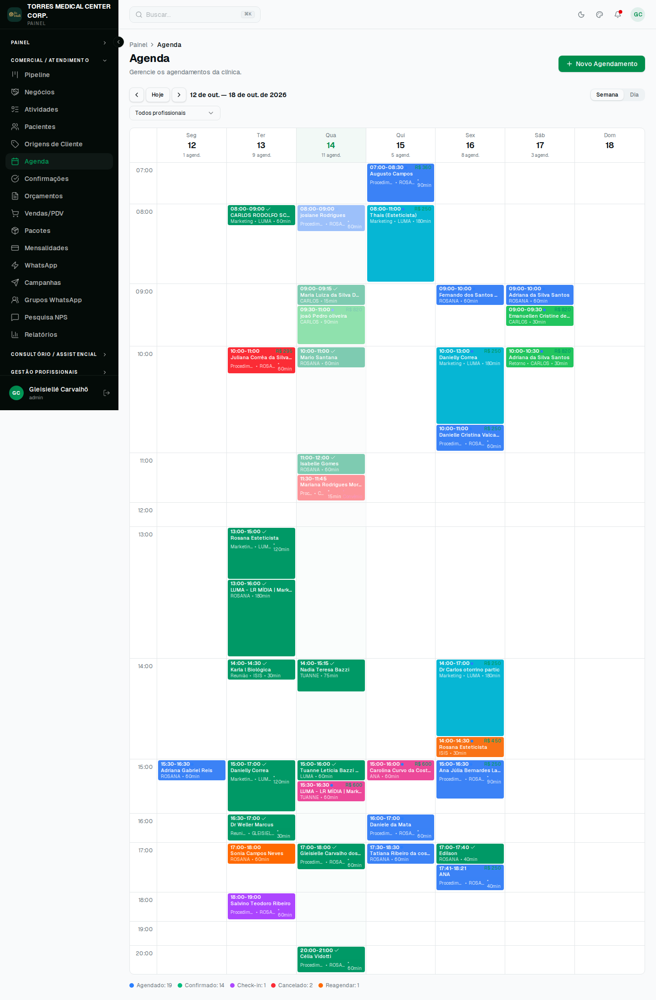
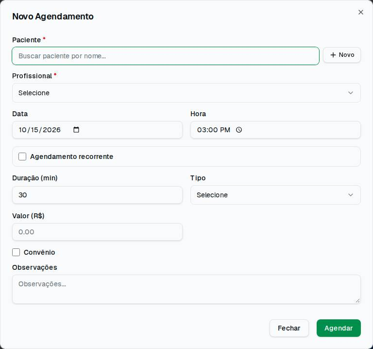
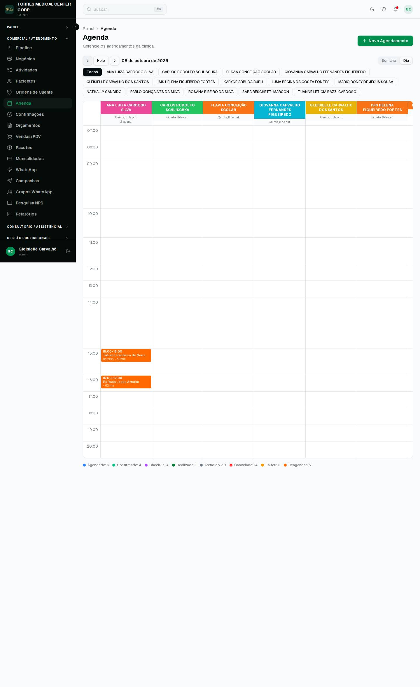
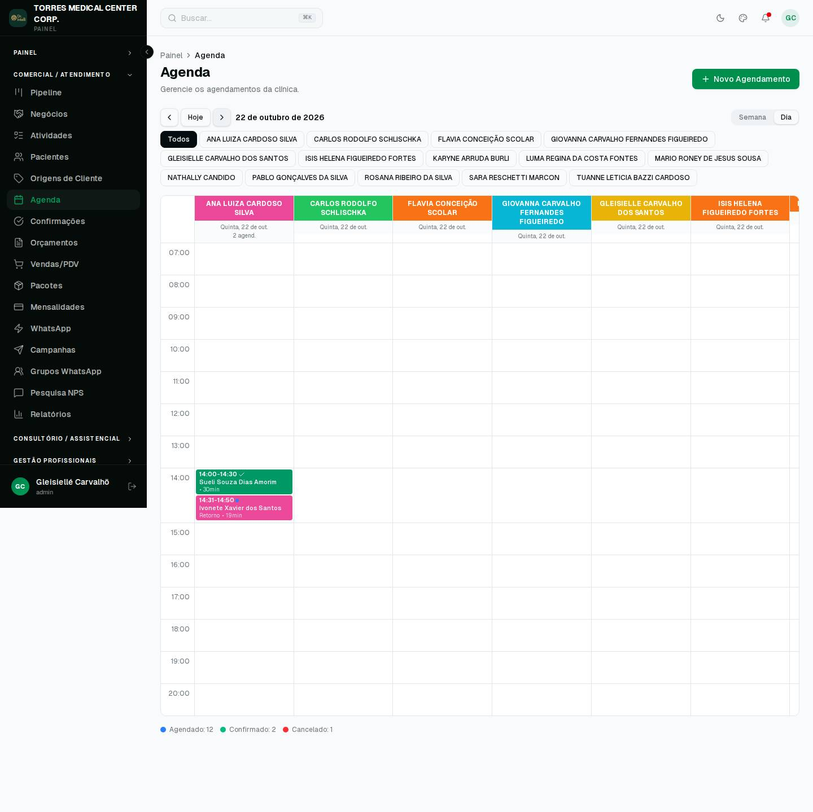
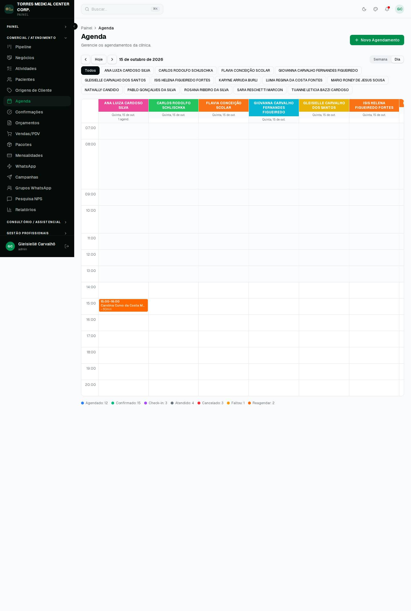
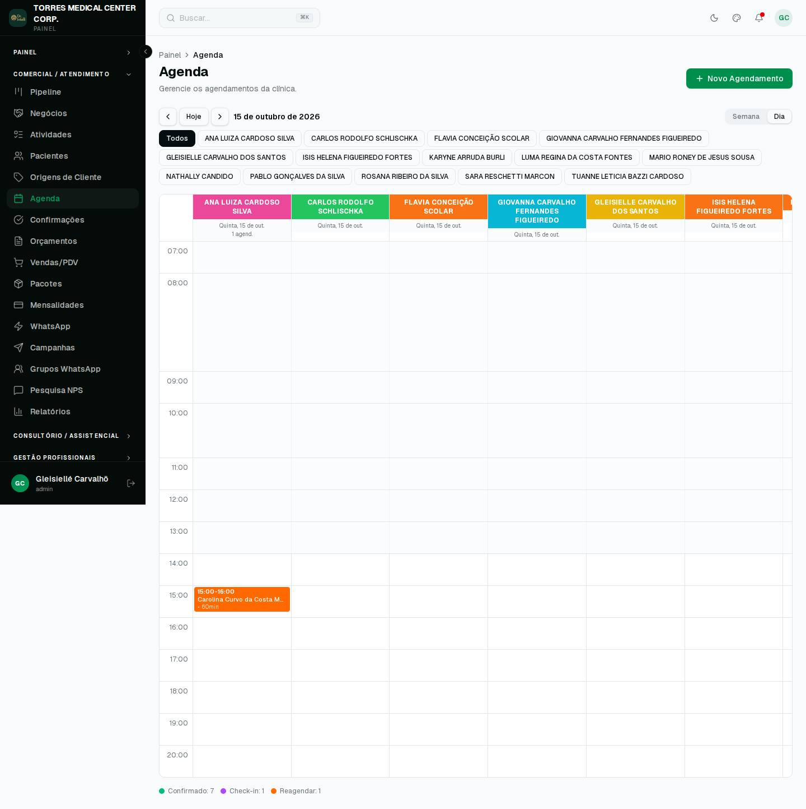
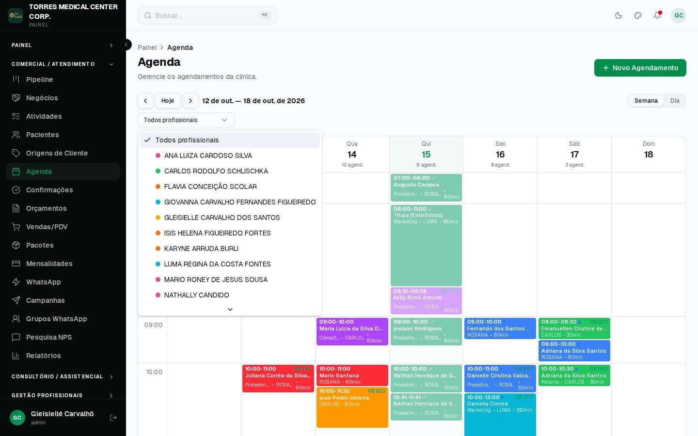

# Agenda

- **Módulo:** COMERCIAL / ATENDIMENTO
- **Tela:** Agenda
- **URL:** `/agenda`
- **Título na página:** Agenda

## Objetivo (inferido)

Tela "Agenda" do módulo COMERCIAL / ATENDIMENTO. Possui 1 campo(s) de entrada/filtro. Seções: 12 de out. — 18 de out. de 2026. Texto de apoio: "Painel Agenda Agenda Gerencie os agendamentos da clínica. Novo Agendamento Hoje 12 de out. — 18 de out. de 2026 Semana Dia Todos profissionais Seg 12 1 agend. Ter 13 9 agend. Qua 14 11 agend. Qui 15 5…"

## Screenshot

## Campos

| Nome | Rótulo | Tipo | Obrigatório | Valores/opções |
|---|---|---|---|---|
| — | — | combobox | não indicado | — |

## Botões e ações

- Buscar... ⌘K
- Toggle theme
- Customize theme
- Notifications
- GC
- Novo Agendamento
- (ícone sem rótulo)
- Hoje
- Semana
- Dia
- Todos profissionais

## Tabelas / grids

_Nenhuma tabela encontrada._

- Filtros/busca: não identificado
- Paginação: não identificada

## Abas

_Nenhuma aba._

## Modais

_Nenhum modal aberto na carga da tela. Modais disparados por botões não foram abertos (regra somente-leitura)._

## Links para outras telas

- Painel → `/`

## Mensagens e validações visíveis

_Nenhuma mensagem visível._

## Seções (cabeçalhos)

- 12 de out. — 18 de out. de 2026

<!-- estados -->
## Estados capturados (interações de visualização)

_Capturados em 15/10/2026 clicando só em itens de visualização do checklist da issue. Nenhum formulário foi preenchido e toda gravação foi bloqueada._

### Novo Agendamento

- Abre modal **Novo Agendamento**

| Campo | Tipo | Obrigatório | Opções |
|---|---|---|---|
| Buscar paciente por nome... | text | não indicado | — |
| Profissional * | combobox | sim | — |
| Data | date | não indicado | — |
| Hora | time | não indicado | — |
| Agendamento recorrente | checkbox | não indicado | — |
| Duração (min) | number | não indicado | — |
| Tipo | combobox | não indicado | — |
| Valor (R$) | number | não indicado | — |
| Convênio | checkbox | não indicado | — |
| Observações | textarea | não indicado | — |

- Botões do modal: Novo · Selecione · Fechar · Agendar · Close

### Anterior (ícone ‹)

### Hoje

### Próximo (ícone ›)

### Semana

### Dia

### Dropdown aberto: Todos profissionais

- Itens do menu/lista: Todos profissionais · ANA LUIZA CARDOSO SILVA · CARLOS RODOLFO SCHLISCHKA · FLAVIA CONCEIÇÃO SCOLAR · GIOVANNA CARVALHO FERNANDES FIGUEIREDO · GLEISIELLE CARVALHO DOS SANTOS · ISIS HELENA FIGUEIREDO FORTES · KARYNE ARRUDA BURLI · LUMA REGINA DA COSTA FONTES · MARIO RONEY DE JESUS SOUSA · NATHALLY CANDIDO · PABLO GONÇALVES DA SILVA · ROSANA RIBEIRO DA SILVA · SARA RESCHETTI MARCON · TUANNE LETICIA BAZZI CARDOSO

<!-- /estados -->
