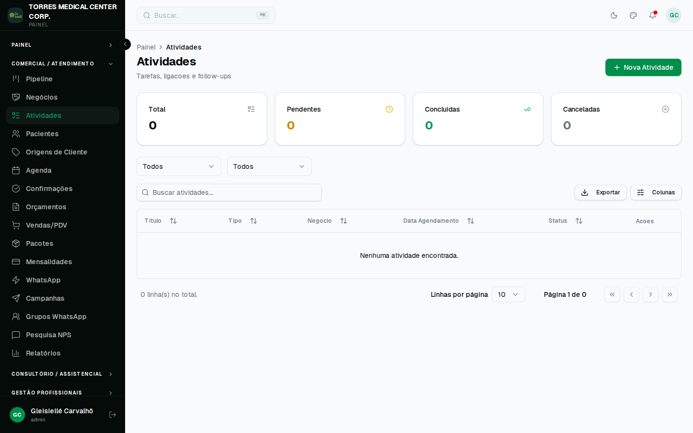

# Atividades

- **Módulo:** COMERCIAL / ATENDIMENTO
- **Tela:** Atividades
- **URL:** `/atividades`
- **Título na página:** Atividades

## Objetivo (inferido)

Tela "Atividades" do módulo COMERCIAL / ATENDIMENTO. Apresenta listagem em tabela com colunas Titulo, Tipo, Negocio, Data Agendamento, Status, Acoes. Possui 4 campo(s) de entrada/filtro. Texto de apoio: "Painel Atividades Atividades Tarefas, ligacoes e follow-ups Nova Atividade Total 0 Pendentes 0 Concluidas 0 Canceladas 0 Todos Todos Exportar Colunas Titulo Tipo Negocio Data Agendamento Status Acoes …"

## Screenshot

## Campos

| Nome | Rótulo | Tipo | Obrigatório | Valores/opções |
|---|---|---|---|---|
| — | — | combobox | não indicado | — |
| — | — | combobox | não indicado | — |
| — | Buscar atividades... | text | não indicado | — |
| — | — | combobox | não indicado | — |

## Botões e ações

- Buscar... ⌘K
- Toggle theme
- Customize theme
- Notifications
- GC
- Nova Atividade
- Todos
- Exportar
- Colunas
- Titulo
- Tipo
- Negocio
- Data Agendamento
- Status
- 10
- Ir para primeira página _(desabilitado)_
- Ir para página anterior _(desabilitado)_
- Ir para próxima página _(desabilitado)_
- Ir para última página _(desabilitado)_

## Tabelas / grids

**Tabela 1** — 1 linha(s) visível(is)

- Colunas: Titulo · Tipo · Negocio · Data Agendamento · Status · Acoes
- Colunas possivelmente ordenáveis: Titulo, Tipo, Negocio, Data Agendamento, Status

- Filtros/busca: Buscar atividades...
- Paginação: Página 1 de 0

## Abas

_Nenhuma aba._

## Modais

_Nenhum modal aberto na carga da tela. Modais disparados por botões não foram abertos (regra somente-leitura)._

## Links para outras telas

- Painel → `/`

## Mensagens e validações visíveis

_Nenhuma mensagem visível._
