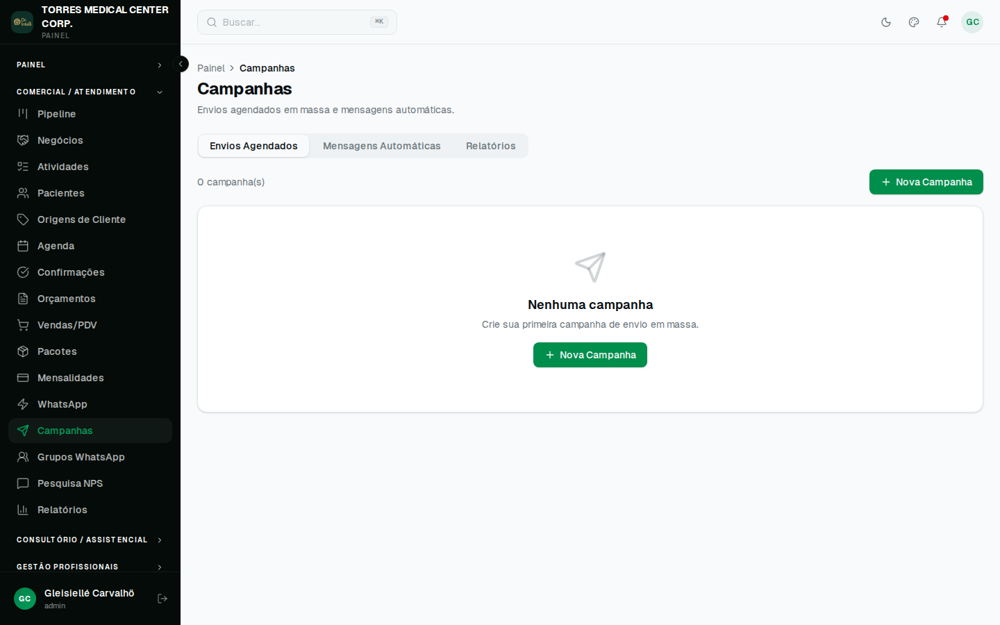

# Campanhas

- **Módulo:** COMERCIAL / ATENDIMENTO
- **Tela:** Campanhas
- **URL:** `/campanhas`
- **Título na página:** Campanhas

## Objetivo (inferido)

Tela "Campanhas" do módulo COMERCIAL / ATENDIMENTO. Seções: Nenhuma campanha. Texto de apoio: "Painel Campanhas Campanhas Envios agendados em massa e mensagens automáticas. Envios Agendados Mensagens Automáticas Relatórios 0 campanha(s) Nova Campanha Nenhuma campanha Crie sua primeira campanha …"

## Screenshot

## Campos

_Nenhum campo de formulário/filtro visível._

## Botões e ações

- Buscar... ⌘K
- Toggle theme
- Customize theme
- Notifications
- GC
- Envios Agendados
- Mensagens Automáticas
- Relatórios
- Nova Campanha

## Tabelas / grids

_Nenhuma tabela encontrada._

- Filtros/busca: não identificado
- Paginação: não identificada

## Abas

_Nenhuma aba._

## Modais

_Nenhum modal aberto na carga da tela. Modais disparados por botões não foram abertos (regra somente-leitura)._

## Links para outras telas

- Painel → `/`

## Mensagens e validações visíveis

_Nenhuma mensagem visível._

## Seções (cabeçalhos)

- Nenhuma campanha
