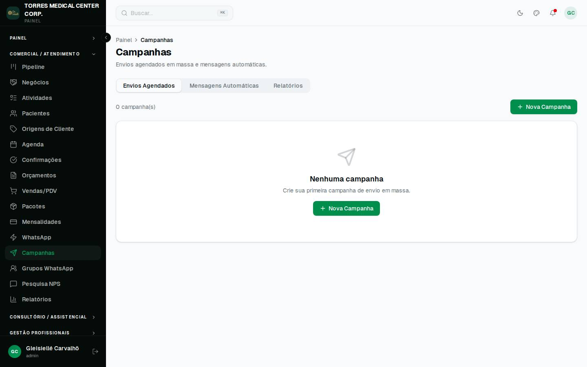
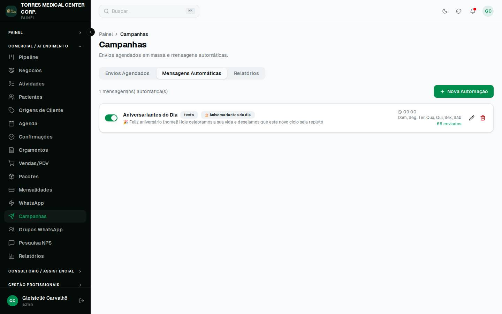
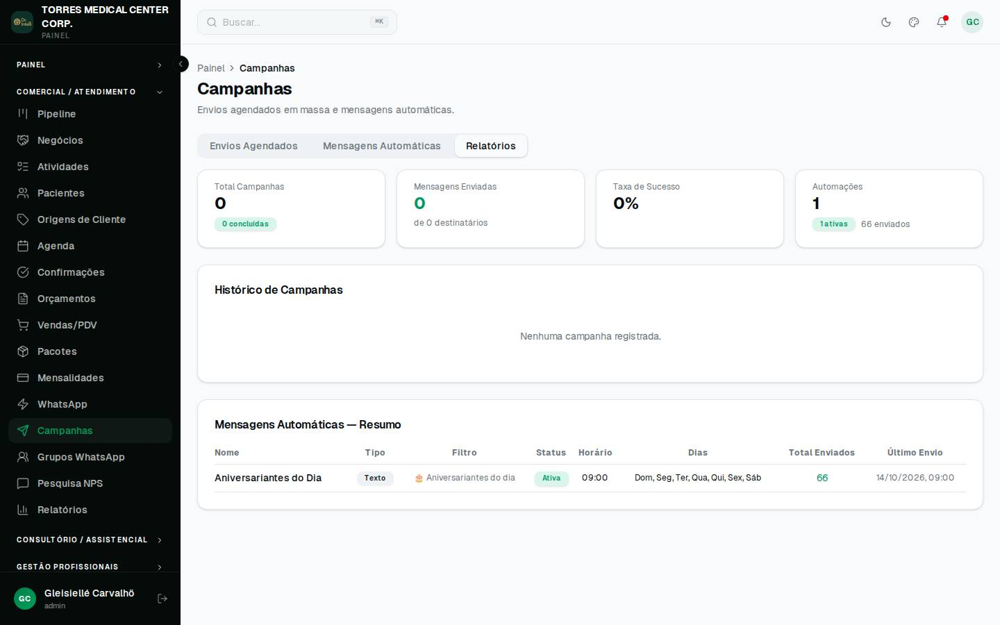
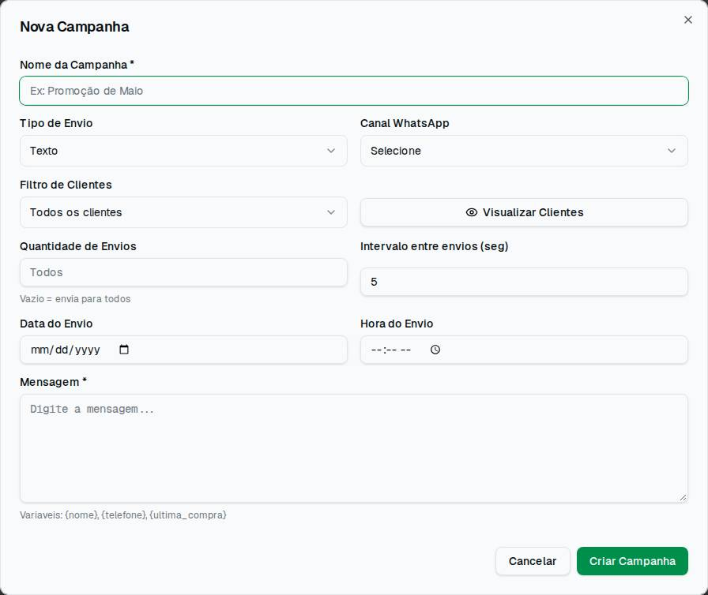

# Campanhas

- **Módulo:** COMERCIAL / ATENDIMENTO
- **Tela:** Campanhas
- **URL:** `/campanhas`
- **Título na página:** Campanhas

## Objetivo (inferido)

Tela "Campanhas" do módulo COMERCIAL / ATENDIMENTO. Seções: Nenhuma campanha. Texto de apoio: "Painel Campanhas Campanhas Envios agendados em massa e mensagens automáticas. Envios Agendados Mensagens Automáticas Relatórios 0 campanha(s) Nova Campanha Nenhuma campanha Crie sua primeira campanha …"

## Screenshot

## Campos

_Nenhum campo de formulário/filtro visível._

## Botões e ações

- Buscar... ⌘K
- Toggle theme
- Customize theme
- Notifications
- GC
- Envios Agendados
- Mensagens Automáticas
- Relatórios
- Nova Campanha

## Tabelas / grids

_Nenhuma tabela encontrada._

- Filtros/busca: não identificado
- Paginação: não identificada

## Abas

_Nenhuma aba._

## Modais

_Nenhum modal aberto na carga da tela. Modais disparados por botões não foram abertos (regra somente-leitura)._

## Links para outras telas

- Painel → `/`

## Mensagens e validações visíveis

_Nenhuma mensagem visível._

## Seções (cabeçalhos)

- Nenhuma campanha

<!-- estados -->
## Estados capturados (interações de visualização)

_Capturados em 15/10/2026 clicando só em itens de visualização do checklist da issue. Nenhum formulário foi preenchido e toda gravação foi bloqueada._

### Envios Agendados

### Mensagens Automáticas

### Relatórios

### Nova Campanha

- Abre modal **Nova Campanha**

| Campo | Tipo | Obrigatório | Opções |
|---|---|---|---|
| Nome da Campanha * | text | sim | — |
| Tipo de Envio | combobox | não indicado | — |
| Canal WhatsApp | combobox | não indicado | — |
| Filtro de Clientes | combobox | não indicado | — |
| Quantidade de Envios | number | não indicado | — |
| Intervalo entre envios (seg) | number | não indicado | — |
| Data do Envio | date | não indicado | — |
| Hora do Envio | time | não indicado | — |
| Mensagem * | textarea | sim | — |

- Botões do modal: Texto · Selecione · Todos os clientes · Visualizar Clientes · Cancelar · Criar Campanha · Close

<!-- /estados -->
