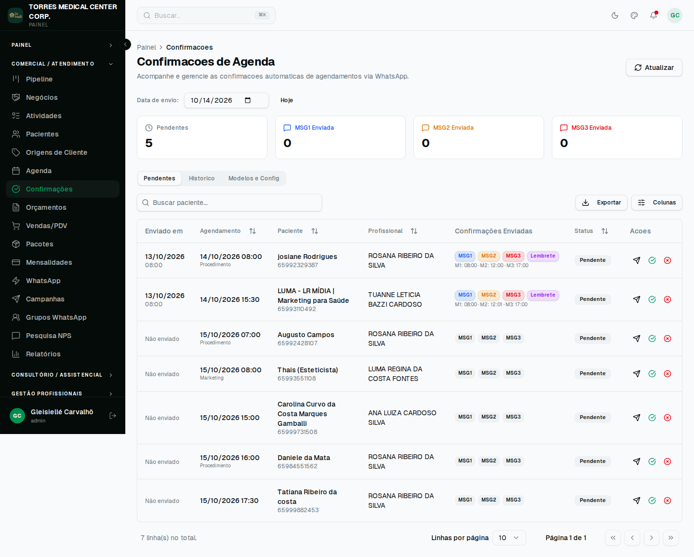
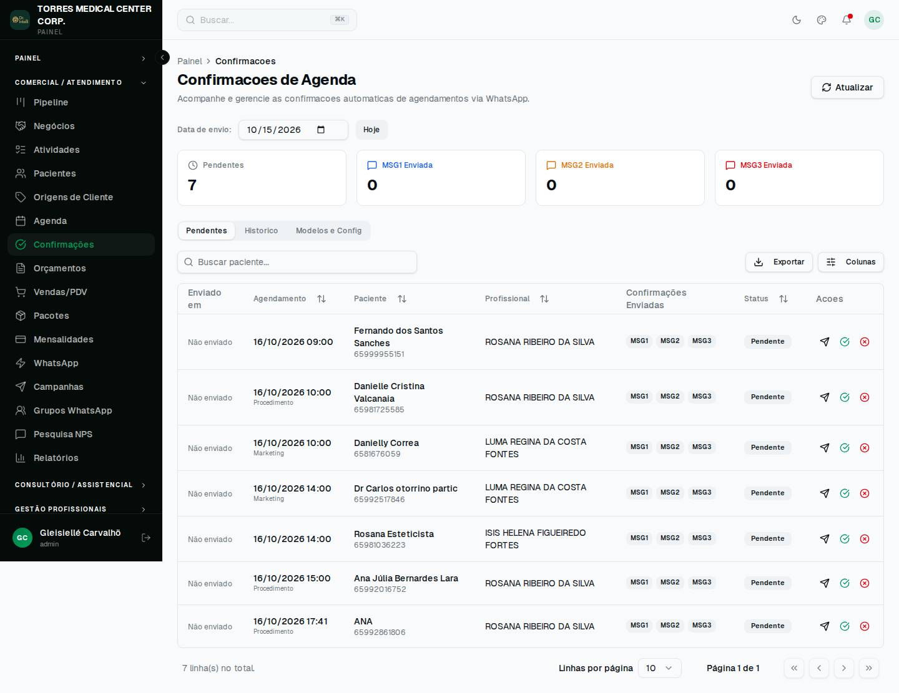
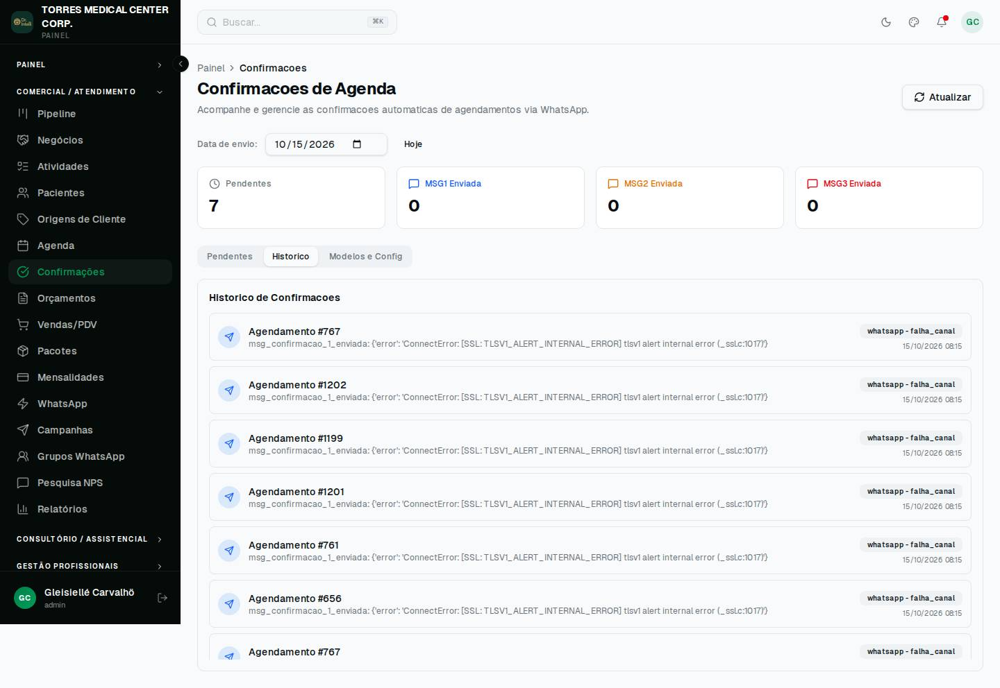
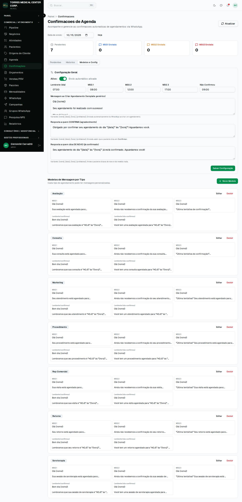
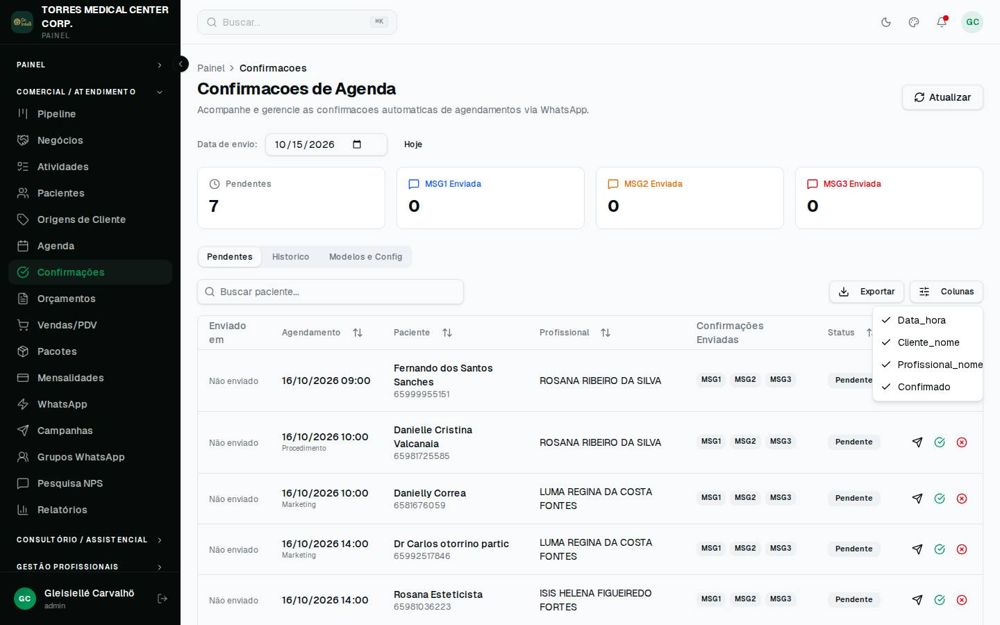
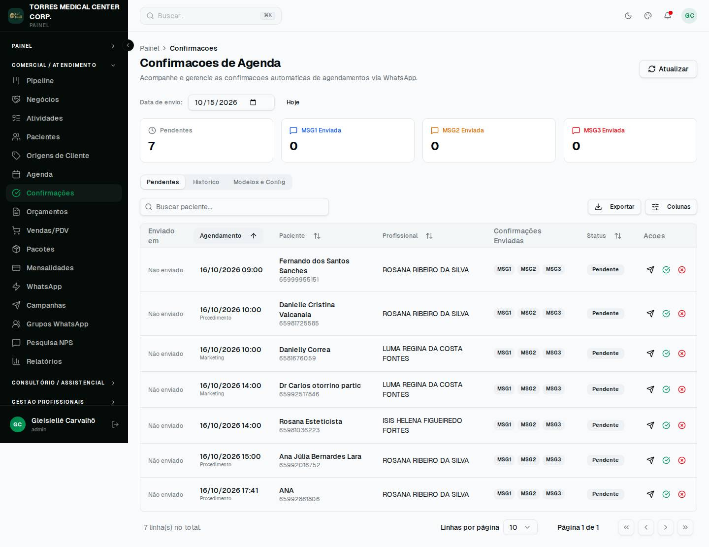

# Confirmações

- **Módulo:** COMERCIAL / ATENDIMENTO
- **Tela:** Confirmações
- **URL:** `/confirmacoes`
- **Título na página:** Confirmacoes de Agenda

## Objetivo (inferido)

Tela "Confirmações" do módulo COMERCIAL / ATENDIMENTO. Apresenta listagem em tabela com colunas Enviado em, Agendamento, Paciente, Profissional, Confirmações Enviadas, Status. Possui 3 campo(s) de entrada/filtro. Texto de apoio: "Painel Confirmacoes Confirmacoes de Agenda Acompanhe e gerencie as confirmacoes automaticas de agendamentos via WhatsApp. Atualizar Data de envio: Hoje Pendentes 5 MSG1 Enviada 0 MSG2 Enviada 0 MSG3 E…"

## Screenshot

## Campos

| Nome | Rótulo | Tipo | Obrigatório | Valores/opções |
|---|---|---|---|---|
| — | Data de envio: | date | não indicado | — |
| — | Buscar paciente... | text | não indicado | — |
| — | — | combobox | não indicado | — |

## Botões e ações

- Buscar... ⌘K
- Toggle theme
- Customize theme
- Notifications
- GC
- Atualizar
- Hoje
- Pendentes
- Historico
- Modelos e Config
- Exportar
- Colunas
- Agendamento
- Paciente
- Profissional
- Status
- Enviar confirmacao
- Confirmar
- Cancelar
- 10
- Ir para primeira página _(desabilitado)_
- Ir para página anterior _(desabilitado)_
- Ir para próxima página _(desabilitado)_
- Ir para última página _(desabilitado)_

## Tabelas / grids

**Tabela 1** — 7 linha(s) visível(is)

- Colunas: Enviado em · Agendamento · Paciente · Profissional · Confirmações Enviadas · Status · Acoes
- Colunas possivelmente ordenáveis: Agendamento, Paciente, Profissional, Status

- Filtros/busca: Data de envio:, Buscar paciente...
- Paginação: Página 1 de 1

## Abas

_Nenhuma aba._

## Modais

_Nenhum modal aberto na carga da tela. Modais disparados por botões não foram abertos (regra somente-leitura)._

## Links para outras telas

- Painel → `/`

## Mensagens e validações visíveis

_Nenhuma mensagem visível._

<!-- estados -->
## Estados capturados (interações de visualização)

_Capturados em 15/10/2026 clicando só em itens de visualização do checklist da issue. Nenhum formulário foi preenchido e toda gravação foi bloqueada._

### Atualizar

### Hoje

### Pendentes

### Historico

### Modelos e Config

### Colunas

- Itens do menu/lista: Data_hora · Cliente_nome · Profissional_nome · Confirmado

### Ordenação por coluna — 1 print de exemplo (colunas: Agendamento, Paciente, Profissional, Status)

### Paginação — 1 print da página 2

- lista com uma página só (botão de próxima página desabilitado), sem print

<!-- /estados -->
