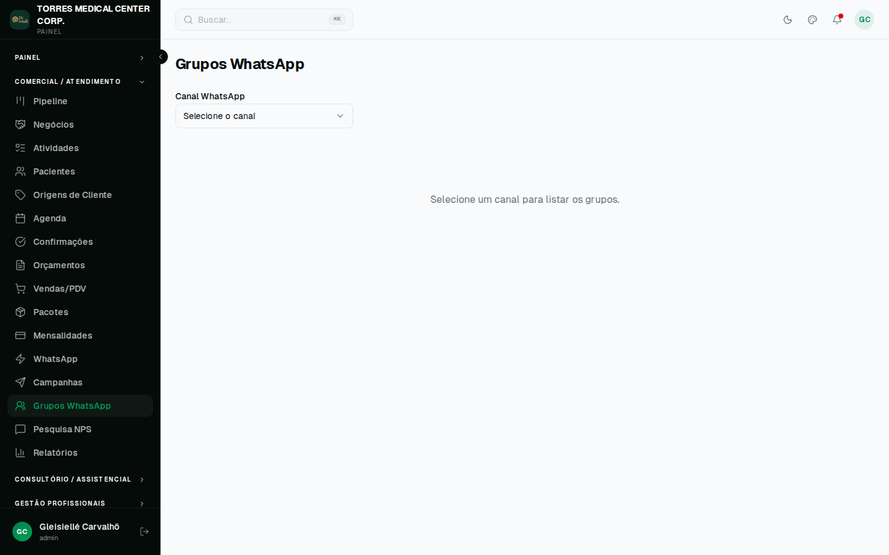

# Grupos WhatsApp

- **Módulo:** COMERCIAL / ATENDIMENTO
- **Tela:** Grupos WhatsApp
- **URL:** `/grupos-whatsapp`
- **Título na página:** Grupos WhatsApp

## Objetivo (inferido)

Tela "Grupos WhatsApp" do módulo COMERCIAL / ATENDIMENTO. Possui 1 campo(s) de entrada/filtro. Texto de apoio: "Grupos WhatsApp Canal WhatsApp Selecione o canal Selecione um canal para listar os grupos.…"

## Screenshot

## Campos

| Nome | Rótulo | Tipo | Obrigatório | Valores/opções |
|---|---|---|---|---|
| — | Canal WhatsApp | combobox | não indicado | — |

## Botões e ações

- Buscar... ⌘K
- Toggle theme
- Customize theme
- Notifications
- GC
- Selecione o canal

## Tabelas / grids

_Nenhuma tabela encontrada._

- Filtros/busca: não identificado
- Paginação: não identificada

## Abas

_Nenhuma aba._

## Modais

_Nenhum modal aberto na carga da tela. Modais disparados por botões não foram abertos (regra somente-leitura)._

## Links para outras telas

_Nenhum link na área principal._

## Mensagens e validações visíveis

_Nenhuma mensagem visível._
