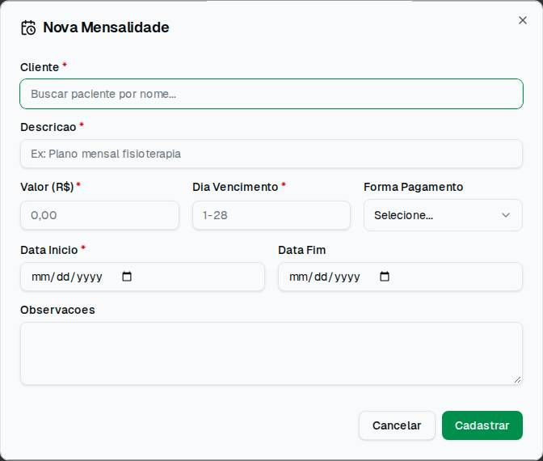
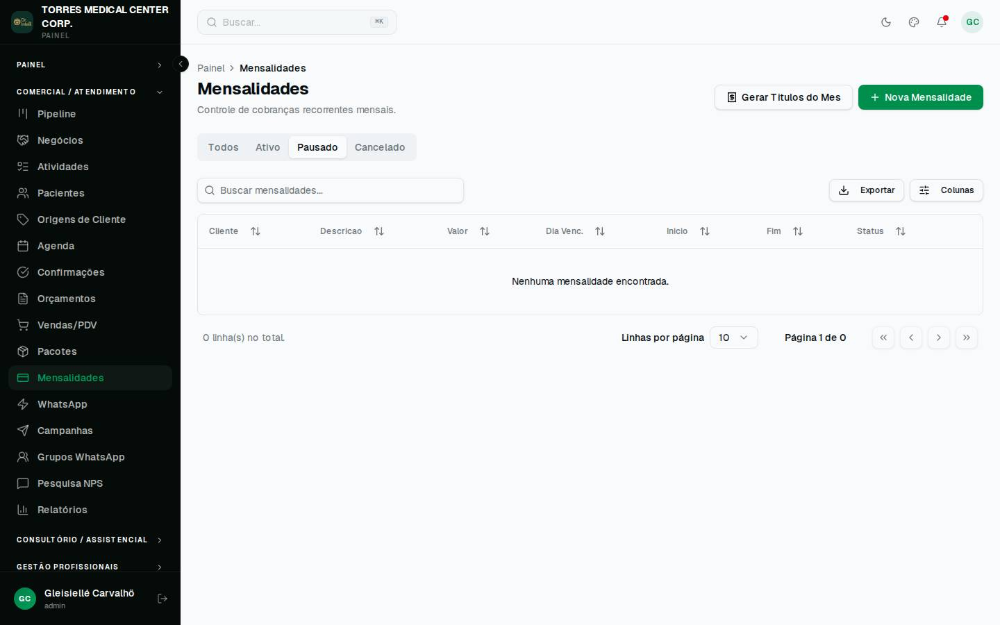
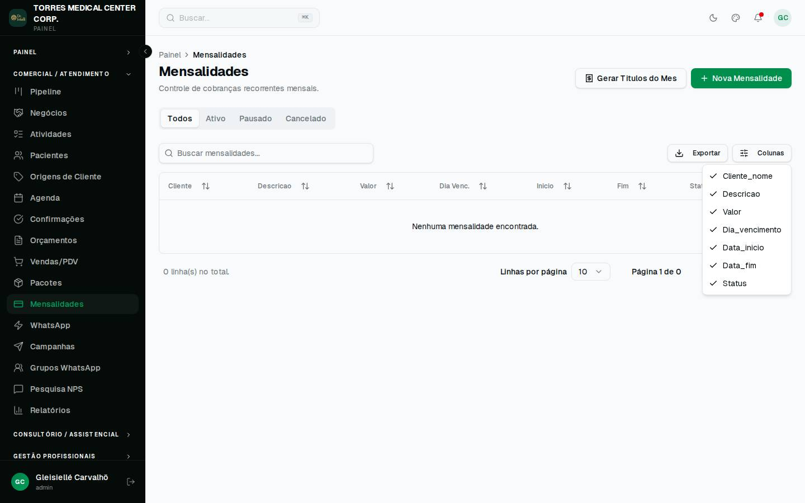
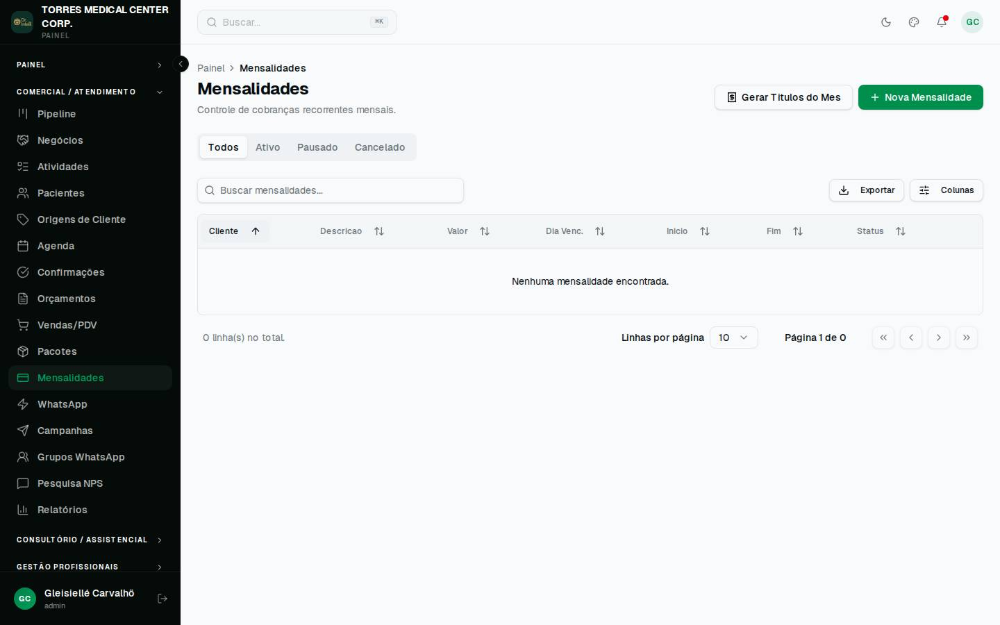

# Mensalidades

- **Módulo:** COMERCIAL / ATENDIMENTO
- **Tela:** Mensalidades
- **URL:** `/mensalidades`
- **Título na página:** Mensalidades

## Objetivo (inferido)

Tela "Mensalidades" do módulo COMERCIAL / ATENDIMENTO. Apresenta listagem em tabela com colunas Cliente, Descricao, Valor, Dia Venc., Inicio, Fim. Possui 2 campo(s) de entrada/filtro. Organizada em abas (Todos, Ativo, Pausado, Cancelado). Texto de apoio: "Painel Mensalidades Mensalidades Controle de cobranças recorrentes mensais. Gerar Titulos do Mes Nova Mensalidade Todos Ativo Pausado Cancelado Exportar Colunas Cliente Descricao Valor Dia Venc. Inici…"

## Screenshot

## Campos

| Nome | Rótulo | Tipo | Obrigatório | Valores/opções |
|---|---|---|---|---|
| — | Buscar mensalidades... | text | não indicado | — |
| — | — | combobox | não indicado | — |

## Botões e ações

- Buscar... ⌘K
- Toggle theme
- Customize theme
- Notifications
- GC
- Gerar Titulos do Mes
- Nova Mensalidade
- Todos
- Ativo
- Pausado
- Cancelado
- Exportar
- Colunas
- Cliente
- Descricao
- Valor
- Dia Venc.
- Inicio
- Fim
- Status
- 10
- Ir para primeira página _(desabilitado)_
- Ir para página anterior _(desabilitado)_
- Ir para próxima página _(desabilitado)_
- Ir para última página _(desabilitado)_

## Tabelas / grids

**Tabela 1** — 1 linha(s) visível(is)

- Colunas: Cliente · Descricao · Valor · Dia Venc. · Inicio · Fim · Status
- Colunas possivelmente ordenáveis: Cliente, Descricao, Valor, Dia Venc., Inicio, Fim, Status

- Filtros/busca: Buscar mensalidades...
- Paginação: Página 1 de 0

## Abas

- Todos _(ativa)_
- Ativo
- Pausado
- Cancelado

## Modais

_Nenhum modal aberto na carga da tela. Modais disparados por botões não foram abertos (regra somente-leitura)._

## Links para outras telas

- Painel → `/`

## Mensagens e validações visíveis

_Nenhuma mensagem visível._

<!-- estados -->
## Estados capturados (interações de visualização)

_Capturados em 15/10/2026 clicando só em itens de visualização do checklist da issue. Nenhum formulário foi preenchido e toda gravação foi bloqueada._

### Nova Mensalidade

- Abre modal **Nova Mensalidade**

| Campo | Tipo | Obrigatório | Opções |
|---|---|---|---|
| Buscar paciente por nome... | text | não indicado | — |
| Descricao * | text | sim | — |
| Valor (R$) * | number | sim | — |
| Dia Vencimento * | number | sim | — |
| Forma Pagamento | combobox | não indicado | — |
| Data Inicio * | date | sim | — |
| Data Fim | date | não indicado | — |
| Observacoes | textarea | não indicado | — |

- Botões do modal: Selecione... · Cancelar · Cadastrar · Close

### Aba: Todos

### Aba: Ativo

### Aba: Pausado

### Aba: Cancelado

### Colunas

- Itens do menu/lista: Cliente_nome · Descricao · Valor · Dia_vencimento · Data_inicio · Data_fim · Status

### Ordenação por coluna — 1 print de exemplo (colunas: Cliente, Descricao, Valor, Dia Venc., Inicio, Fim, Status)

### Paginação — 1 print da página 2

- lista com uma página só (botão de próxima página desabilitado), sem print

<!-- /estados -->
