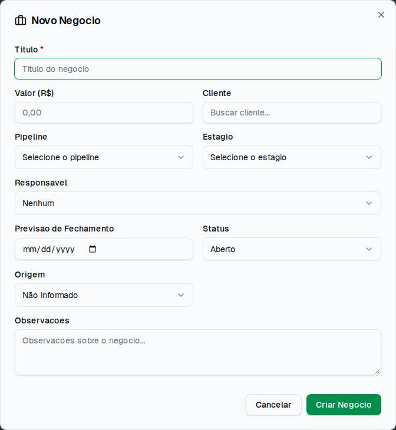
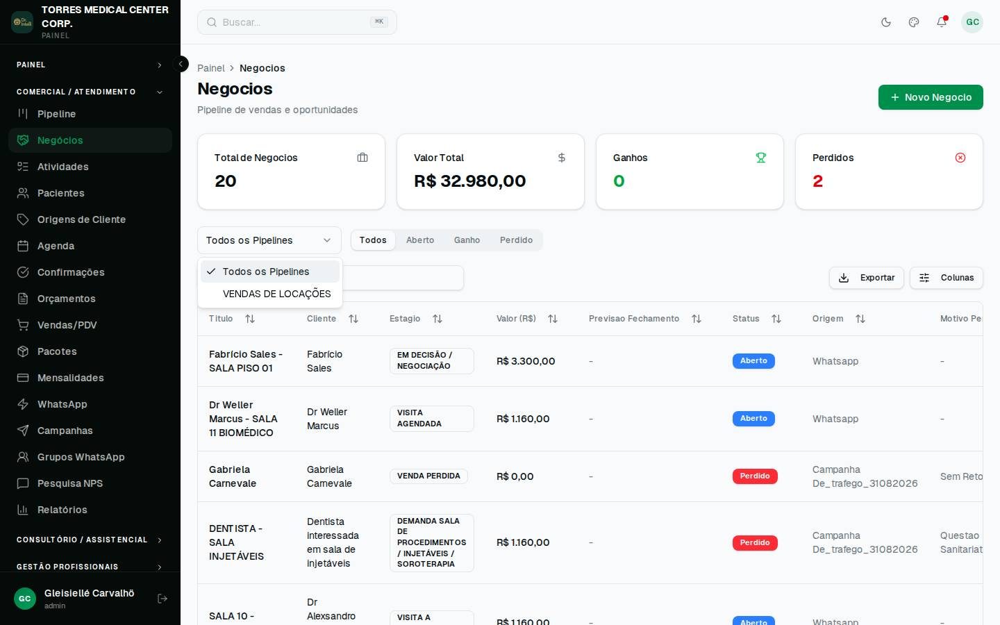
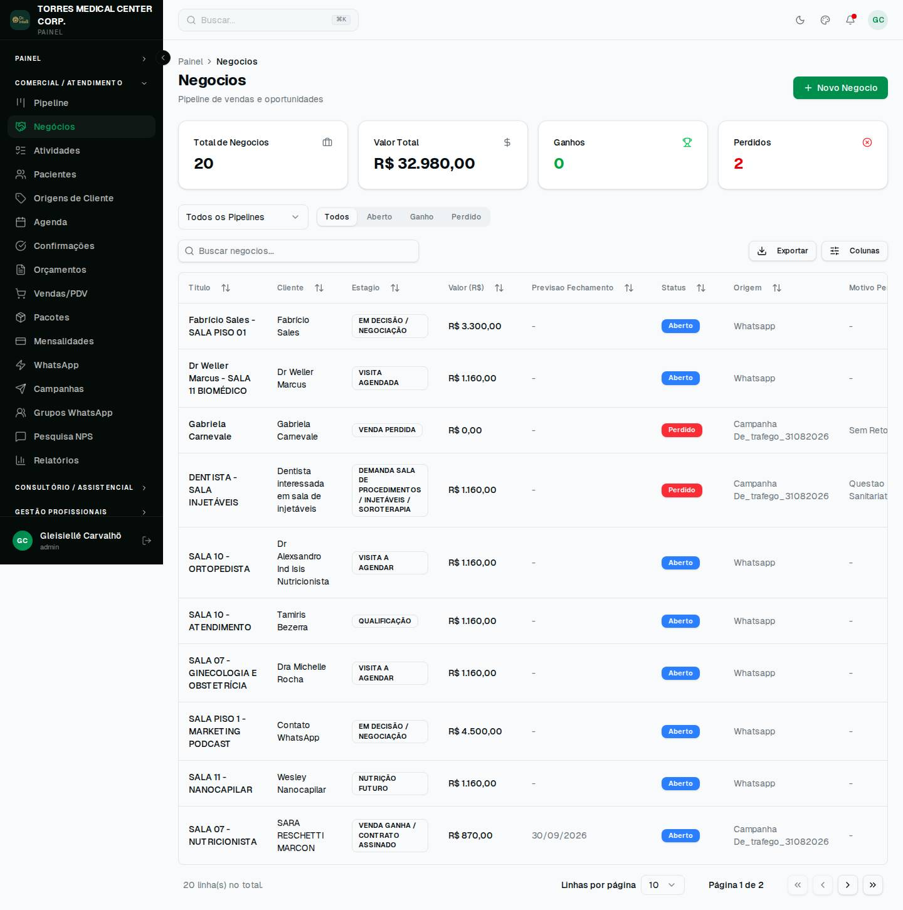
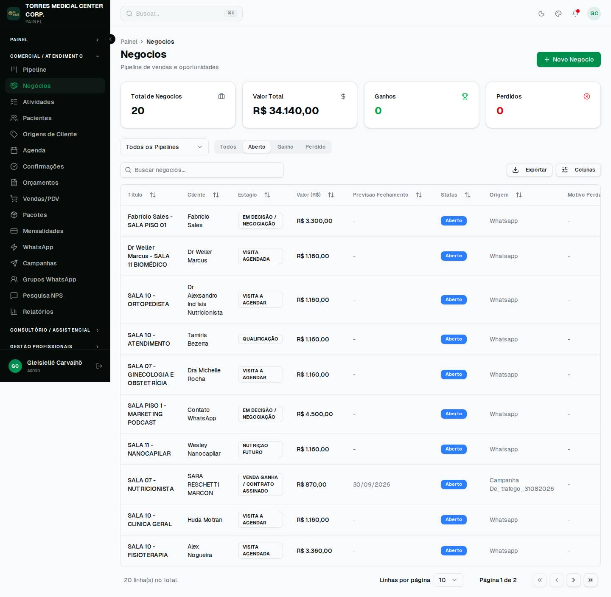
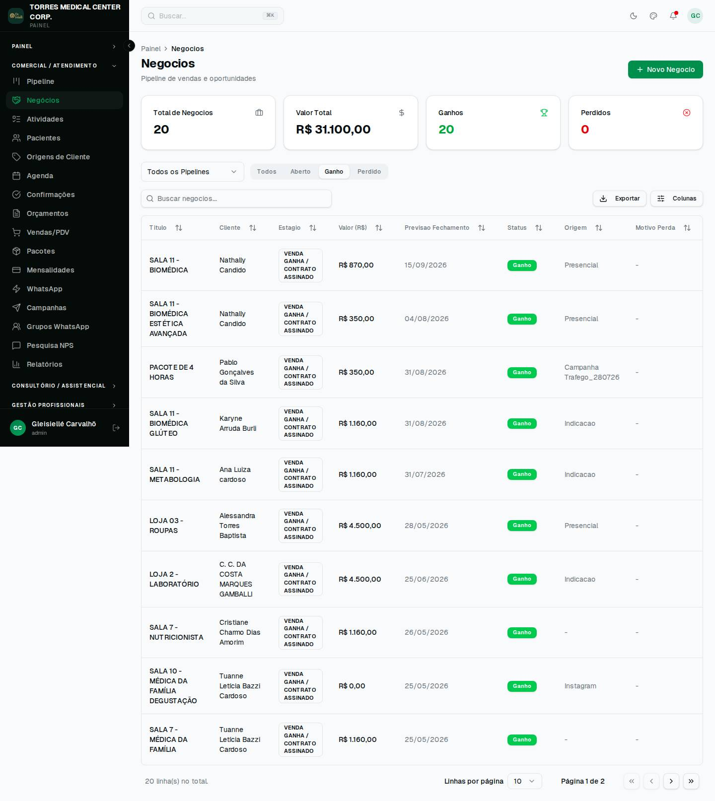
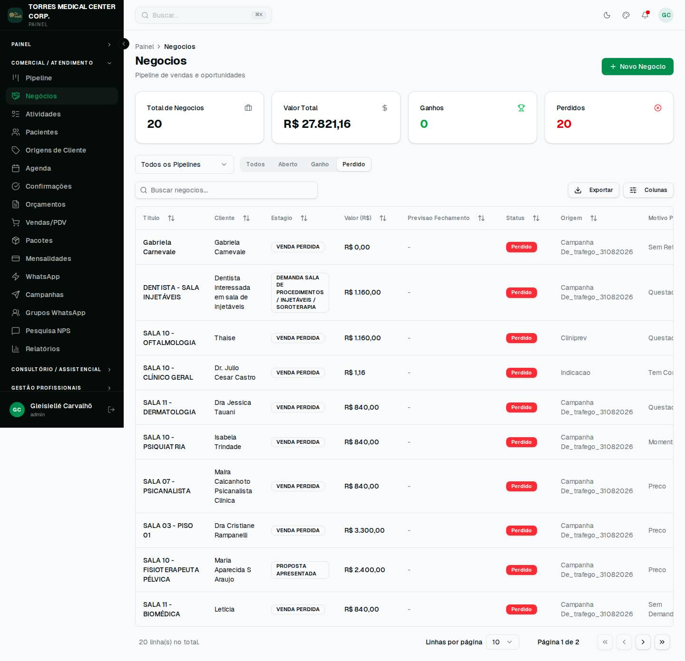
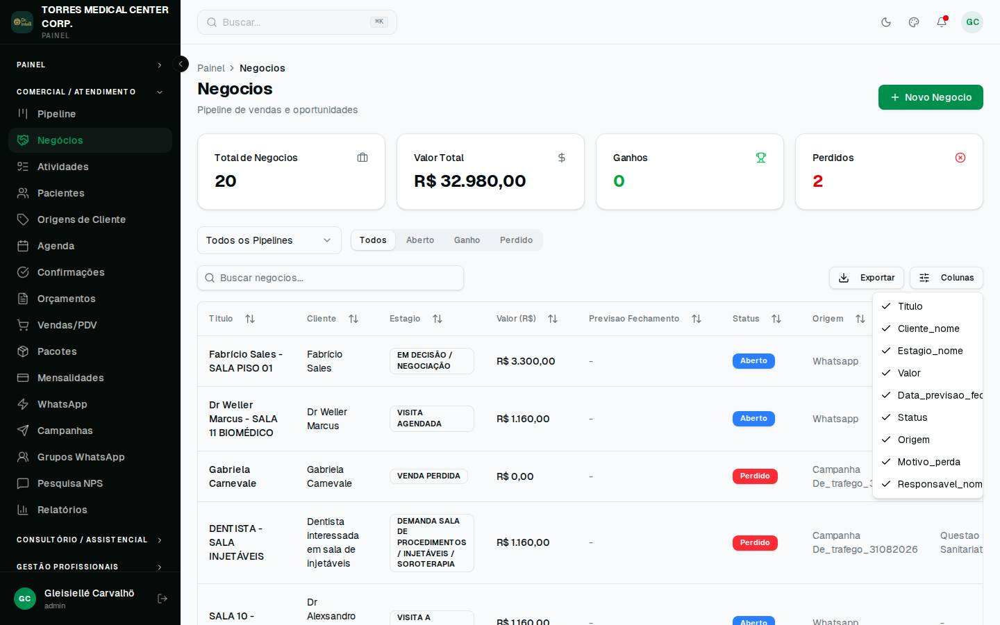
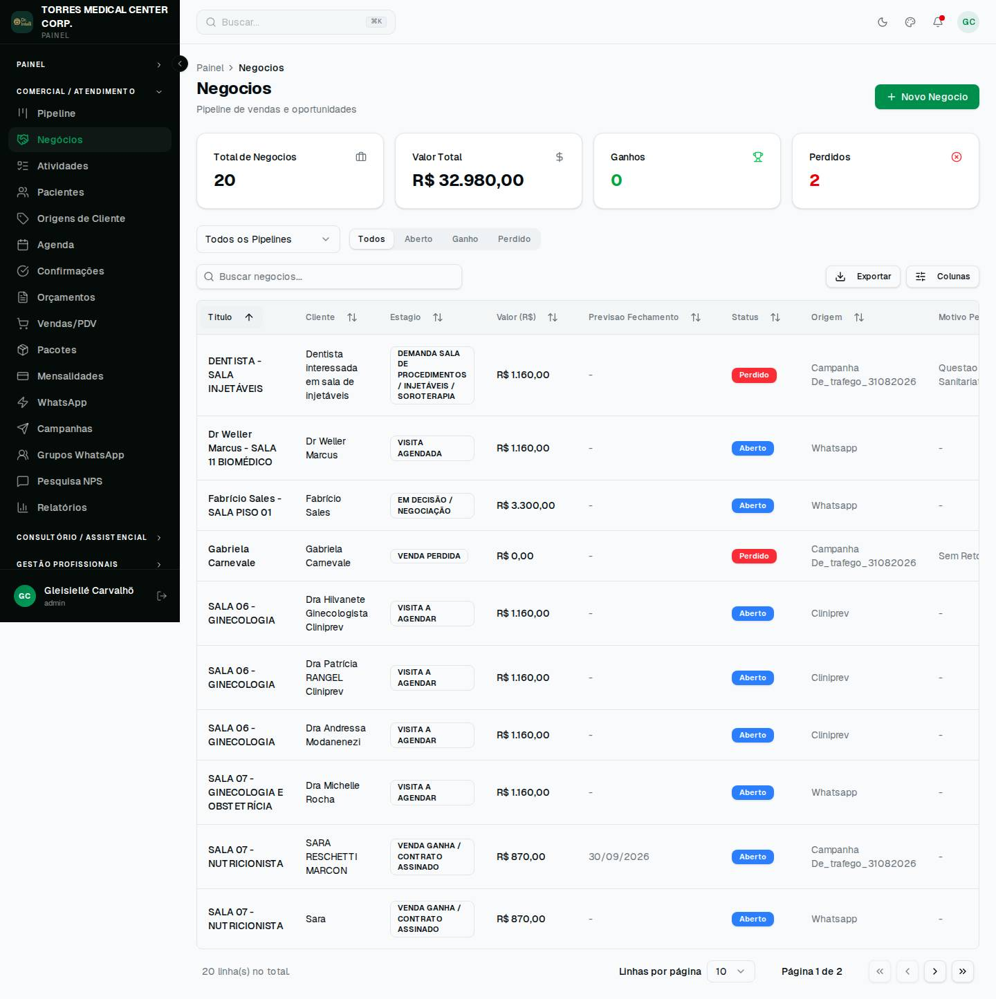
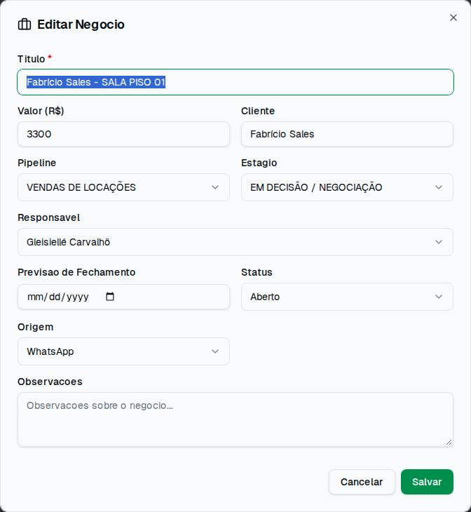
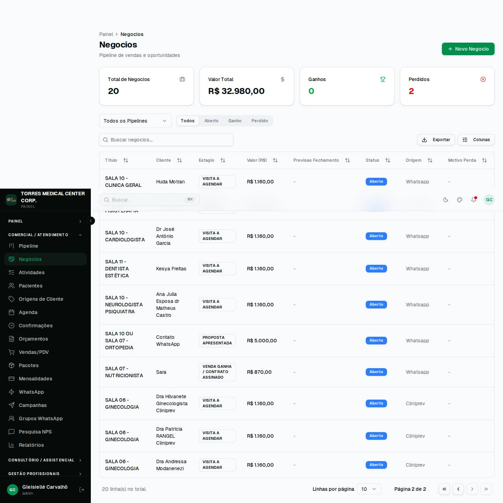

# Negócios

- **Módulo:** COMERCIAL / ATENDIMENTO
- **Tela:** Negócios
- **URL:** `/negocios`
- **Título na página:** Negocios

## Objetivo (inferido)

Tela "Negócios" do módulo COMERCIAL / ATENDIMENTO. Apresenta listagem em tabela com colunas Titulo, Cliente, Estagio, Valor (R$), Previsao Fechamento, Status. Possui 3 campo(s) de entrada/filtro. Texto de apoio: "Painel Negocios Negocios Pipeline de vendas e oportunidades Novo Negocio Total de Negocios 20 Valor Total R$ 32.980,00 Ganhos 0 Perdidos 2 Todos os Pipelines Todos Aberto Ganho Perdido Exportar Coluna…"

## Screenshot

## Campos

| Nome | Rótulo | Tipo | Obrigatório | Valores/opções |
|---|---|---|---|---|
| — | — | combobox | não indicado | — |
| — | Buscar negocios... | text | não indicado | — |
| — | — | combobox | não indicado | — |

## Botões e ações

- Buscar... ⌘K
- Toggle theme
- Customize theme
- Notifications
- GC
- Novo Negocio
- Todos os Pipelines
- Todos
- Aberto
- Ganho
- Perdido
- Exportar
- Colunas
- Titulo
- Cliente
- Estagio
- Valor (R$)
- Previsao Fechamento
- Status
- Origem
- Motivo Perda
- Responsavel
- Editar
- Excluir
- 10
- Ir para primeira página _(desabilitado)_
- Ir para página anterior _(desabilitado)_
- Ir para próxima página
- Ir para última página

## Tabelas / grids

**Tabela 1** — 10 linha(s) visível(is)

- Colunas: Titulo · Cliente · Estagio · Valor (R$) · Previsao Fechamento · Status · Origem · Motivo Perda · Responsavel · Acoes
- Colunas possivelmente ordenáveis: Titulo, Cliente, Estagio, Valor (R$), Previsao Fechamento, Status, Origem, Motivo Perda, Responsavel

- Filtros/busca: Buscar negocios...
- Paginação: Página 1 de 2

## Abas

_Nenhuma aba._

## Modais

_Nenhum modal aberto na carga da tela. Modais disparados por botões não foram abertos (regra somente-leitura)._

## Links para outras telas

- Painel → `/`

## Mensagens e validações visíveis

_Nenhuma mensagem visível._

<!-- estados -->
## Estados capturados (interações de visualização)

_Capturados em 15/10/2026 clicando só em itens de visualização do checklist da issue. Nenhum formulário foi preenchido e toda gravação foi bloqueada._

### Novo Negocio

- Abre modal **Novo Negocio**

| Campo | Tipo | Obrigatório | Opções |
|---|---|---|---|
| Titulo * | text | sim | — |
| Valor (R$) | number | não indicado | — |
| Cliente | text | não indicado | — |
| Pipeline | combobox | não indicado | — |
| Estagio | combobox | não indicado | — |
| Responsavel | combobox | não indicado | — |
| Previsao de Fechamento | date | não indicado | — |
| Status | combobox | não indicado | — |
| Origem | combobox | não indicado | — |
| Observacoes | textarea | não indicado | — |

- Botões do modal: Selecione o pipeline · Selecione o estagio · Nenhum · Aberto · Não informado · Cancelar · Criar Negocio · Close

### Dropdown aberto: Todos os Pipelines

- Itens do menu/lista: Todos os Pipelines · VENDAS DE LOCAÇÕES

### Todos

### Aberto

### Ganho

### Perdido

### Colunas

- Itens do menu/lista: Titulo · Cliente_nome · Estagio_nome · Valor · Data_previsao_fechamento · Status · Origem · Motivo_perda · Responsavel_nome

### Ordenação por coluna — 1 print de exemplo (colunas: Titulo, Cliente, Estagio, Valor (R$), Previsao Fechamento, Status, Origem, Motivo Perda, Responsavel)

### Editar (na linha da tabela)

- Abre modal **Editar Negocio**

| Campo | Tipo | Obrigatório | Opções |
|---|---|---|---|
| Titulo * | text | sim | — |
| Valor (R$) | number | não indicado | — |
| Cliente | text | não indicado | — |
| Pipeline | combobox | não indicado | — |
| Estagio | combobox | não indicado | — |
| Responsavel | combobox | não indicado | — |
| Previsao de Fechamento | date | não indicado | — |
| Status | combobox | não indicado | — |
| Origem | combobox | não indicado | — |
| Observacoes | textarea | não indicado | — |

- Botões do modal: VENDAS DE LOCAÇÕES · EM DECISÃO / NEGOCIAÇÃO · Gleisiellé Carvalhö · Aberto · WhatsApp · Cancelar · Salvar · Close

### Paginação — 1 print da página 2

<!-- /estados -->
