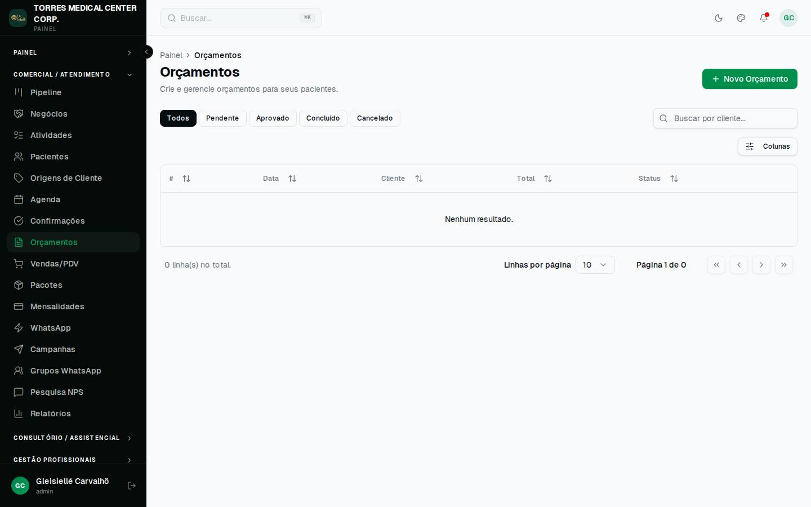
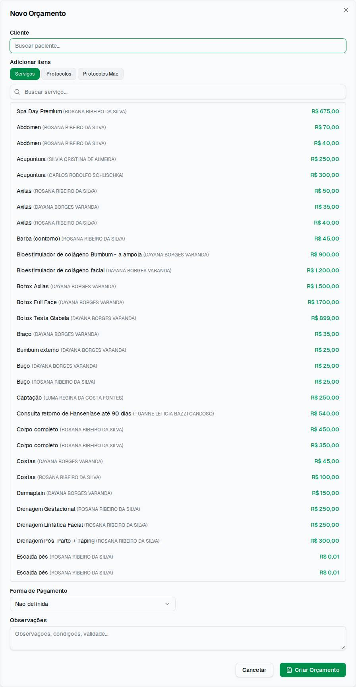
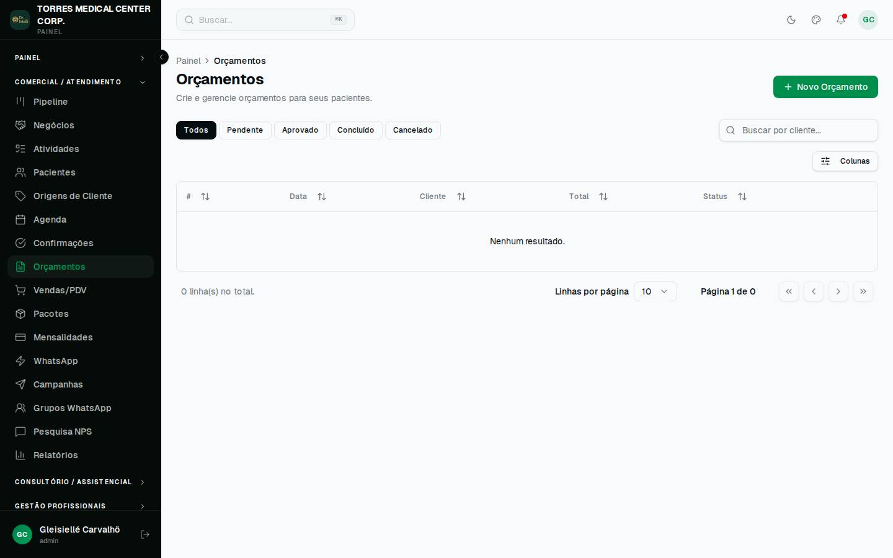
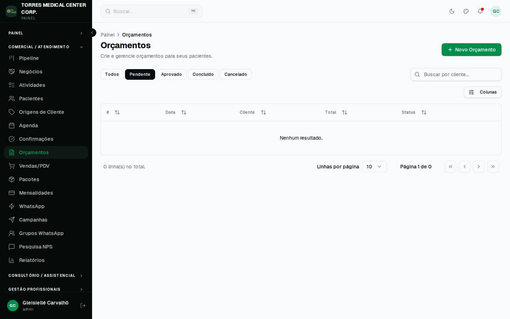
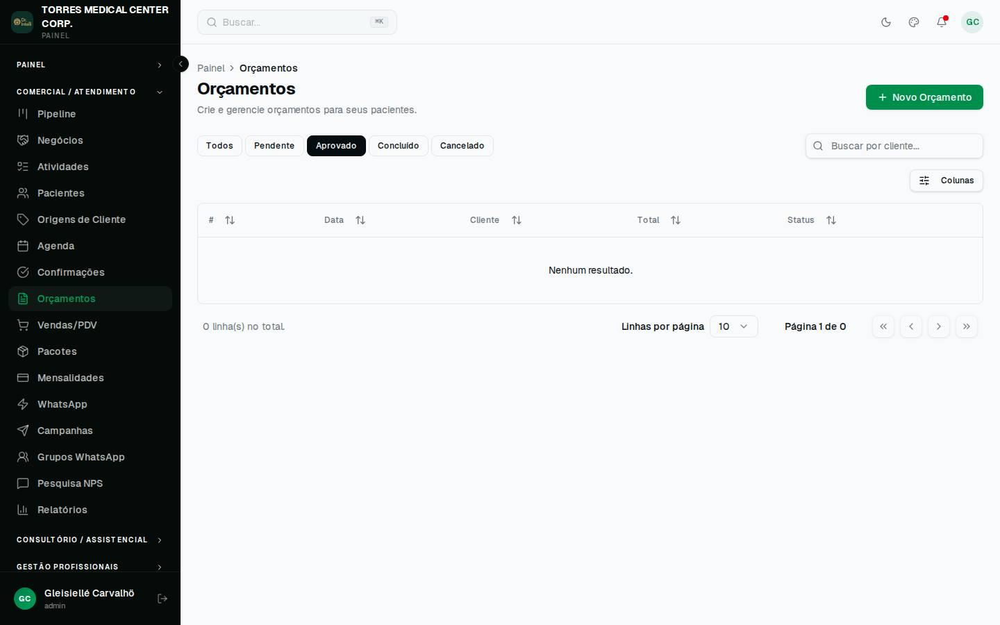
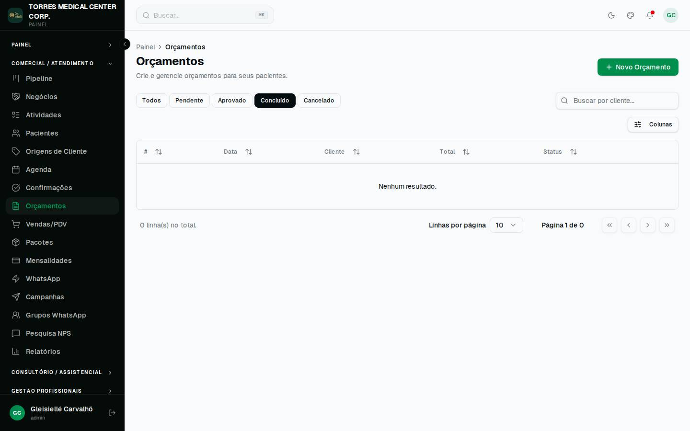
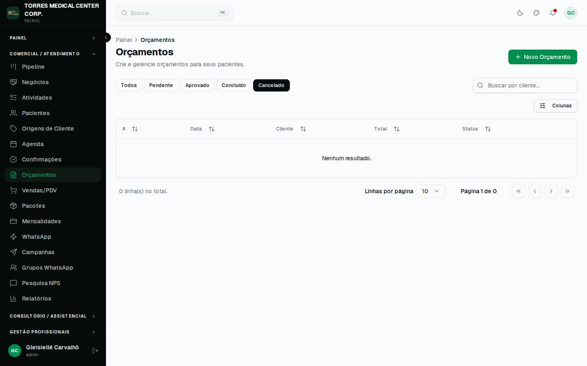
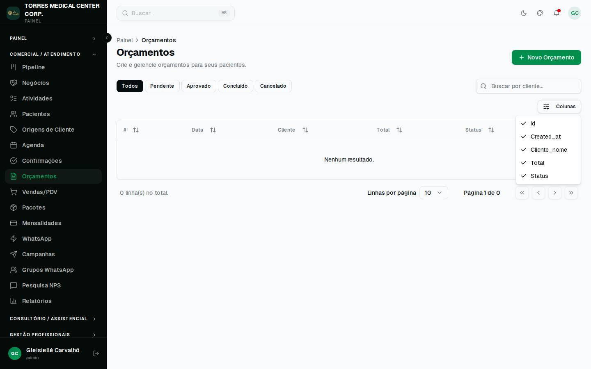
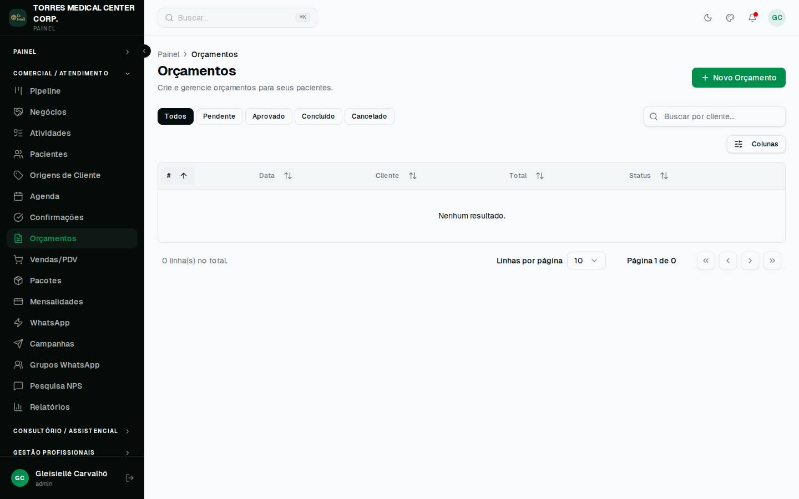

# Orçamentos

- **Módulo:** COMERCIAL / ATENDIMENTO
- **Tela:** Orçamentos
- **URL:** `/orcamentos`
- **Título na página:** Orçamentos

## Objetivo (inferido)

Tela "Orçamentos" do módulo COMERCIAL / ATENDIMENTO. Apresenta listagem em tabela com colunas #, Data, Cliente, Total, Status. Possui 2 campo(s) de entrada/filtro. Texto de apoio: "Painel Orçamentos Orçamentos Crie e gerencie orçamentos para seus pacientes. Novo Orçamento Todos Pendente Aprovado Concluído Cancelado Colunas # Data Cliente Total Status Nenhum resultado. 0 linha(s)…"

## Screenshot

## Campos

| Nome | Rótulo | Tipo | Obrigatório | Valores/opções |
|---|---|---|---|---|
| — | Buscar por cliente... | text | não indicado | — |
| — | — | combobox | não indicado | — |

## Botões e ações

- Buscar... ⌘K
- Toggle theme
- Customize theme
- Notifications
- GC
- Novo Orçamento
- Todos
- Pendente
- Aprovado
- Concluído
- Cancelado
- Colunas
- #
- Data
- Cliente
- Total
- Status
- 10
- Ir para primeira página _(desabilitado)_
- Ir para página anterior _(desabilitado)_
- Ir para próxima página _(desabilitado)_
- Ir para última página _(desabilitado)_

## Tabelas / grids

**Tabela 1** — 1 linha(s) visível(is)

- Colunas: # · Data · Cliente · Total · Status
- Colunas possivelmente ordenáveis: #, Data, Cliente, Total, Status

- Filtros/busca: Buscar por cliente...
- Paginação: Página 1 de 0

## Abas

_Nenhuma aba._

## Modais

_Nenhum modal aberto na carga da tela. Modais disparados por botões não foram abertos (regra somente-leitura)._

## Links para outras telas

- Painel → `/`

## Mensagens e validações visíveis

_Nenhuma mensagem visível._

<!-- estados -->
## Estados capturados (interações de visualização)

_Capturados em 15/10/2026 clicando só em itens de visualização do checklist da issue. Nenhum formulário foi preenchido e toda gravação foi bloqueada._

### Novo Orçamento

- Abre modal **Novo Orçamento**

| Campo | Tipo | Obrigatório | Opções |
|---|---|---|---|
| Buscar paciente... | text | não indicado | — |
| Buscar serviço... | text | não indicado | — |
| Forma de Pagamento | combobox | não indicado | — |
| Observações | textarea | não indicado | — |

- Botões do modal: Serviços · Protocolos · Protocolos Mãe · Spa Day Premium(ROSANA RIBEIRO DA SILVA) R$ 675,00 · Abdomen(ROSANA RIBEIRO DA SILVA) R$ 70,00 · Abdômen(ROSANA RIBEIRO DA SILVA) R$ 40,00 · Acupuntura(SILVIA CRISTINA DE ALMEIDA) R$ 250,00 · Acupuntura(CARLOS RODOLFO SCHLISCHKA) R$ 300,00 · Axilas(ROSANA RIBEIRO DA SILVA) R$ 50,00 · Axilas(DAYANA BORGES VARANDA) R$ 35,00 · Axilas(ROSANA RIBEIRO DA SILVA) R$ 40,00 · Barba (contorno)(ROSANA RIBEIRO DA SILVA) R$ 45,00 · Bioestimulador de colágeno Bumbum - a ampola(DAYANA BORGES VARANDA) R$ 900,00 · Bioestimulador de colágeno facial(DAYANA BORGES VARANDA) R$ 1.200,00 · Botox Axilas(DAYANA BORGES VARANDA) R$ 1.500,00 · Botox Full Face(DAYANA BORGES VARANDA) R$ 1.700,00 · Botox Testa Glabela(DAYANA BORGES VARANDA) R$ 899,00 · Braço(DAYANA BORGES VARANDA) R$ 35,00 · Bumbum externo(DAYANA BORGES VARANDA) R$ 25,00 · Buço(DAYANA BORGES VARANDA) R$ 25,00 · Buço(ROSANA RIBEIRO DA SILVA) R$ 25,00 · Captação(LUMA REGINA DA COSTA FONTES) R$ 250,00 · Consulta retorno de Hanseníase até 90 dias(TUANNE LETICIA BAZZI CARDOSO) R$ 540,00 · Corpo completo(ROSANA RIBEIRO DA SILVA) R$ 450,00 · Corpo completo(ROSANA RIBEIRO DA SILVA) R$ 350,00 · Costas(DAYANA BORGES VARANDA) R$ 45,00 · Costas(ROSANA RIBEIRO DA SILVA) R$ 100,00 · Dermaplain(DAYANA BORGES VARANDA) R$ 150,00 · Drenagem Gestacional(ROSANA RIBEIRO DA SILVA) R$ 250,00 · Drenagem Linfática Facial(ROSANA RIBEIRO DA SILVA) R$ 250,00 · Drenagem Pós-Parto + Taping(ROSANA RIBEIRO DA SILVA) R$ 300,00 · Escalda pés(ROSANA RIBEIRO DA SILVA) R$ 0,01 · Não definida · Cancelar · Criar Orçamento · Close

### Todos

### Pendente

### Aprovado

### Concluído

### Cancelado

### Colunas

- Itens do menu/lista: Id · Created_at · Cliente_nome · Total · Status

### Ordenação por coluna — 1 print de exemplo (colunas: #, Data, Cliente, Total, Status)

### Paginação — 1 print da página 2

- lista com uma página só (botão de próxima página desabilitado), sem print

<!-- /estados -->
