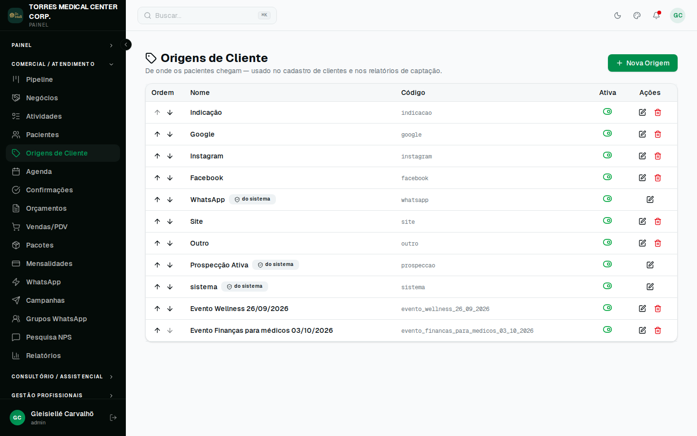
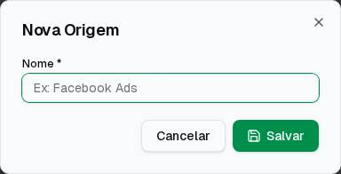
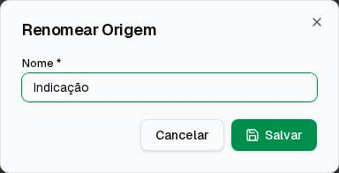

# Origens de Cliente

- **Módulo:** COMERCIAL / ATENDIMENTO
- **Tela:** Origens de Cliente
- **URL:** `/origens-cliente`
- **Título na página:** Origens de Cliente

## Objetivo (inferido)

Tela "Origens de Cliente" do módulo COMERCIAL / ATENDIMENTO. Apresenta listagem em tabela com colunas Ordem, Nome, Código, Ativa, Ações. Texto de apoio: "Origens de Cliente De onde os pacientes chegam — usado no cadastro de clientes e nos relatórios de captação. Nova Origem Ordem Nome Código Ativa Ações Indicação indicacao Google google Instagram insta…"

## Screenshot

## Campos

_Nenhum campo de formulário/filtro visível._

## Botões e ações

- Buscar... ⌘K
- Toggle theme
- Customize theme
- Notifications
- GC
- Nova Origem
- (ícone sem rótulo)

## Tabelas / grids

**Tabela 1** — 11 linha(s) visível(is)

- Colunas: Ordem · Nome · Código · Ativa · Ações
- Colunas possivelmente ordenáveis: não identificado

- Filtros/busca: não identificado
- Paginação: não identificada

## Abas

_Nenhuma aba._

## Modais

_Nenhum modal aberto na carga da tela. Modais disparados por botões não foram abertos (regra somente-leitura)._

## Links para outras telas

_Nenhum link na área principal._

## Mensagens e validações visíveis

_Nenhuma mensagem visível._

<!-- estados -->
## Estados capturados (interações de visualização)

_Capturados em 15/10/2026 clicando só em itens de visualização do checklist da issue. Nenhum formulário foi preenchido e toda gravação foi bloqueada._

### Nova Origem

- Abre modal **Nova Origem**

| Campo | Tipo | Obrigatório | Opções |
|---|---|---|---|
| Nome * | text | sim | — |

- Botões do modal: Cancelar · Salvar · Close

### Editar (ícone lápis) (na linha da tabela)

- Abre modal **Renomear Origem**

| Campo | Tipo | Obrigatório | Opções |
|---|---|---|---|
| Nome * | text | sim | — |

- Botões do modal: Cancelar · Salvar · Close

<!-- /estados -->
