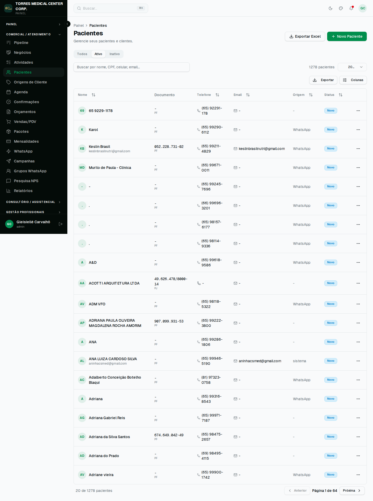
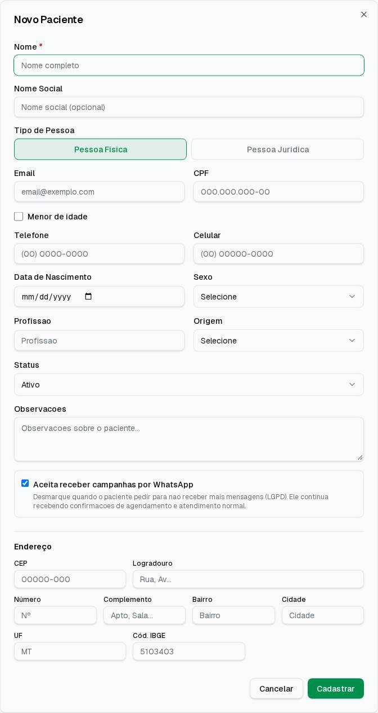
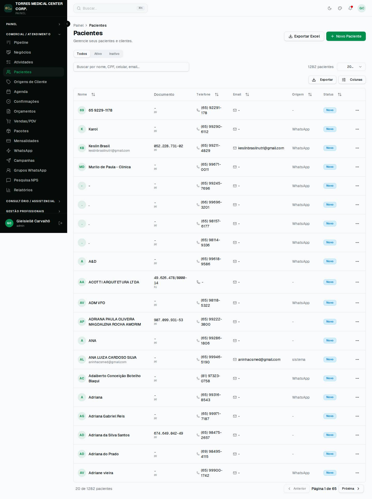
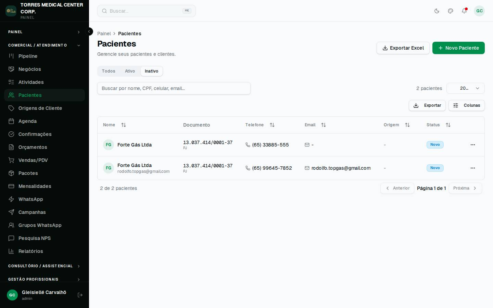
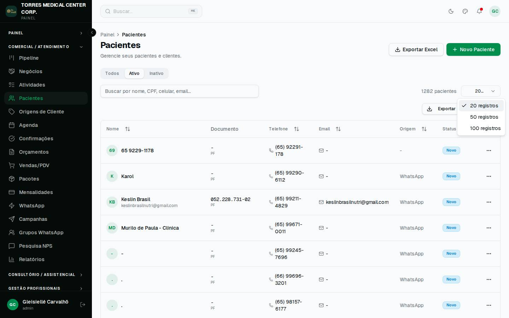
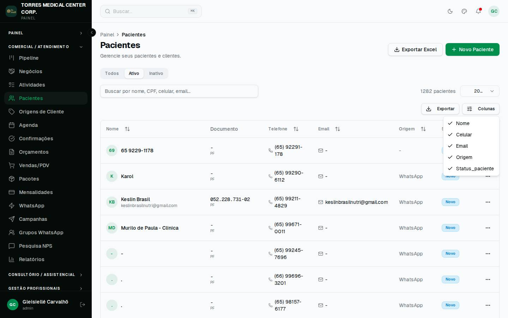
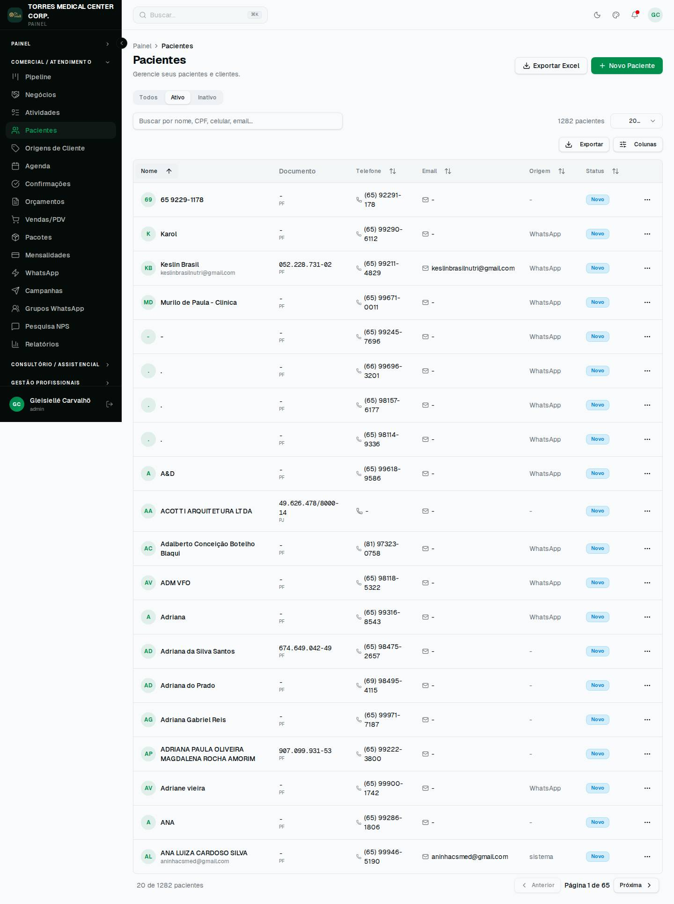
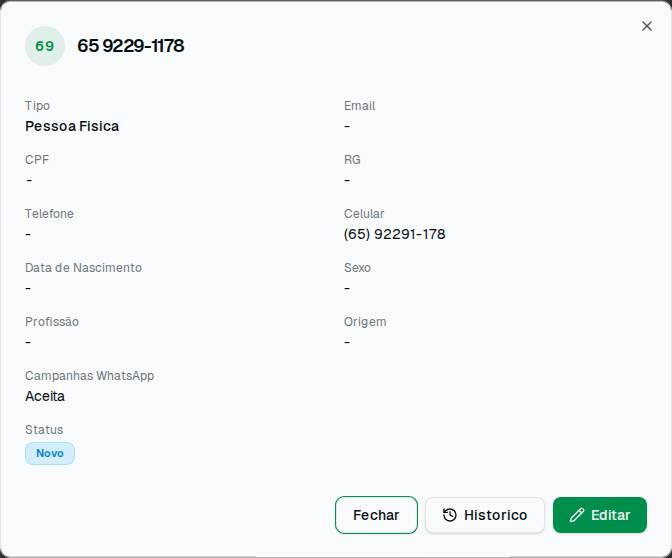
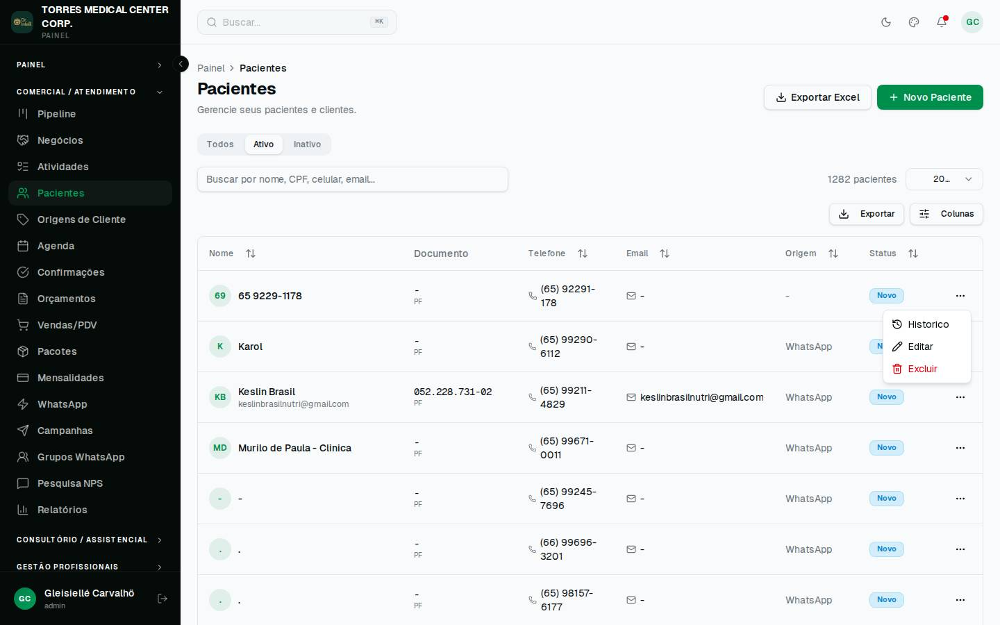
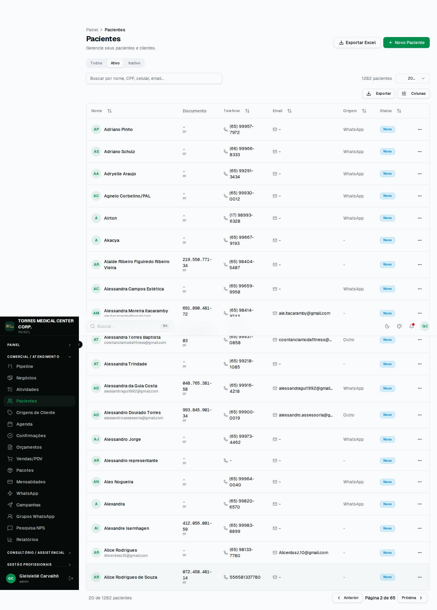

# Pacientes

- **Módulo:** COMERCIAL / ATENDIMENTO
- **Tela:** Pacientes
- **URL:** `/clientes`
- **Título na página:** Pacientes

## Objetivo (inferido)

Tela "Pacientes" do módulo COMERCIAL / ATENDIMENTO. Apresenta listagem em tabela com colunas Nome, Documento, Telefone, Email, Origem, Status. Possui 2 campo(s) de entrada/filtro. Texto de apoio: "Painel Pacientes Pacientes Gerencie seus pacientes e clientes. Exportar Excel Novo Paciente Todos Ativo Inativo 1278 pacientes 20 registros Exportar Colunas Nome Documento Telefone Email Origem Status…"

## Screenshot

## Campos

| Nome | Rótulo | Tipo | Obrigatório | Valores/opções |
|---|---|---|---|---|
| — | Buscar por nome, CPF, celular, email... | text | não indicado | — |
| — | — | combobox | não indicado | — |

## Botões e ações

- Buscar... ⌘K
- Toggle theme
- Customize theme
- Notifications
- GC
- Exportar Excel
- Novo Paciente
- Todos
- Ativo
- Inativo
- 20 registros
- Exportar
- Colunas
- Nome
- Telefone
- Email
- Origem
- Status
- Acoes
- Anterior _(desabilitado)_
- Próxima

## Tabelas / grids

**Tabela 1** — 20 linha(s) visível(is)

- Colunas: Nome · Documento · Telefone · Email · Origem · Status
- Colunas possivelmente ordenáveis: Nome, Telefone, Email, Origem, Status

- Filtros/busca: Buscar por nome, CPF, celular, email...
- Paginação: 20 registros

## Abas

_Nenhuma aba._

## Modais

_Nenhum modal aberto na carga da tela. Modais disparados por botões não foram abertos (regra somente-leitura)._

## Links para outras telas

- Painel → `/`

## Mensagens e validações visíveis

_Nenhuma mensagem visível._

<!-- estados -->
## Estados capturados (interações de visualização)

_Capturados em 15/10/2026 clicando só em itens de visualização do checklist da issue. Nenhum formulário foi preenchido e toda gravação foi bloqueada._

### Novo Paciente

- Abre modal **Novo Paciente**

| Campo | Tipo | Obrigatório | Opções |
|---|---|---|---|
| Nome * | text | sim | — |
| Nome Social | text | não indicado | — |
| Email | email | não indicado | — |
| CPF | text | não indicado | — |
| Menor de idade | checkbox | não indicado | — |
| Telefone | text | não indicado | — |
| Celular | text | não indicado | — |
| Data de Nascimento | date | não indicado | — |
| Sexo | combobox | não indicado | — |
| Profissao | text | não indicado | — |
| Origem | combobox | não indicado | — |
| Status | combobox | não indicado | — |
| Observacoes | textarea | não indicado | — |
| Aceita receber campanhas por WhatsApp | checkbox | não indicado | — |
| CEP | text | não indicado | — |
| Logradouro | text | não indicado | — |
| Número | text | não indicado | — |
| Complemento | text | não indicado | — |
| Bairro | text | não indicado | — |
| Cidade | text | não indicado | — |
| UF | text | não indicado | — |
| Cód. IBGE | text | não indicado | — |

- Botões do modal: Pessoa Fisica · Pessoa Juridica · Selecione · Ativo · Cancelar · Cadastrar · Close

### Todos

### Ativo

### Inativo

### Dropdown aberto: 20 registros

- Itens do menu/lista: 20 registros · 50 registros · 100 registros

### Colunas

- Itens do menu/lista: Nome · Celular · Email · Origem · Status_paciente

### Ordenação por coluna — 1 print de exemplo (colunas: Nome, Telefone, Email, Origem, Status)

### Clicar na linha da tabela (abre detalhe)

- Abre modal
- Botões do modal: Fechar · Historico · Editar · Close

### Menu de ações (⋯) (na linha da tabela)

- Itens do menu/lista: Historico · Editar · Excluir

### Paginação — 1 print da página 2

<!-- /estados -->
