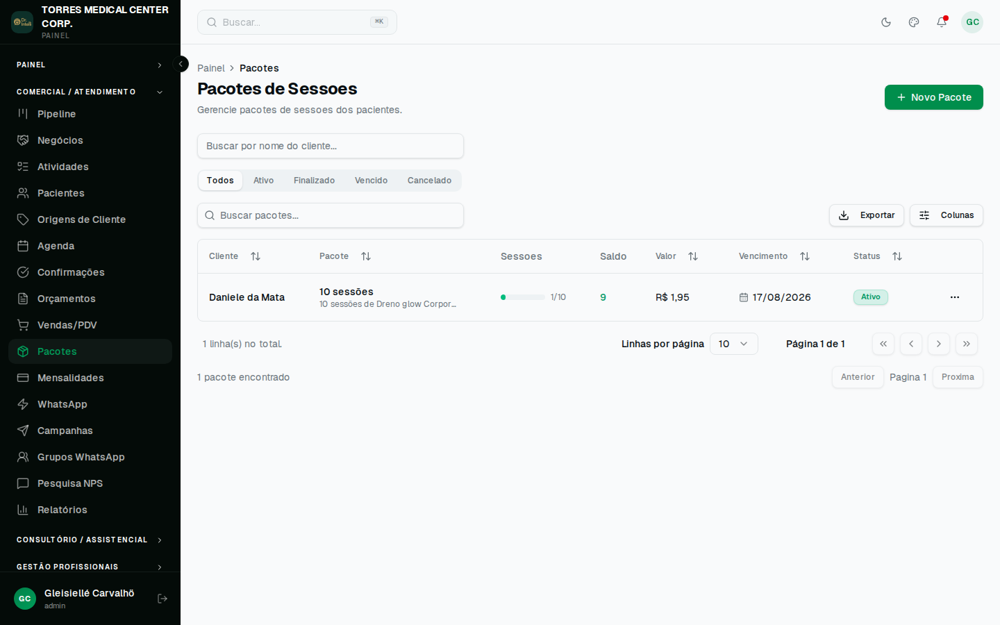

# Pacotes

- **Módulo:** COMERCIAL / ATENDIMENTO
- **Tela:** Pacotes
- **URL:** `/pacotes`
- **Título na página:** Pacotes de Sessoes

## Objetivo (inferido)

Tela "Pacotes" do módulo COMERCIAL / ATENDIMENTO. Apresenta listagem em tabela com colunas Cliente, Pacote, Sessoes, Saldo, Valor, Vencimento. Possui 3 campo(s) de entrada/filtro. Texto de apoio: "Painel Pacotes Pacotes de Sessoes Gerencie pacotes de sessoes dos pacientes. Novo Pacote Todos Ativo Finalizado Vencido Cancelado Exportar Colunas Cliente Pacote Sessoes Saldo Valor Vencimento Status …"

## Screenshot

## Campos

| Nome | Rótulo | Tipo | Obrigatório | Valores/opções |
|---|---|---|---|---|
| — | Buscar por nome do cliente... | text | não indicado | — |
| — | Buscar pacotes... | text | não indicado | — |
| — | — | combobox | não indicado | — |

## Botões e ações

- Buscar... ⌘K
- Toggle theme
- Customize theme
- Notifications
- GC
- Novo Pacote
- Todos
- Ativo
- Finalizado
- Vencido
- Cancelado
- Exportar
- Colunas
- Cliente
- Pacote
- Valor
- Vencimento
- Status
- Acoes
- 10
- Ir para primeira página _(desabilitado)_
- Ir para página anterior _(desabilitado)_
- Ir para próxima página _(desabilitado)_
- Ir para última página _(desabilitado)_
- Anterior _(desabilitado)_
- Proxima _(desabilitado)_

## Tabelas / grids

**Tabela 1** — 1 linha(s) visível(is)

- Colunas: Cliente · Pacote · Sessoes · Saldo · Valor · Vencimento · Status
- Colunas possivelmente ordenáveis: Cliente, Pacote, Valor, Vencimento, Status

- Filtros/busca: Buscar por nome do cliente..., Buscar pacotes...
- Paginação: Página 1 de 1

## Abas

_Nenhuma aba._

## Modais

_Nenhum modal aberto na carga da tela. Modais disparados por botões não foram abertos (regra somente-leitura)._

## Links para outras telas

- Painel → `/`

## Mensagens e validações visíveis

_Nenhuma mensagem visível._
