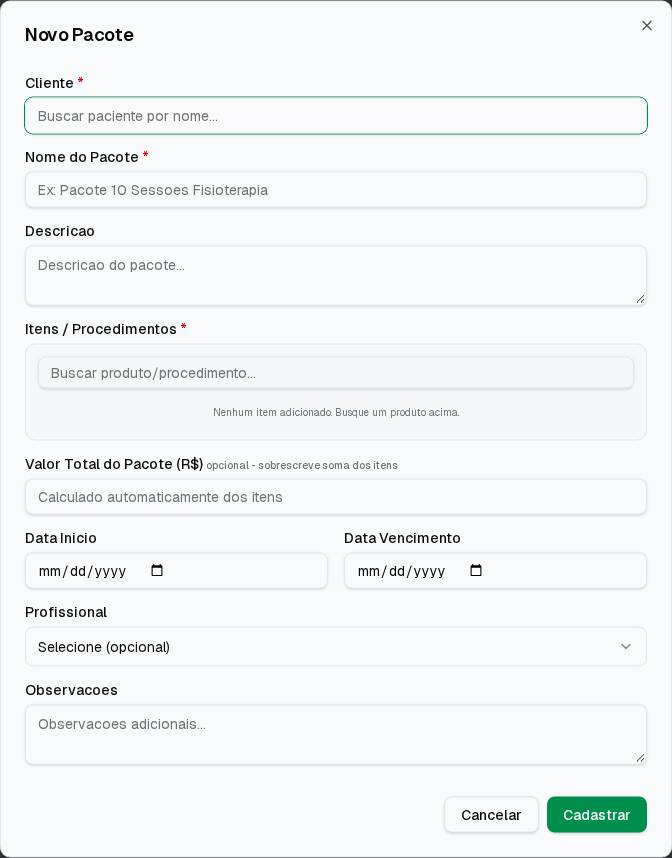
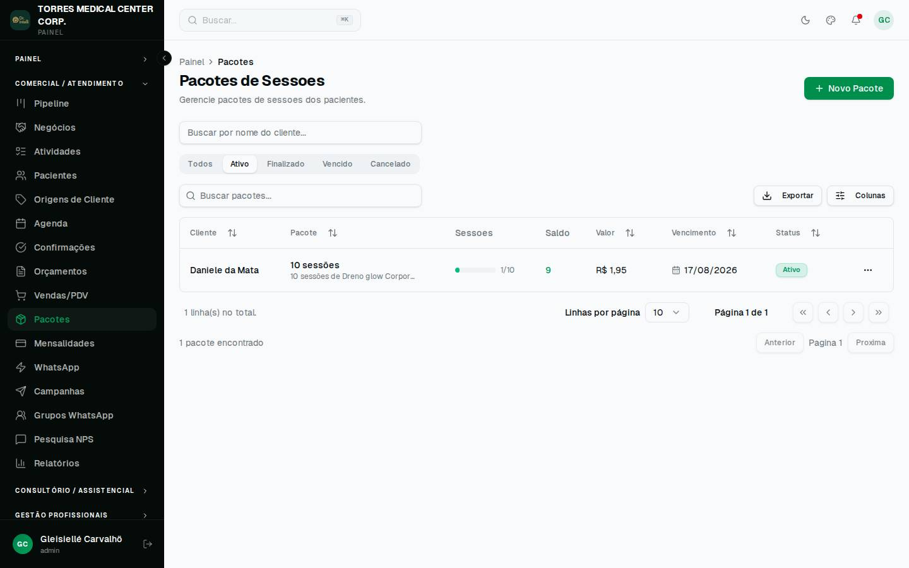
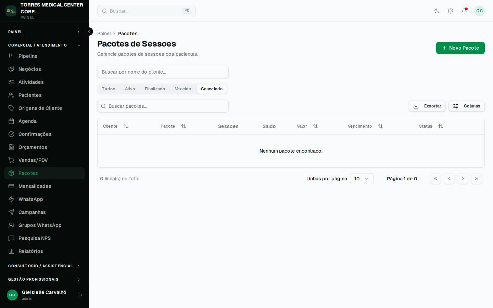
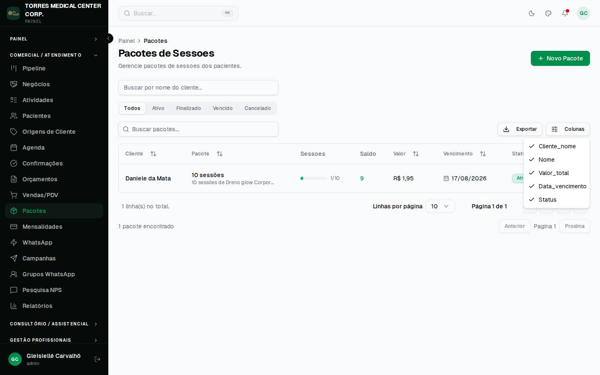
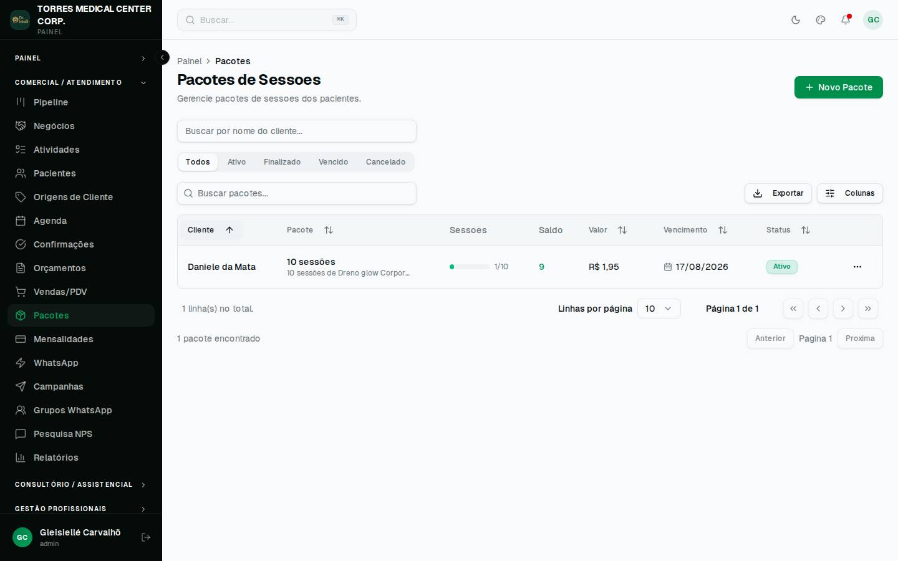
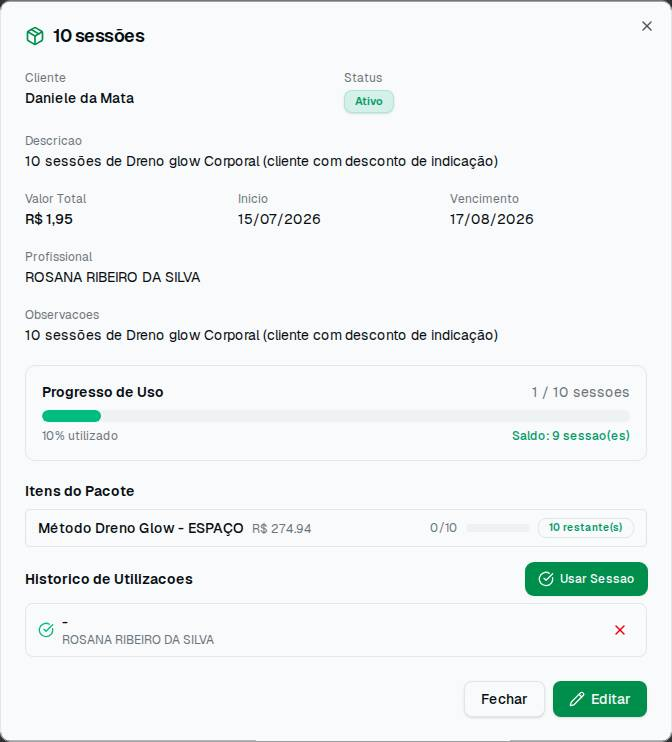
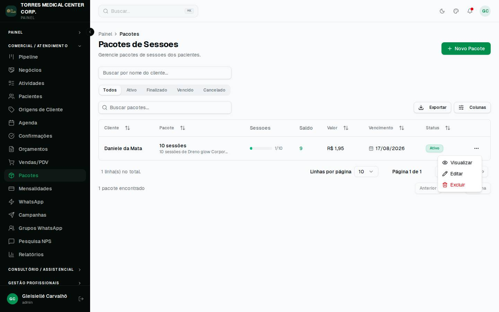

# Pacotes

- **Módulo:** COMERCIAL / ATENDIMENTO
- **Tela:** Pacotes
- **URL:** `/pacotes`
- **Título na página:** Pacotes de Sessoes

## Objetivo (inferido)

Tela "Pacotes" do módulo COMERCIAL / ATENDIMENTO. Apresenta listagem em tabela com colunas Cliente, Pacote, Sessoes, Saldo, Valor, Vencimento. Possui 3 campo(s) de entrada/filtro. Texto de apoio: "Painel Pacotes Pacotes de Sessoes Gerencie pacotes de sessoes dos pacientes. Novo Pacote Todos Ativo Finalizado Vencido Cancelado Exportar Colunas Cliente Pacote Sessoes Saldo Valor Vencimento Status …"

## Screenshot

## Campos

| Nome | Rótulo | Tipo | Obrigatório | Valores/opções |
|---|---|---|---|---|
| — | Buscar por nome do cliente... | text | não indicado | — |
| — | Buscar pacotes... | text | não indicado | — |
| — | — | combobox | não indicado | — |

## Botões e ações

- Buscar... ⌘K
- Toggle theme
- Customize theme
- Notifications
- GC
- Novo Pacote
- Todos
- Ativo
- Finalizado
- Vencido
- Cancelado
- Exportar
- Colunas
- Cliente
- Pacote
- Valor
- Vencimento
- Status
- Acoes
- 10
- Ir para primeira página _(desabilitado)_
- Ir para página anterior _(desabilitado)_
- Ir para próxima página _(desabilitado)_
- Ir para última página _(desabilitado)_
- Anterior _(desabilitado)_
- Proxima _(desabilitado)_

## Tabelas / grids

**Tabela 1** — 1 linha(s) visível(is)

- Colunas: Cliente · Pacote · Sessoes · Saldo · Valor · Vencimento · Status
- Colunas possivelmente ordenáveis: Cliente, Pacote, Valor, Vencimento, Status

- Filtros/busca: Buscar por nome do cliente..., Buscar pacotes...
- Paginação: Página 1 de 1

## Abas

_Nenhuma aba._

## Modais

_Nenhum modal aberto na carga da tela. Modais disparados por botões não foram abertos (regra somente-leitura)._

## Links para outras telas

- Painel → `/`

## Mensagens e validações visíveis

_Nenhuma mensagem visível._

<!-- estados -->
## Estados capturados (interações de visualização)

_Capturados em 15/10/2026 clicando só em itens de visualização do checklist da issue. Nenhum formulário foi preenchido e toda gravação foi bloqueada._

### Novo Pacote

- Abre modal **Novo Pacote**

| Campo | Tipo | Obrigatório | Opções |
|---|---|---|---|
| Buscar paciente por nome... | text | não indicado | — |
| Nome do Pacote * | text | sim | — |
| Descricao | textarea | não indicado | — |
| Buscar produto/procedimento... | text | não indicado | — |
| Valor Total do Pacote (R$) opcional - sobrescreve soma dos itens | number | não indicado | — |
| Data Inicio | date | não indicado | — |
| Data Vencimento | date | não indicado | — |
| Profissional | combobox | não indicado | — |
| Observacoes | textarea | não indicado | — |

- Botões do modal: Selecione (opcional) · Cancelar · Cadastrar · Close

### Todos

### Ativo

### Finalizado

### Vencido

### Cancelado

### Colunas

- Itens do menu/lista: Cliente_nome · Nome · Valor_total · Data_vencimento · Status

### Ordenação por coluna — 1 print de exemplo (colunas: Cliente, Pacote, Valor, Vencimento, Status)

### Clicar na linha da tabela (abre detalhe)

- Abre modal
- Botões do modal: Usar Sessao · Fechar · Editar · Close

### Menu de ações (⋯) (na linha da tabela)

- Itens do menu/lista: Visualizar · Editar · Excluir

### Paginação — 1 print da página 2

- lista com uma página só (botão de próxima página desabilitado), sem print

<!-- /estados -->
