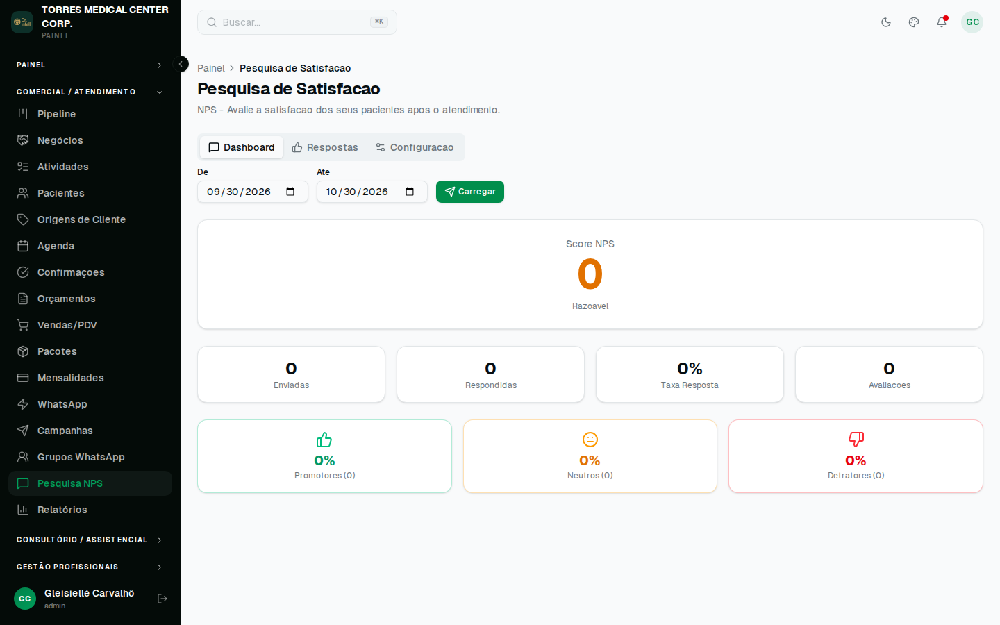

# Pesquisa NPS

- **Módulo:** COMERCIAL / ATENDIMENTO
- **Tela:** Pesquisa NPS
- **URL:** `/pesquisa-satisfacao`
- **Título na página:** Pesquisa de Satisfacao

## Objetivo (inferido)

Tela "Pesquisa NPS" do módulo COMERCIAL / ATENDIMENTO. Possui 2 campo(s) de entrada/filtro. Organizada em abas (Dashboard, Respostas, Configuracao). Texto de apoio: "Painel Pesquisa de Satisfacao Pesquisa de Satisfacao NPS - Avalie a satisfacao dos seus pacientes apos o atendimento. Dashboard Respostas Configuracao De Ate Carregar Score NPS 0 Razoavel 0 Enviadas 0…"

## Screenshot

## Campos

| Nome | Rótulo | Tipo | Obrigatório | Valores/opções |
|---|---|---|---|---|
| — | De | date | não indicado | — |
| — | Ate | date | não indicado | — |

## Botões e ações

- Buscar... ⌘K
- Toggle theme
- Customize theme
- Notifications
- GC
- Dashboard
- Respostas
- Configuracao
- Carregar

## Tabelas / grids

_Nenhuma tabela encontrada._

- Filtros/busca: não identificado
- Paginação: não identificada

## Abas

- Dashboard _(ativa)_
- Respostas
- Configuracao

## Modais

_Nenhum modal aberto na carga da tela. Modais disparados por botões não foram abertos (regra somente-leitura)._

## Links para outras telas

- Painel → `/`

## Mensagens e validações visíveis

_Nenhuma mensagem visível._
