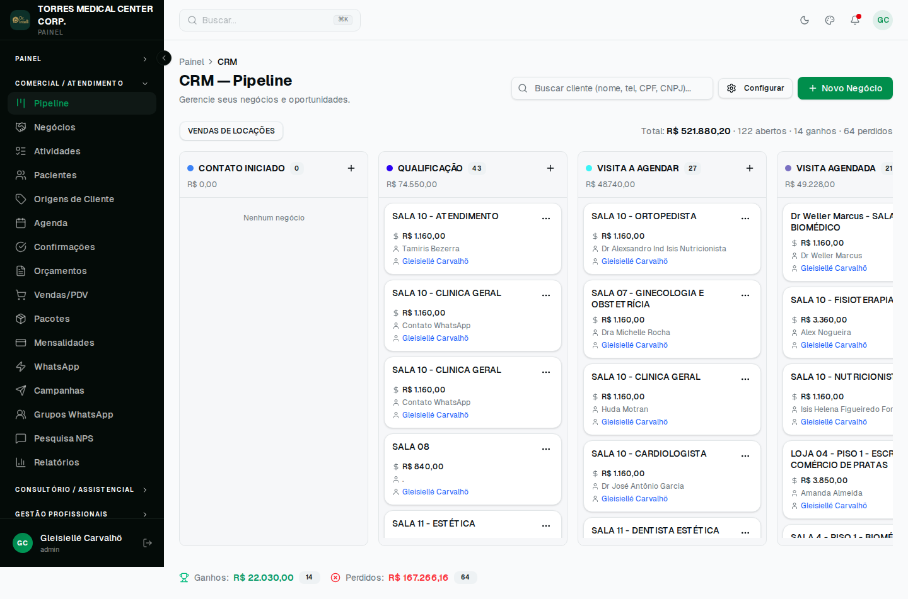
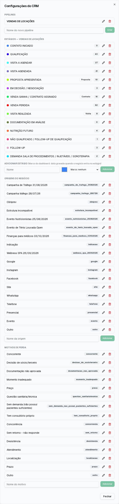
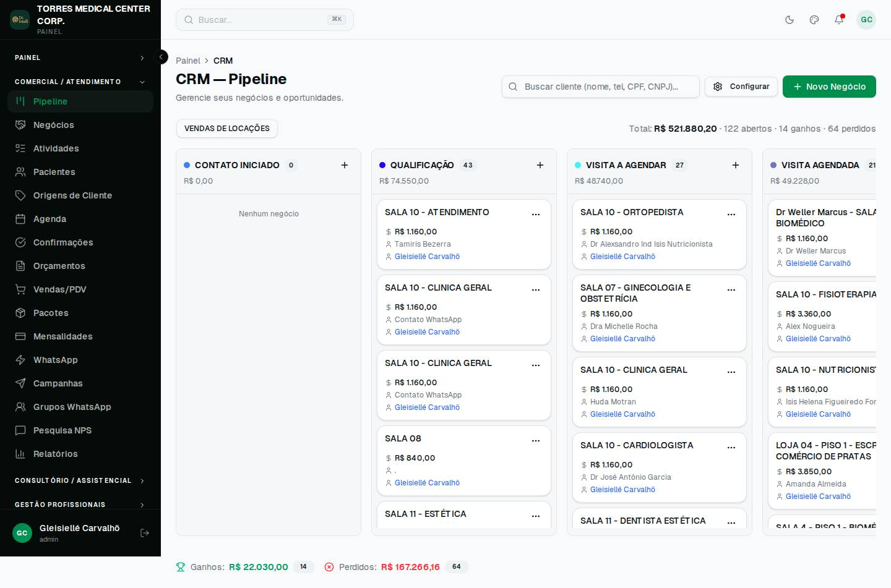
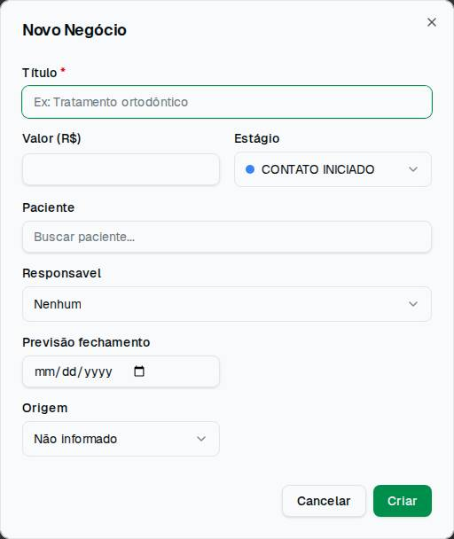
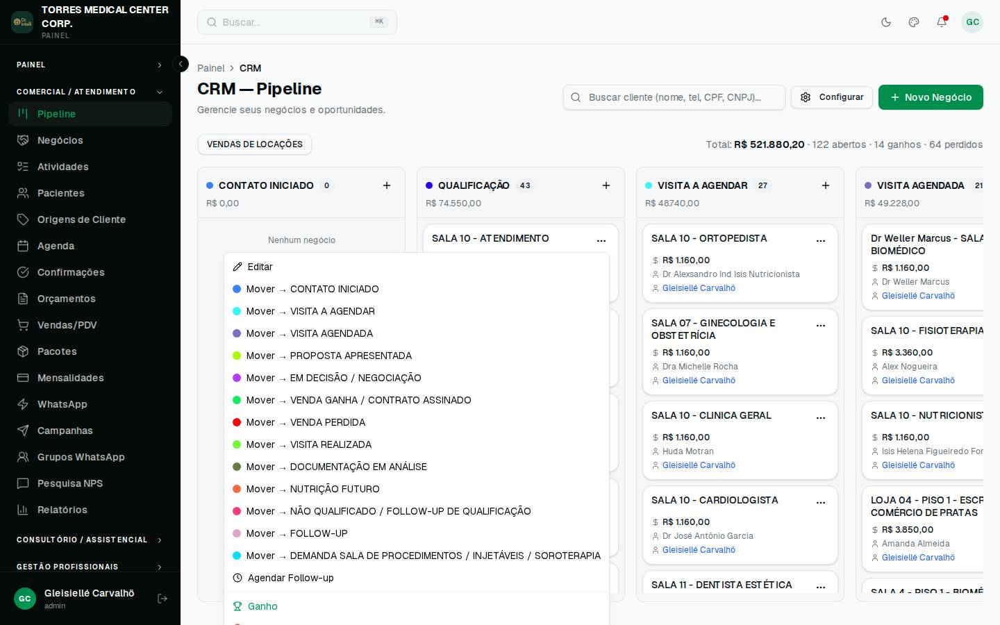

# Pipeline

- **Módulo:** COMERCIAL / ATENDIMENTO
- **Tela:** Pipeline
- **URL:** `/crm`
- **Título na página:** CRM — Pipeline

## Objetivo (inferido)

Tela "Pipeline" do módulo COMERCIAL / ATENDIMENTO. Possui 1 campo(s) de entrada/filtro. Texto de apoio: "Painel CRM CRM — Pipeline Gerencie seus negócios e oportunidades. Configurar Novo Negócio VENDAS DE LOCAÇÕES Total: R$ 521.880,20 · 122 abertos · 14 ganhos · 64 perdidos CONTATO INICIADO 0 R$ 0,00 Nen…"

## Screenshot

## Campos

| Nome | Rótulo | Tipo | Obrigatório | Valores/opções |
|---|---|---|---|---|
| — | Buscar cliente (nome, tel, CPF, CNPJ)... | text | não indicado | — |

## Botões e ações

- Buscar... ⌘K
- Toggle theme
- Customize theme
- Notifications
- GC
- Configurar
- Novo Negócio
- VENDAS DE LOCAÇÕES
- (ícone sem rótulo)
- (ícone sem rótulo)

## Tabelas / grids

_Nenhuma tabela encontrada._

- Filtros/busca: não identificado
- Paginação: não identificada

## Abas

_Nenhuma aba._

## Modais

_Nenhum modal aberto na carga da tela. Modais disparados por botões não foram abertos (regra somente-leitura)._

## Links para outras telas

- Painel → `/`

## Mensagens e validações visíveis

_Nenhuma mensagem visível._

<!-- estados -->
## Estados capturados (interações de visualização)

_Capturados em 15/10/2026 clicando só em itens de visualização do checklist da issue. Nenhum formulário foi preenchido e toda gravação foi bloqueada._

### Configurar

- Abre modal **Configurações do CRM**

| Campo | Tipo | Obrigatório | Opções |
|---|---|---|---|
| Nome do novo pipeline | text | não indicado | — |
| Nome | text | não indicado | — |
| — | color | não indicado | — |
| Marco do dashboard | select | não indicado | Marco: nenhum, Marco: Primeiro contato, Marco: Visita, Marco: Proposta, Marco: Contrato |
| Nome da origem | text | não indicado | — |
| Nome do motivo | text | não indicado | — |

- Botões do modal: Criar · Adicionar · Fechar · Close

### Novo Negócio

- Abre modal **Novo Negócio**

| Campo | Tipo | Obrigatório | Opções |
|---|---|---|---|
| Título * | text | sim | — |
| Valor (R$) | number | não indicado | — |
| Estágio | combobox | não indicado | — |
| Paciente | text | não indicado | — |
| Responsavel | combobox | não indicado | — |
| Previsão fechamento | date | não indicado | — |
| Origem | combobox | não indicado | — |

- Botões do modal: CONTATO INICIADO · Nenhum · Não informado · Cancelar · Criar · Close

### VENDAS DE LOCAÇÕES

### Adicionar (ícone +)

- Abre modal **Novo Negócio**

| Campo | Tipo | Obrigatório | Opções |
|---|---|---|---|
| Título * | text | sim | — |
| Valor (R$) | number | não indicado | — |
| Estágio | combobox | não indicado | — |
| Paciente | text | não indicado | — |
| Responsavel | combobox | não indicado | — |
| Previsão fechamento | date | não indicado | — |
| Origem | combobox | não indicado | — |

- Botões do modal: CONTATO INICIADO · Nenhum · Não informado · Cancelar · Criar · Close

### Menu de ações (⋯)

- Itens do menu/lista: Editar · Mover → CONTATO INICIADO · Mover → VISITA A AGENDAR · Mover → VISITA AGENDADA · Mover → PROPOSTA APRESENTADA · Mover → EM DECISÃO / NEGOCIAÇÃO · Mover → VENDA GANHA / CONTRATO ASSINADO · Mover → VENDA PERDIDA · Mover → VISITA REALIZADA · Mover → DOCUMENTAÇÃO EM ANÁLISE · Mover → NUTRIÇÃO FUTURO · Mover → NÃO QUALIFICADO / FOLLOW-UP DE QUALIFICAÇÃO · Mover → FOLLOW-UP · Mover → DEMANDA SALA DE PROCEDIMENTOS / INJETÁVEIS / SOROTERAPIA · Agendar Follow-up · Ganho · Perdido · Excluir

<!-- /estados -->
