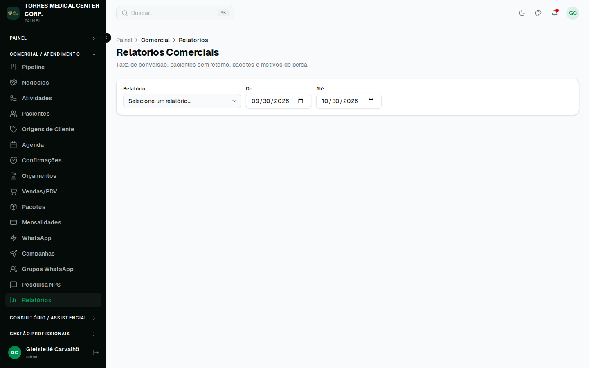

# Relatórios

- **Módulo:** COMERCIAL / ATENDIMENTO
- **Tela:** Relatórios
- **URL:** `/crm/relatorios`
- **Título na página:** Relatorios Comerciais

## Objetivo (inferido)

Tela "Relatórios" do módulo COMERCIAL / ATENDIMENTO. Possui 3 campo(s) de entrada/filtro. Texto de apoio: "Painel Comercial Relatorios Relatorios Comerciais Taxa de conversao, pacientes sem retorno, pacotes e motivos de perda. Relatório Selecione um relatório... COM-01 — Taxa de Conversao por Origem COM-02…"

## Screenshot

## Campos

| Nome | Rótulo | Tipo | Obrigatório | Valores/opções |
|---|---|---|---|---|
| — | — | select | não indicado | Selecione um relatório..., COM-01 — Taxa de Conversao por Origem, COM-02 — Pacientes Sem Retorno, COM-03 — Pacotes Acabando, COM-04 — Motivo de Perda |
| — | De | date | não indicado | — |
| — | Até | date | não indicado | — |

## Botões e ações

- Buscar... ⌘K
- Toggle theme
- Customize theme
- Notifications
- GC

## Tabelas / grids

_Nenhuma tabela encontrada._

- Filtros/busca: não identificado
- Paginação: não identificada

## Abas

_Nenhuma aba._

## Modais

_Nenhum modal aberto na carga da tela. Modais disparados por botões não foram abertos (regra somente-leitura)._

## Links para outras telas

- Painel → `/`

## Mensagens e validações visíveis

_Nenhuma mensagem visível._

<!-- estados -->
## Estados capturados (interações de visualização)

_Capturados em 15/10/2026 clicando só em itens de visualização do checklist da issue. Nenhum formulário foi preenchido e toda gravação foi bloqueada._

### Dropdown aberto: Selecione um relatório... COM-01 — Taxa de Conversao por Origem COM-02 — Pacient

- select nativo: opções listadas, sem print
- Opções: Selecione um relatório..., COM-01 — Taxa de Conversao por Origem, COM-02 — Pacientes Sem Retorno, COM-03 — Pacotes Acabando, COM-04 — Motivo de Perda

<!-- /estados -->
