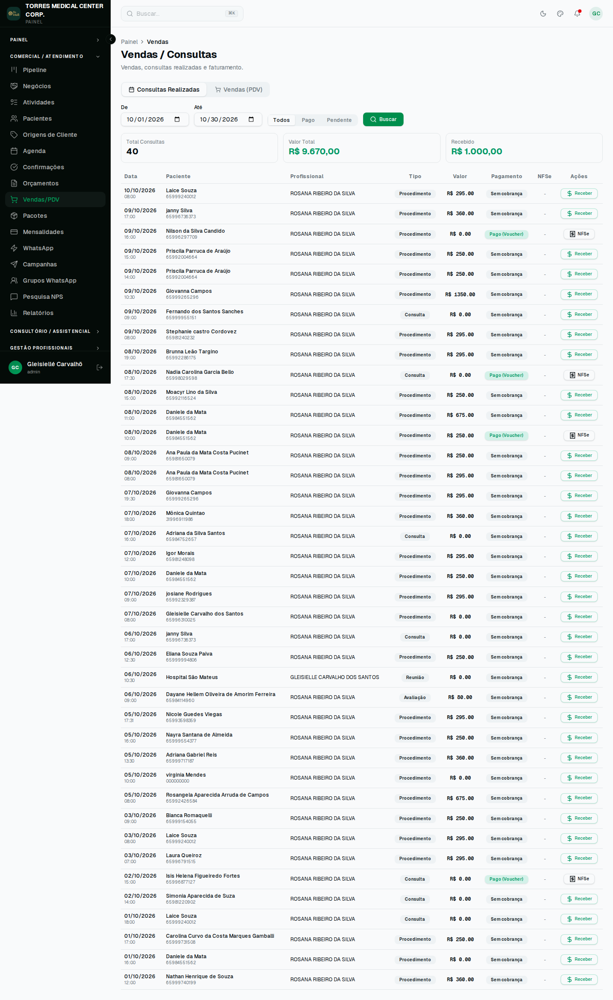

# Vendas/PDV

- **Módulo:** COMERCIAL / ATENDIMENTO
- **Tela:** Vendas/PDV
- **URL:** `/vendas`
- **Título na página:** Vendas / Consultas

## Objetivo (inferido)

Tela "Vendas/PDV" do módulo COMERCIAL / ATENDIMENTO. Apresenta listagem em tabela com colunas Data, Paciente, Profissional, Tipo, Valor, Pagamento. Possui 2 campo(s) de entrada/filtro. Texto de apoio: "Painel Vendas Vendas / Consultas Vendas, consultas realizadas e faturamento. Consultas Realizadas Vendas (PDV) De Até Todos Pago Pendente Buscar Total Consultas 40 Valor Total R$ 9.670,00 Recebido R$ …"

## Screenshot

## Campos

| Nome | Rótulo | Tipo | Obrigatório | Valores/opções |
|---|---|---|---|---|
| — | De | date | não indicado | — |
| — | Até | date | não indicado | — |

## Botões e ações

- Buscar... ⌘K
- Toggle theme
- Customize theme
- Notifications
- GC
- Consultas Realizadas
- Vendas (PDV)
- Todos
- Pago
- Pendente
- Buscar
- Receber
- NFSe

## Tabelas / grids

**Tabela 1** — 40 linha(s) visível(is)

- Colunas: Data · Paciente · Profissional · Tipo · Valor · Pagamento · NFSe · Ações
- Colunas possivelmente ordenáveis: não identificado

- Filtros/busca: De, Até
- Paginação: não identificada

## Abas

_Nenhuma aba._

## Modais

_Nenhum modal aberto na carga da tela. Modais disparados por botões não foram abertos (regra somente-leitura)._

## Links para outras telas

- Painel → `/`

## Mensagens e validações visíveis

_Nenhuma mensagem visível._
