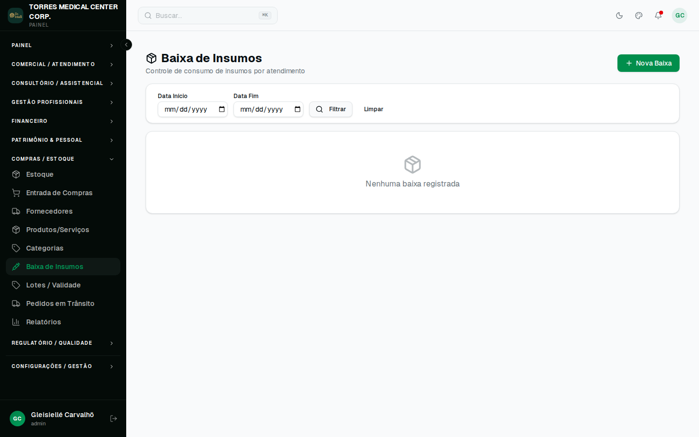

# Baixa de Insumos

- **Módulo:** COMPRAS / ESTOQUE
- **Tela:** Baixa de Insumos
- **URL:** `/baixa-insumos`
- **Título na página:** Baixa de Insumos

## Objetivo (inferido)

Tela "Baixa de Insumos" do módulo COMPRAS / ESTOQUE. Possui 2 campo(s) de entrada/filtro. Texto de apoio: "Baixa de Insumos Controle de consumo de insumos por atendimento Nova Baixa Data Início Data Fim Filtrar Limpar Nenhuma baixa registrada…"

## Screenshot

## Campos

| Nome | Rótulo | Tipo | Obrigatório | Valores/opções |
|---|---|---|---|---|
| — | Data Início | date | não indicado | — |
| — | Data Fim | date | não indicado | — |

## Botões e ações

- Buscar... ⌘K
- Toggle theme
- Customize theme
- Notifications
- GC
- Nova Baixa
- Filtrar
- Limpar

## Tabelas / grids

_Nenhuma tabela encontrada._

- Filtros/busca: não identificado
- Paginação: não identificada

## Abas

_Nenhuma aba._

## Modais

_Nenhum modal aberto na carga da tela. Modais disparados por botões não foram abertos (regra somente-leitura)._

## Links para outras telas

_Nenhum link na área principal._

## Mensagens e validações visíveis

_Nenhuma mensagem visível._
