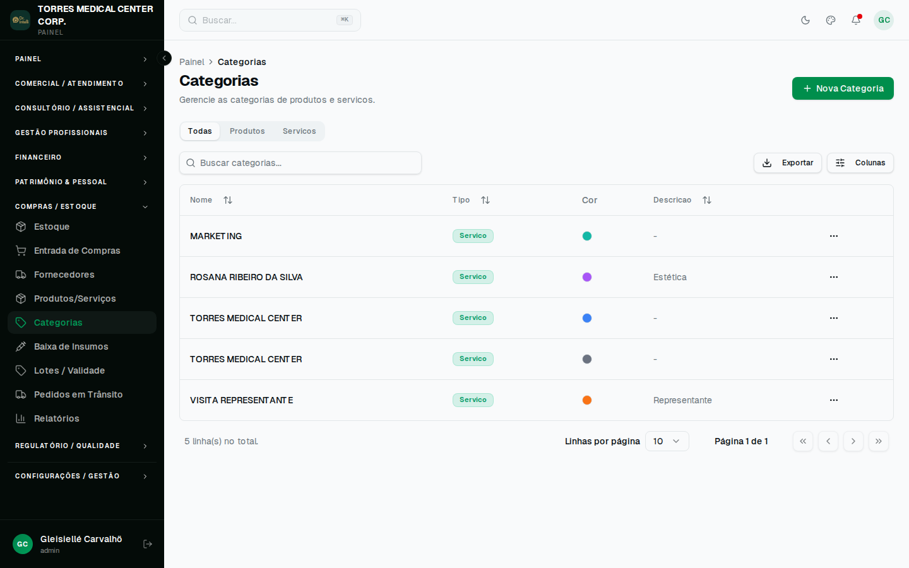

# Categorias

- **Módulo:** COMPRAS / ESTOQUE
- **Tela:** Categorias
- **URL:** `/categorias`
- **Título na página:** Categorias

## Objetivo (inferido)

Tela "Categorias" do módulo COMPRAS / ESTOQUE. Apresenta listagem em tabela com colunas Nome, Tipo, Cor, Descricao. Possui 2 campo(s) de entrada/filtro. Texto de apoio: "Painel Categorias Categorias Gerencie as categorias de produtos e servicos. Nova Categoria Todas Produtos Servicos Exportar Colunas Nome Tipo Cor Descricao MARKETING Servico - Acoes ROSANA RIBEIRO DA …"

## Screenshot

## Campos

| Nome | Rótulo | Tipo | Obrigatório | Valores/opções |
|---|---|---|---|---|
| — | Buscar categorias... | text | não indicado | — |
| — | — | combobox | não indicado | — |

## Botões e ações

- Buscar... ⌘K
- Toggle theme
- Customize theme
- Notifications
- GC
- Nova Categoria
- Todas
- Produtos
- Servicos
- Exportar
- Colunas
- Nome
- Tipo
- Descricao
- Acoes
- 10
- Ir para primeira página _(desabilitado)_
- Ir para página anterior _(desabilitado)_
- Ir para próxima página _(desabilitado)_
- Ir para última página _(desabilitado)_

## Tabelas / grids

**Tabela 1** — 5 linha(s) visível(is)

- Colunas: Nome · Tipo · Cor · Descricao
- Colunas possivelmente ordenáveis: Nome, Tipo, Descricao

- Filtros/busca: Buscar categorias...
- Paginação: Página 1 de 1

## Abas

_Nenhuma aba._

## Modais

_Nenhum modal aberto na carga da tela. Modais disparados por botões não foram abertos (regra somente-leitura)._

## Links para outras telas

- Painel → `/`

## Mensagens e validações visíveis

_Nenhuma mensagem visível._
