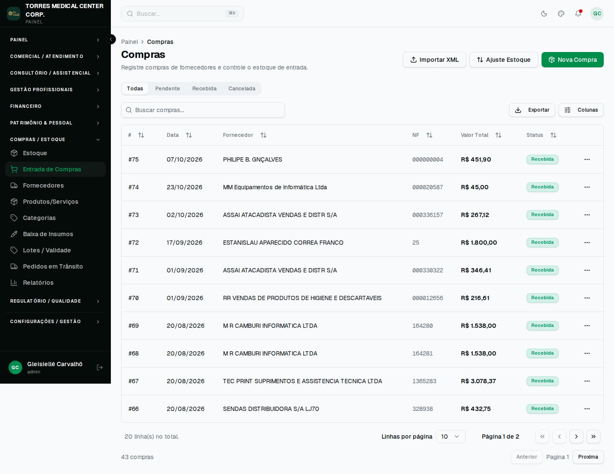
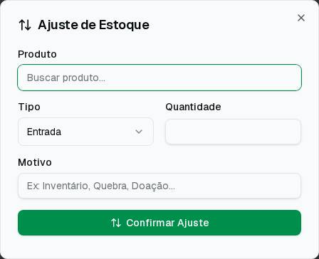
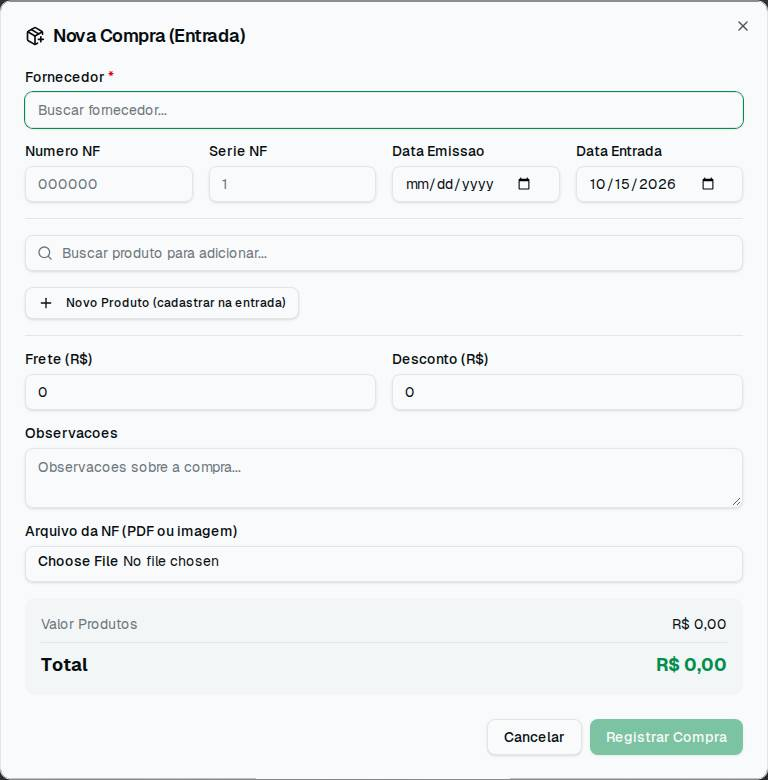
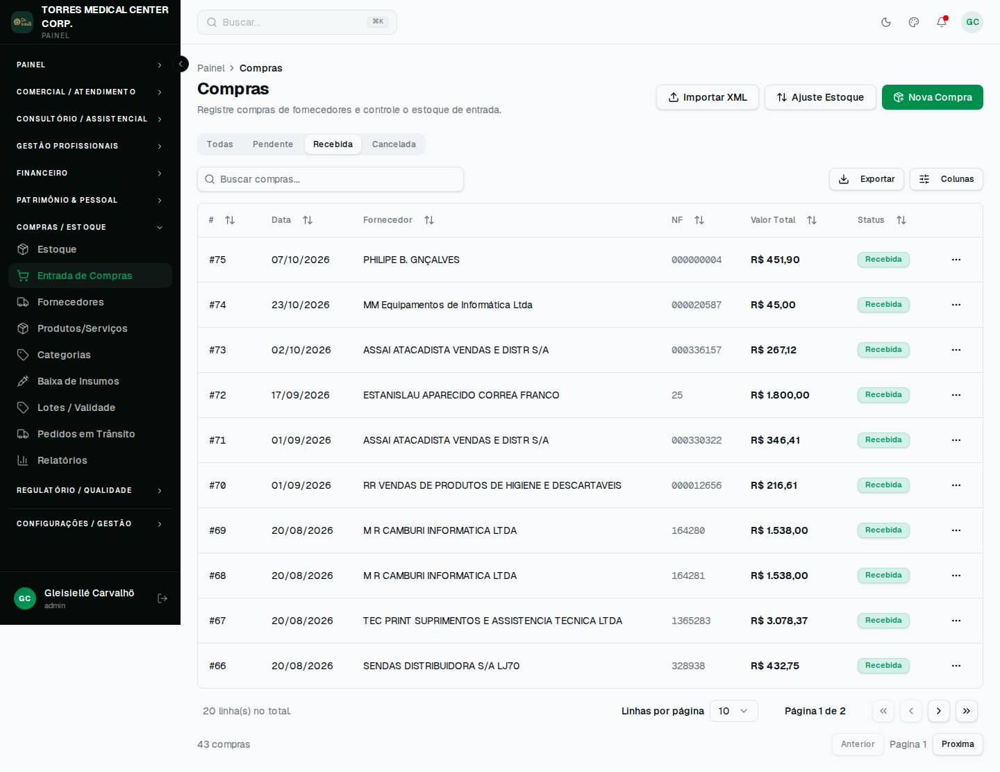
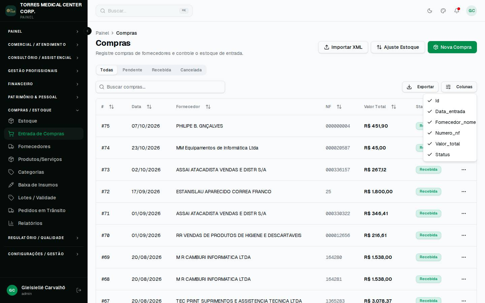
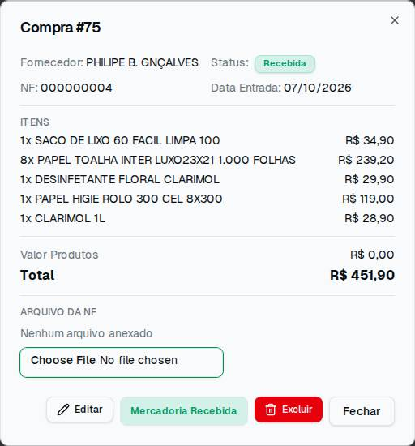
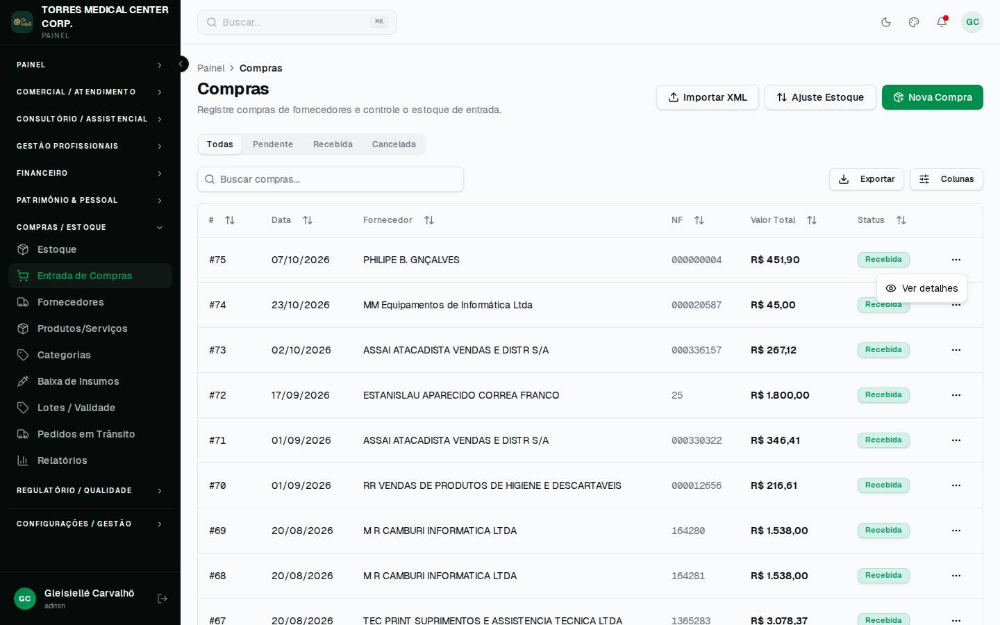
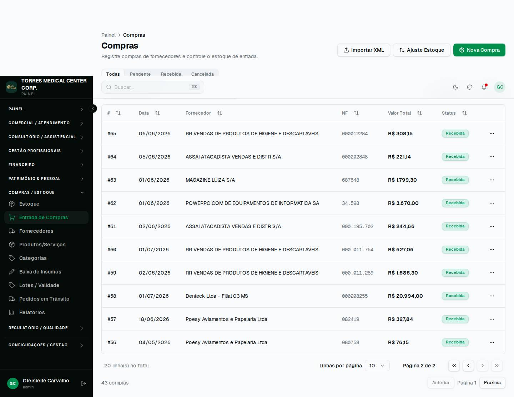

# Entrada de Compras

- **Módulo:** COMPRAS / ESTOQUE
- **Tela:** Entrada de Compras
- **URL:** `/compras`
- **Título na página:** Compras

## Objetivo (inferido)

Tela "Entrada de Compras" do módulo COMPRAS / ESTOQUE. Apresenta listagem em tabela com colunas #, Data, Fornecedor, NF, Valor Total, Status. Possui 2 campo(s) de entrada/filtro. Texto de apoio: "Painel Compras Compras Registre compras de fornecedores e controle o estoque de entrada. Importar XML Ajuste Estoque Nova Compra Todas Pendente Recebida Cancelada Exportar Colunas # Data Fornecedor NF…"

## Screenshot

## Campos

| Nome | Rótulo | Tipo | Obrigatório | Valores/opções |
|---|---|---|---|---|
| — | Buscar compras... | text | não indicado | — |
| — | — | combobox | não indicado | — |

## Botões e ações

- Buscar... ⌘K
- Toggle theme
- Customize theme
- Notifications
- GC
- Importar XML
- Ajuste Estoque
- Nova Compra
- Todas
- Pendente
- Recebida
- Cancelada
- Exportar
- Colunas
- #
- Data
- Fornecedor
- NF
- Valor Total
- Status
- (ícone sem rótulo)
- 10
- Ir para primeira página _(desabilitado)_
- Ir para página anterior _(desabilitado)_
- Ir para próxima página
- Ir para última página
- Anterior _(desabilitado)_
- Proxima

## Tabelas / grids

**Tabela 1** — 10 linha(s) visível(is)

- Colunas: # · Data · Fornecedor · NF · Valor Total · Status
- Colunas possivelmente ordenáveis: #, Data, Fornecedor, NF, Valor Total, Status

- Filtros/busca: Buscar compras...
- Paginação: Página 1 de 2

## Abas

_Nenhuma aba._

## Modais

_Nenhum modal aberto na carga da tela. Modais disparados por botões não foram abertos (regra somente-leitura)._

## Links para outras telas

- Painel → `/`

## Mensagens e validações visíveis

_Nenhuma mensagem visível._

<!-- estados -->
## Estados capturados (interações de visualização)

_Capturados em 15/10/2026 clicando só em itens de visualização do checklist da issue. Nenhum formulário foi preenchido e toda gravação foi bloqueada._

### Ordenação por coluna — 1 print de exemplo (colunas: Ajuste Estoque, #, Data, Fornecedor, NF, Valor Total, Status)

- Abre modal **Ajuste de Estoque**

| Campo | Tipo | Obrigatório | Opções |
|---|---|---|---|
| Buscar produto... | text | não indicado | — |
| Tipo | combobox | não indicado | — |
| Quantidade | number | não indicado | — |
| Motivo | text | não indicado | — |

- Botões do modal: Entrada · Confirmar Ajuste · Close

### Nova Compra

- Abre modal **Nova Compra (Entrada)**

| Campo | Tipo | Obrigatório | Opções |
|---|---|---|---|
| Buscar fornecedor... | text | não indicado | — |
| Numero NF | text | não indicado | — |
| Serie NF | text | não indicado | — |
| Data Emissao | date | não indicado | — |
| Data Entrada | date | não indicado | — |
| Buscar produto para adicionar... | text | não indicado | — |
| Frete (R$) | number | não indicado | — |
| Desconto (R$) | number | não indicado | — |
| Observacoes | textarea | não indicado | — |
| Arquivo da NF (PDF ou imagem) | file | não indicado | — |

- Botões do modal: Novo Produto (cadastrar na entrada) · Cancelar · Registrar Compra · Close

### Todas

### Pendente

### Recebida

### Cancelada

### Colunas

- Itens do menu/lista: Id · Data_entrada · Fornecedor_nome · Numero_nf · Valor_total · Status

### Clicar na linha da tabela (abre detalhe)

- Abre modal

| Campo | Tipo | Obrigatório | Opções |
|---|---|---|---|
| — | file | não indicado | — |

- Botões do modal: Editar · Excluir · Fechar · Close

### Menu de ações (⋯) (na linha da tabela)

- Itens do menu/lista: Ver detalhes

### Paginação — 1 print da página 2

<!-- /estados -->
