# Estoque

- **Módulo:** COMPRAS / ESTOQUE
- **Tela:** Estoque
- **URL:** `/estoque`
- **Título na página:** Estoque

## Objetivo (inferido)

Tela "Estoque" do módulo COMPRAS / ESTOQUE. Apresenta listagem em tabela com colunas Produto, Descrição, SKU, Categoria, Estoque Atual, Mínimo. Possui 2 campo(s) de entrada/filtro. Texto de apoio: "Painel Estoque Estoque Gerenciamento de estoque e inventário. Entrada Saída Ajuste Total Produtos 220 Controlados 202 Abaixo do Mínimo 0 Zerados 36 Valor em Estoque R$ 100756.90 Vencendo 30d 0 Vencido…"

## Screenshot

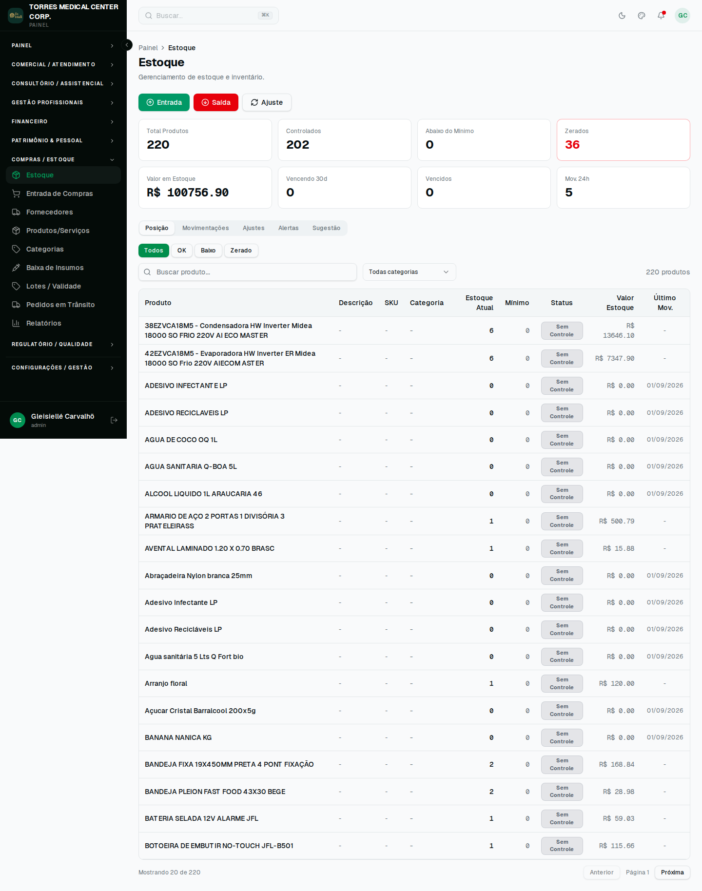

## Campos

| Nome | Rótulo | Tipo | Obrigatório | Valores/opções |
|---|---|---|---|---|
| — | Buscar produto... | text | não indicado | — |
| — | — | combobox | não indicado | — |

## Botões e ações

- Buscar... ⌘K
- Toggle theme
- Customize theme
- Notifications
- GC
- Entrada
- Saída
- Ajuste
- Posição
- Movimentações
- Ajustes
- Alertas
- Sugestão
- Todos
- OK
- Baixo
- Zerado
- Todas categorias
- Anterior _(desabilitado)_
- Próxima

## Tabelas / grids

**Tabela 1** — 20 linha(s) visível(is)

- Colunas: Produto · Descrição · SKU · Categoria · Estoque Atual · Mínimo · Status · Valor Estoque · Último Mov.
- Colunas possivelmente ordenáveis: não identificado

- Filtros/busca: Buscar produto...
- Paginação: não identificada

## Abas

_Nenhuma aba._

## Modais

_Nenhum modal aberto na carga da tela. Modais disparados por botões não foram abertos (regra somente-leitura)._

## Links para outras telas

- Painel → `/`

## Mensagens e validações visíveis

_Nenhuma mensagem visível._

<!-- estados -->
## Estados capturados (interações de visualização)

_Capturados em 15/10/2026 clicando só em itens de visualização do checklist da issue. Nenhum formulário foi preenchido e toda gravação foi bloqueada._

### Entrada

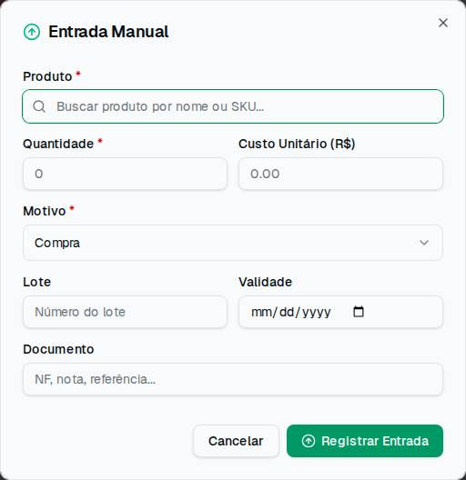

- Abre modal **Entrada Manual**

| Campo | Tipo | Obrigatório | Opções |
|---|---|---|---|
| Buscar produto por nome ou SKU... | text | não indicado | — |
| Quantidade * | number | sim | — |
| Custo Unitário (R$) | number | não indicado | — |
| Motivo * | combobox | sim | — |
| Lote | text | não indicado | — |
| Validade | date | não indicado | — |
| Documento | text | não indicado | — |

- Botões do modal: Compra · Cancelar · Registrar Entrada · Close

### Saída

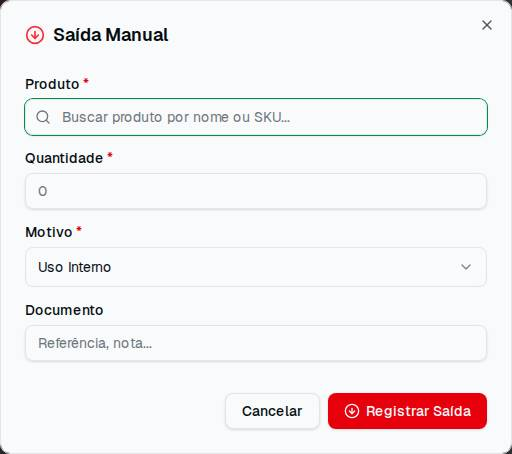

- Abre modal **Saída Manual**

| Campo | Tipo | Obrigatório | Opções |
|---|---|---|---|
| Buscar produto por nome ou SKU... | text | não indicado | — |
| Quantidade * | number | sim | — |
| Motivo * | combobox | sim | — |
| Documento | text | não indicado | — |

- Botões do modal: Uso Interno · Cancelar · Registrar Saída · Close

### Ajuste

### Posição

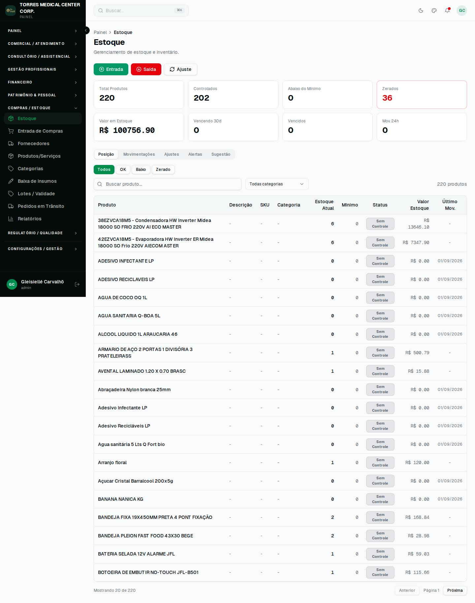

### Movimentações

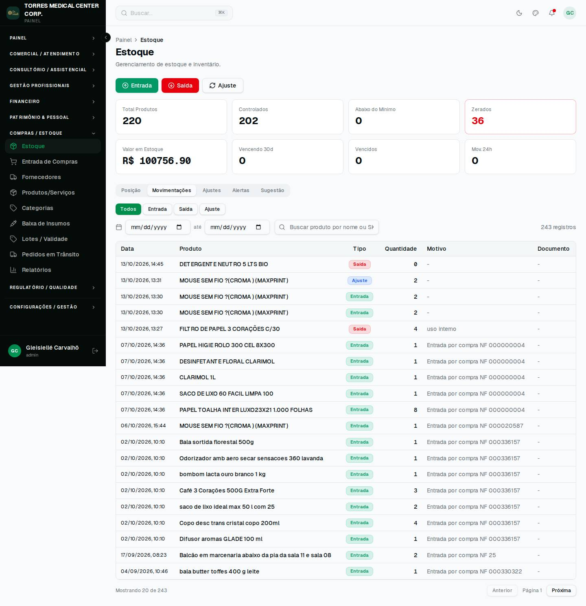

### Ajustes

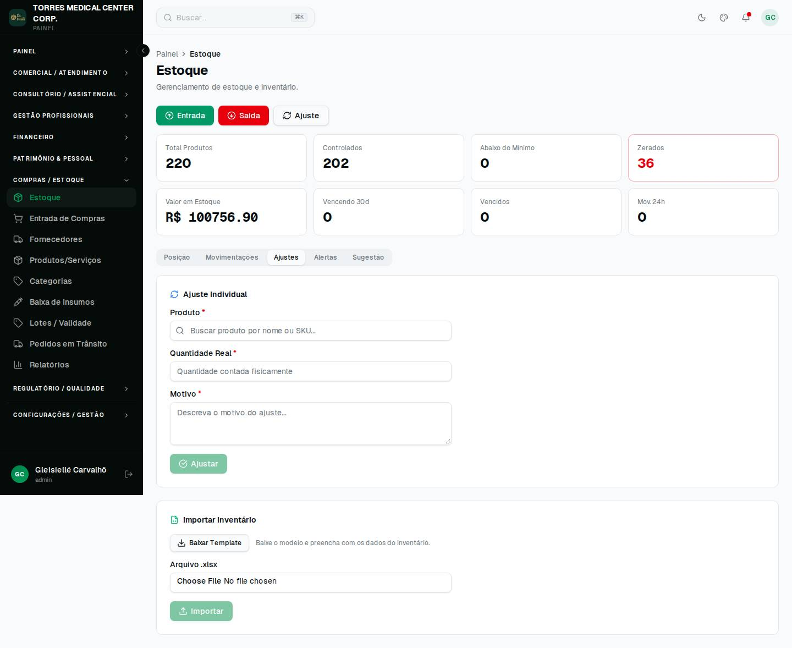

### Alertas

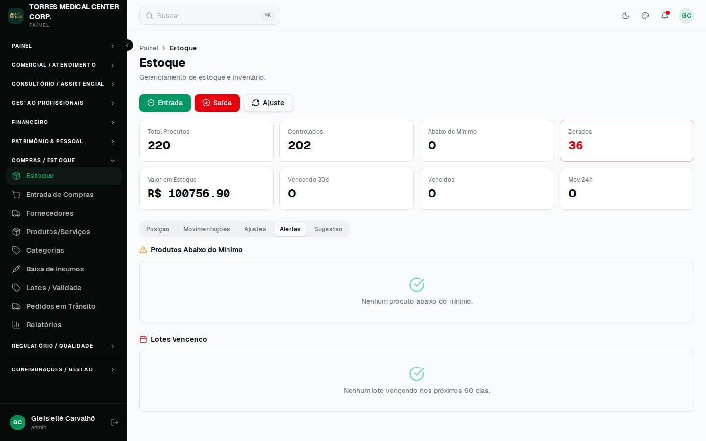

### Sugestão

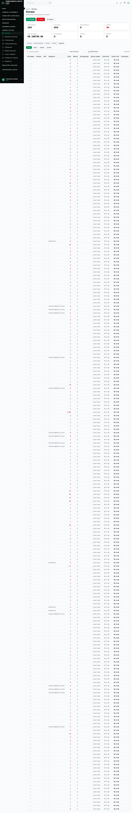

### Todos

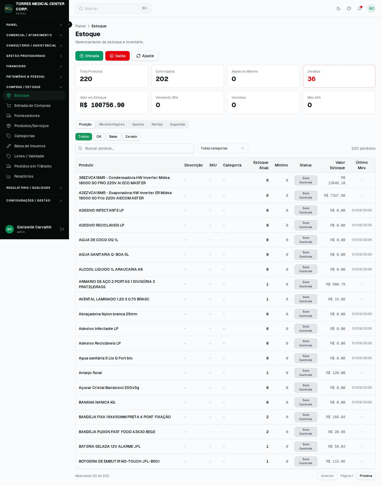

### OK

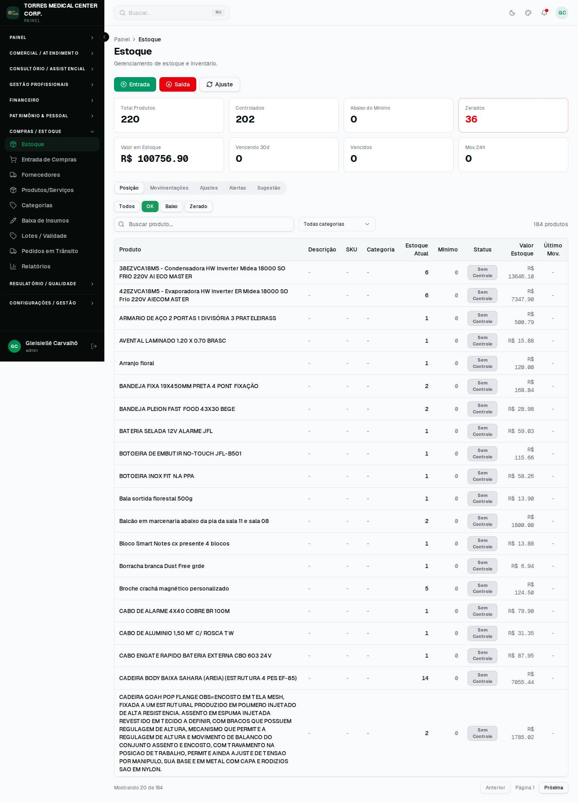

### Baixo

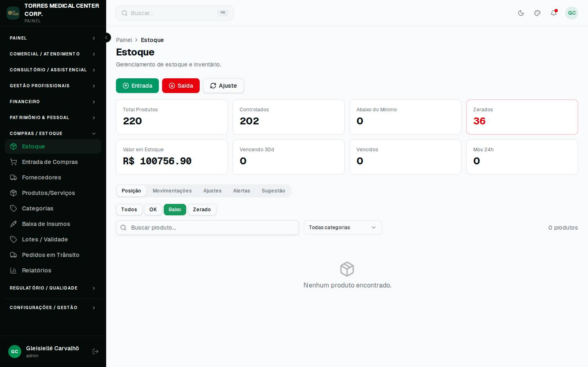

### Zerado

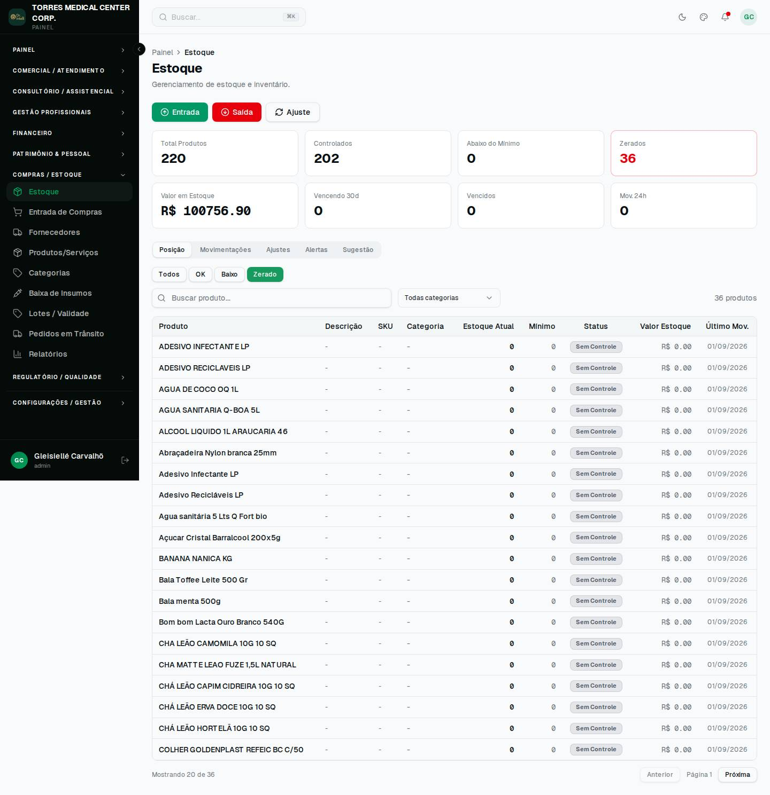

### Dropdown aberto: Todas categorias

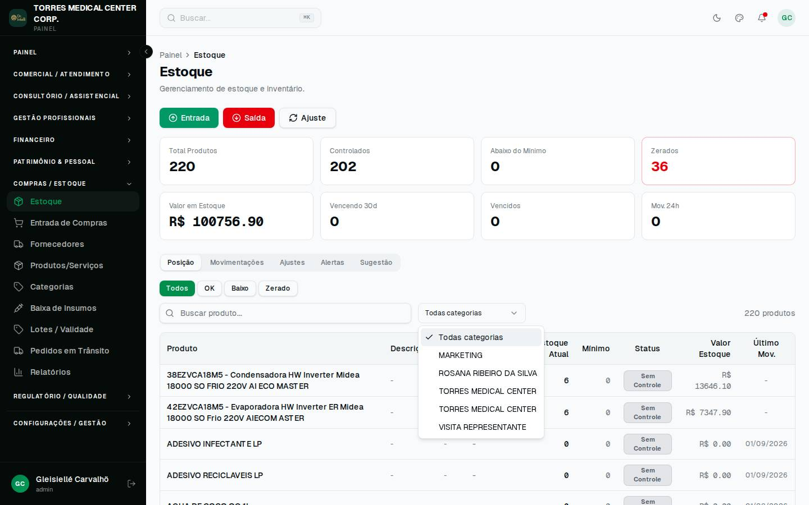

- Itens do menu/lista: Todas categorias · MARKETING · ROSANA RIBEIRO DA SILVA · TORRES MEDICAL CENTER · TORRES MEDICAL CENTER · VISITA REPRESENTANTE

### Paginação — 1 print da página 2

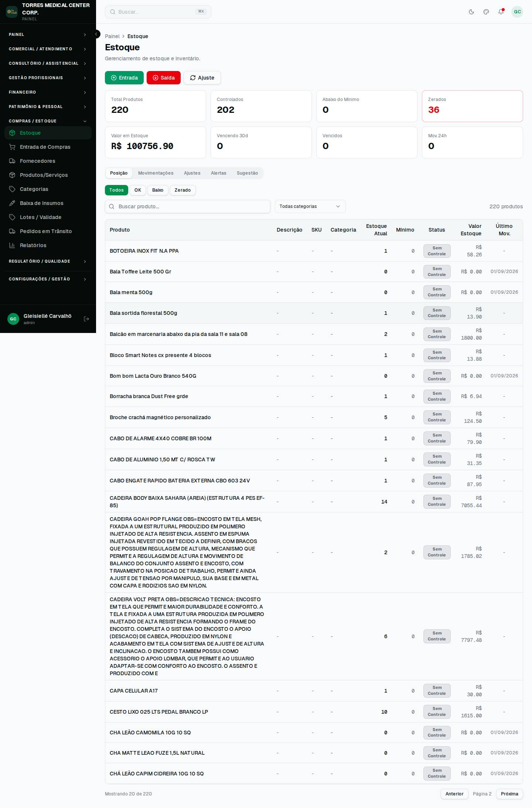

<!-- /estados -->
