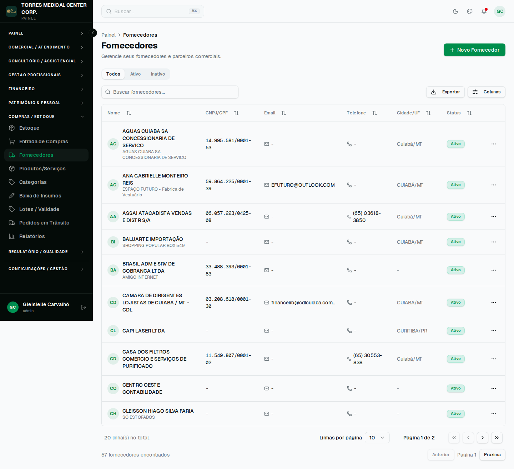
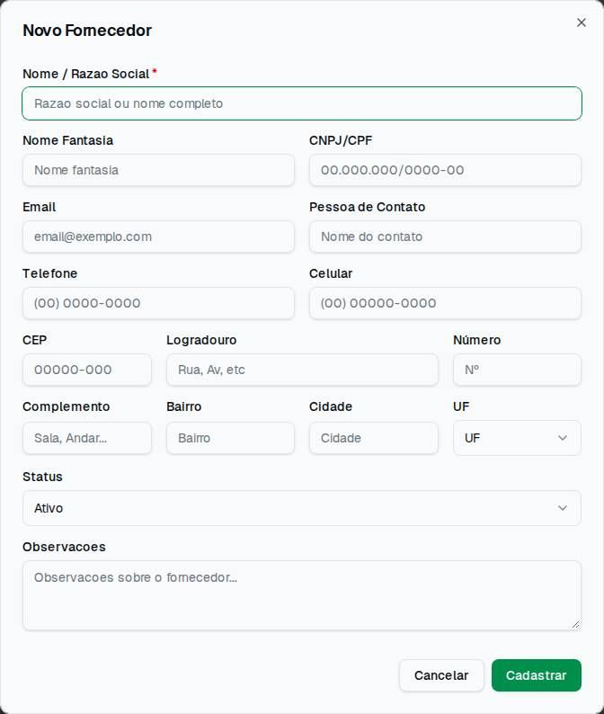
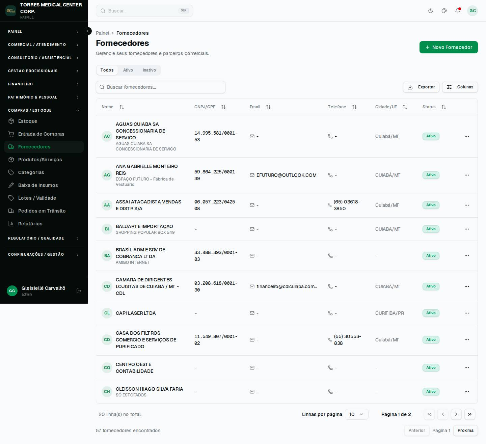
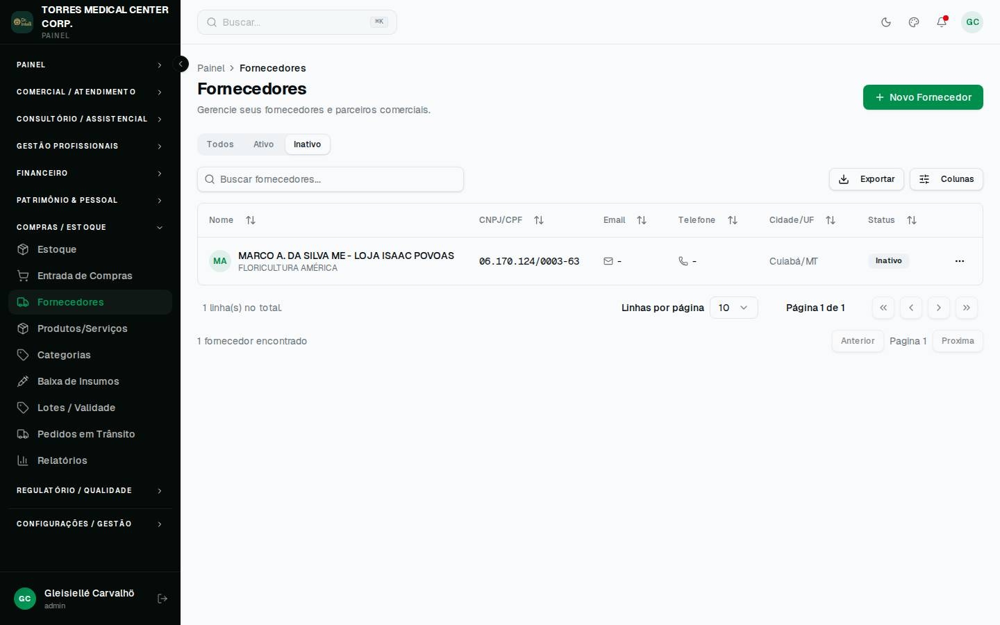
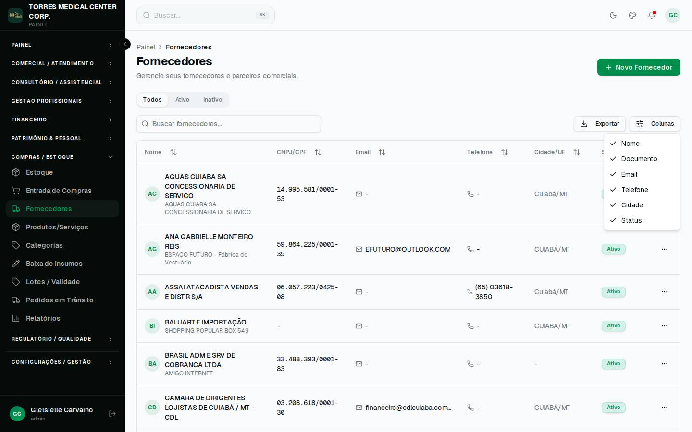
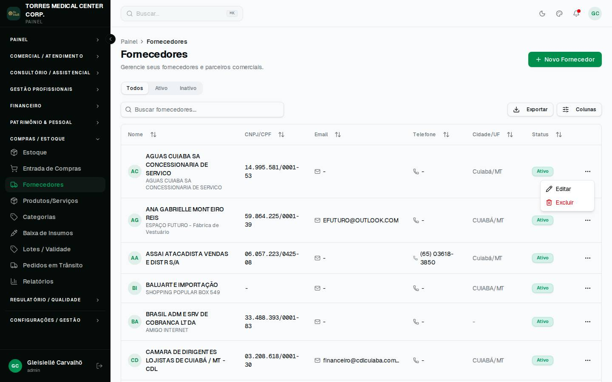
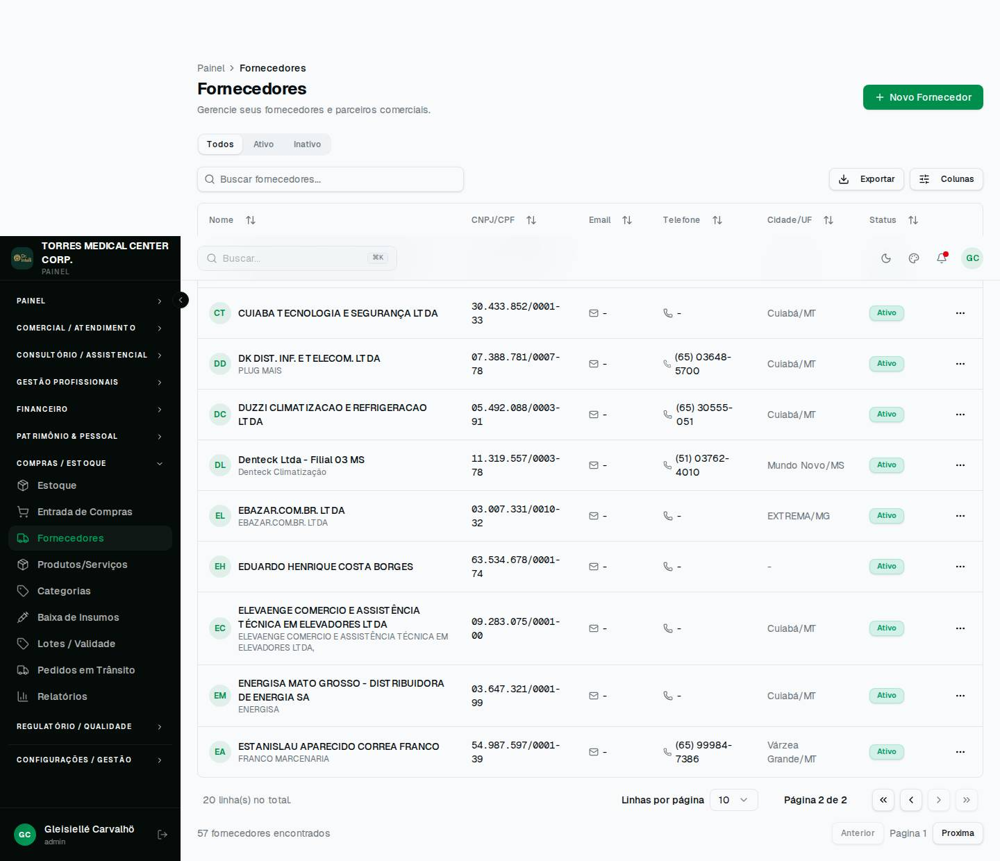

# Fornecedores

- **Módulo:** COMPRAS / ESTOQUE
- **Tela:** Fornecedores
- **URL:** `/fornecedores`
- **Título na página:** Fornecedores

## Objetivo (inferido)

Tela "Fornecedores" do módulo COMPRAS / ESTOQUE. Apresenta listagem em tabela com colunas Nome, CNPJ/CPF, Email, Telefone, Cidade/UF, Status. Possui 2 campo(s) de entrada/filtro. Texto de apoio: "Painel Fornecedores Fornecedores Gerencie seus fornecedores e parceiros comerciais. Novo Fornecedor Todos Ativo Inativo Exportar Colunas Nome CNPJ/CPF Email Telefone Cidade/UF Status AC AGUAS CUIABA S…"

## Screenshot

## Campos

| Nome | Rótulo | Tipo | Obrigatório | Valores/opções |
|---|---|---|---|---|
| — | Buscar fornecedores... | text | não indicado | — |
| — | — | combobox | não indicado | — |

## Botões e ações

- Buscar... ⌘K
- Toggle theme
- Customize theme
- Notifications
- GC
- Novo Fornecedor
- Todos
- Ativo
- Inativo
- Exportar
- Colunas
- Nome
- CNPJ/CPF
- Email
- Telefone
- Cidade/UF
- Status
- Acoes
- 10
- Ir para primeira página _(desabilitado)_
- Ir para página anterior _(desabilitado)_
- Ir para próxima página
- Ir para última página
- Anterior _(desabilitado)_
- Proxima

## Tabelas / grids

**Tabela 1** — 10 linha(s) visível(is)

- Colunas: Nome · CNPJ/CPF · Email · Telefone · Cidade/UF · Status
- Colunas possivelmente ordenáveis: Nome, CNPJ/CPF, Email, Telefone, Cidade/UF, Status

- Filtros/busca: Buscar fornecedores...
- Paginação: Página 1 de 2

## Abas

_Nenhuma aba._

## Modais

_Nenhum modal aberto na carga da tela. Modais disparados por botões não foram abertos (regra somente-leitura)._

## Links para outras telas

- Painel → `/`

## Mensagens e validações visíveis

_Nenhuma mensagem visível._

<!-- estados -->
## Estados capturados (interações de visualização)

_Capturados em 15/10/2026 clicando só em itens de visualização do checklist da issue. Nenhum formulário foi preenchido e toda gravação foi bloqueada._

### Novo Fornecedor

- Abre modal **Novo Fornecedor**

| Campo | Tipo | Obrigatório | Opções |
|---|---|---|---|
| Nome / Razao Social * | text | sim | — |
| Nome Fantasia | text | não indicado | — |
| CNPJ/CPF | text | não indicado | — |
| Email | email | não indicado | — |
| Pessoa de Contato | text | não indicado | — |
| Telefone | text | não indicado | — |
| Celular | text | não indicado | — |
| CEP | text | não indicado | — |
| Logradouro | text | não indicado | — |
| Número | text | não indicado | — |
| Complemento | text | não indicado | — |
| Bairro | text | não indicado | — |
| Cidade | text | não indicado | — |
| UF | combobox | não indicado | — |
| Status | combobox | não indicado | — |
| Observacoes | textarea | não indicado | — |

- Botões do modal: UF · Ativo · Cancelar · Cadastrar · Close

### Todos

### Ativo

### Inativo

### Colunas

- Itens do menu/lista: Nome · Documento · Email · Telefone · Cidade · Status

### Ordenação por coluna — 1 print de exemplo (colunas: Nome, CNPJ/CPF, Email, Telefone, Cidade/UF, Status)

### Menu de ações (⋯) (na linha da tabela)

- Itens do menu/lista: Editar · Excluir

### Paginação — 1 print da página 2

<!-- /estados -->
