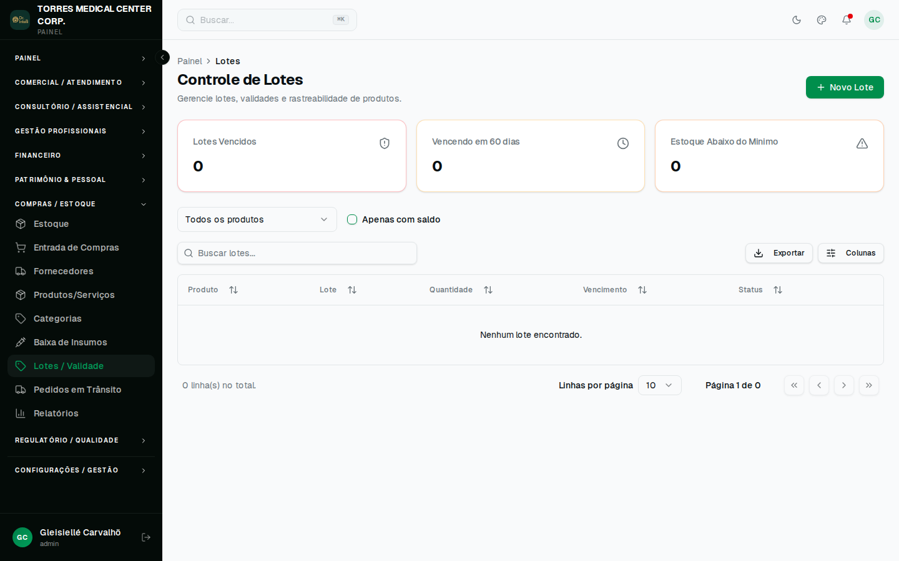
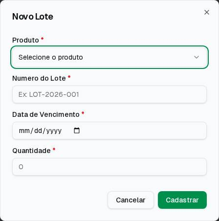
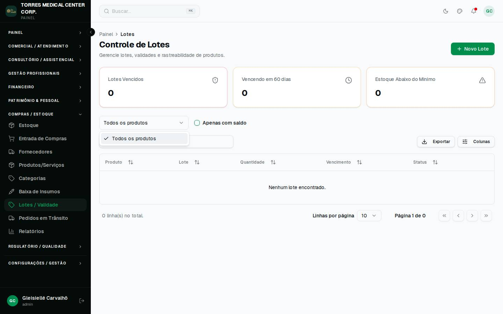
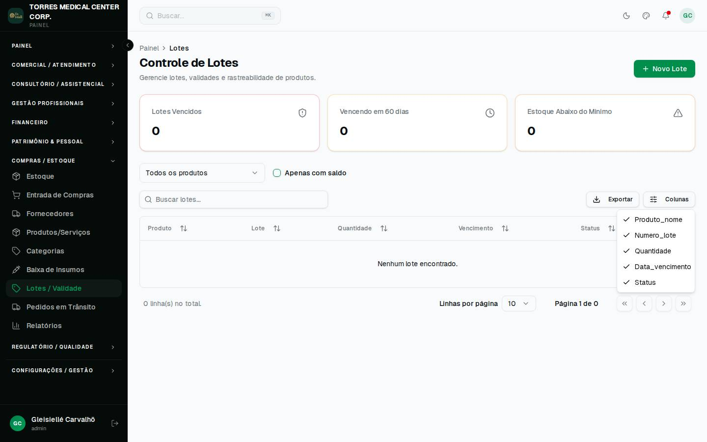
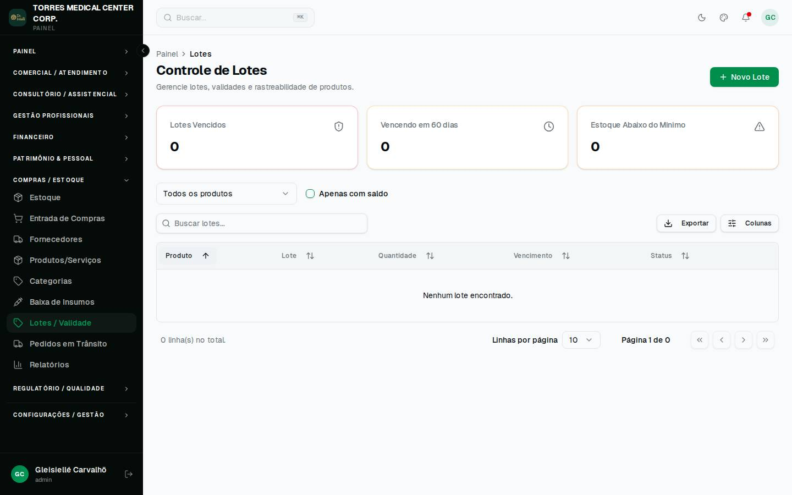

# Lotes / Validade

- **Módulo:** COMPRAS / ESTOQUE
- **Tela:** Lotes / Validade
- **URL:** `/lotes`
- **Título na página:** Controle de Lotes

## Objetivo (inferido)

Tela "Lotes / Validade" do módulo COMPRAS / ESTOQUE. Apresenta listagem em tabela com colunas Produto, Lote, Quantidade, Vencimento, Status. Possui 4 campo(s) de entrada/filtro. Texto de apoio: "Painel Lotes Controle de Lotes Gerencie lotes, validades e rastreabilidade de produtos. Novo Lote Lotes Vencidos 0 Vencendo em 60 dias 0 Estoque Abaixo do Minimo 0 Todos os produtos Apenas com saldo E…"

## Screenshot

## Campos

| Nome | Rótulo | Tipo | Obrigatório | Valores/opções |
|---|---|---|---|---|
| — | — | combobox | não indicado | — |
| apenas-saldo | Apenas com saldo | checkbox | não indicado | — |
| — | Buscar lotes... | text | não indicado | — |
| — | — | combobox | não indicado | — |

## Botões e ações

- Buscar... ⌘K
- Toggle theme
- Customize theme
- Notifications
- GC
- Novo Lote
- Todos os produtos
- on
- Exportar
- Colunas
- Produto
- Lote
- Quantidade
- Vencimento
- Status
- 10
- Ir para primeira página _(desabilitado)_
- Ir para página anterior _(desabilitado)_
- Ir para próxima página _(desabilitado)_
- Ir para última página _(desabilitado)_

## Tabelas / grids

**Tabela 1** — 1 linha(s) visível(is)

- Colunas: Produto · Lote · Quantidade · Vencimento · Status
- Colunas possivelmente ordenáveis: Produto, Lote, Quantidade, Vencimento, Status

- Filtros/busca: Buscar lotes...
- Paginação: Página 1 de 0

## Abas

_Nenhuma aba._

## Modais

_Nenhum modal aberto na carga da tela. Modais disparados por botões não foram abertos (regra somente-leitura)._

## Links para outras telas

- Painel → `/`

## Mensagens e validações visíveis

_Nenhuma mensagem visível._

<!-- estados -->
## Estados capturados (interações de visualização)

_Capturados em 15/10/2026 clicando só em itens de visualização do checklist da issue. Nenhum formulário foi preenchido e toda gravação foi bloqueada._

### Novo Lote

- Abre modal **Novo Lote**

| Campo | Tipo | Obrigatório | Opções |
|---|---|---|---|
| Produto * | combobox | sim | — |
| Numero do Lote * | text | sim | — |
| Data de Vencimento * | date | sim | — |
| Quantidade * | number | sim | — |

- Botões do modal: Selecione o produto · Cancelar · Cadastrar · Close

### Dropdown aberto: Todos os produtos

- Itens do menu/lista: Todos os produtos

### Colunas

- Itens do menu/lista: Produto_nome · Numero_lote · Quantidade · Data_vencimento · Status

### Ordenação por coluna — 1 print de exemplo (colunas: Produto, Lote, Quantidade, Vencimento, Status)

### Paginação — 1 print da página 2

- lista com uma página só (botão de próxima página desabilitado), sem print

<!-- /estados -->
