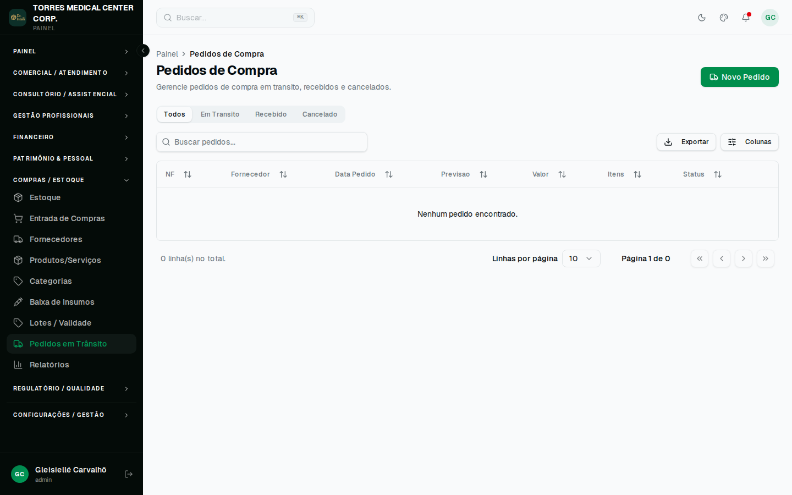

# Pedidos em Trânsito

- **Módulo:** COMPRAS / ESTOQUE
- **Tela:** Pedidos em Trânsito
- **URL:** `/pedidos-compra`
- **Título na página:** Pedidos de Compra

## Objetivo (inferido)

Tela "Pedidos em Trânsito" do módulo COMPRAS / ESTOQUE. Apresenta listagem em tabela com colunas NF, Fornecedor, Data Pedido, Previsao, Valor, Itens. Possui 2 campo(s) de entrada/filtro. Texto de apoio: "Painel Pedidos de Compra Pedidos de Compra Gerencie pedidos de compra em transito, recebidos e cancelados. Novo Pedido Todos Em Transito Recebido Cancelado Exportar Colunas NF Fornecedor Data Pedido P…"

## Screenshot

## Campos

| Nome | Rótulo | Tipo | Obrigatório | Valores/opções |
|---|---|---|---|---|
| — | Buscar pedidos... | text | não indicado | — |
| — | — | combobox | não indicado | — |

## Botões e ações

- Buscar... ⌘K
- Toggle theme
- Customize theme
- Notifications
- GC
- Novo Pedido
- Todos
- Em Transito
- Recebido
- Cancelado
- Exportar
- Colunas
- NF
- Fornecedor
- Data Pedido
- Previsao
- Valor
- Itens
- Status
- 10
- Ir para primeira página _(desabilitado)_
- Ir para página anterior _(desabilitado)_
- Ir para próxima página _(desabilitado)_
- Ir para última página _(desabilitado)_

## Tabelas / grids

**Tabela 1** — 1 linha(s) visível(is)

- Colunas: NF · Fornecedor · Data Pedido · Previsao · Valor · Itens · Status
- Colunas possivelmente ordenáveis: NF, Fornecedor, Data Pedido, Previsao, Valor, Itens, Status

- Filtros/busca: Buscar pedidos...
- Paginação: Página 1 de 0

## Abas

_Nenhuma aba._

## Modais

_Nenhum modal aberto na carga da tela. Modais disparados por botões não foram abertos (regra somente-leitura)._

## Links para outras telas

- Painel → `/`

## Mensagens e validações visíveis

_Nenhuma mensagem visível._
