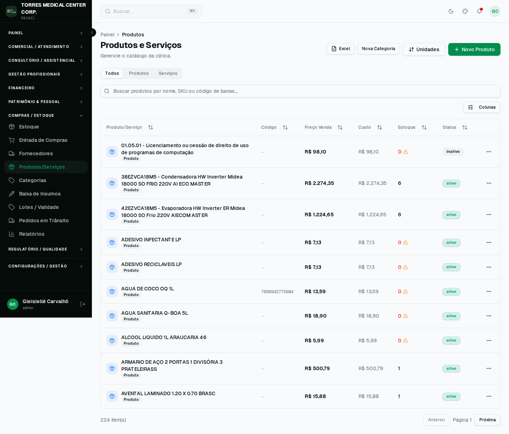
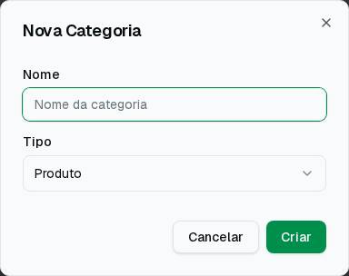
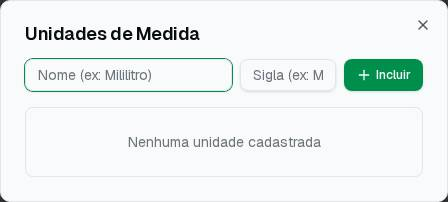
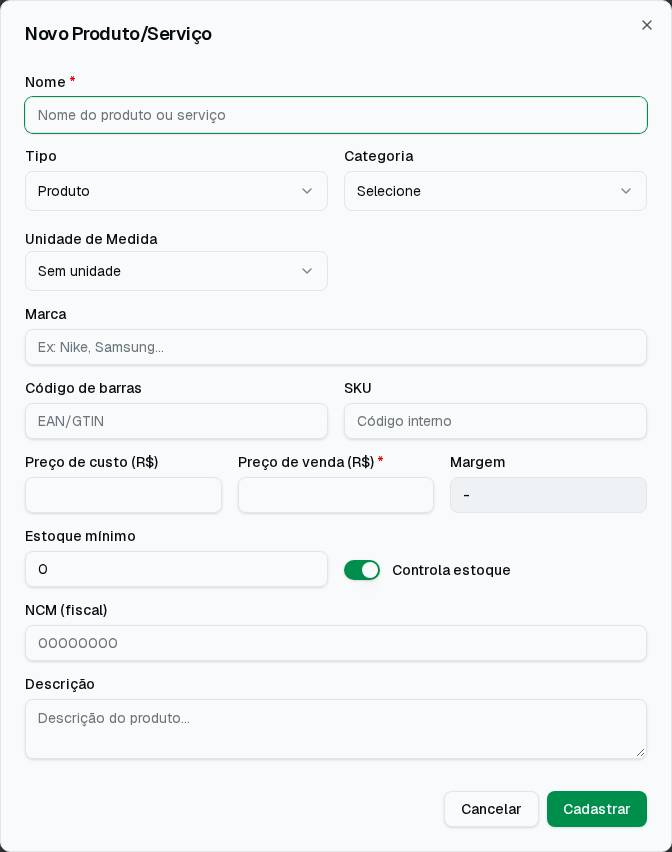
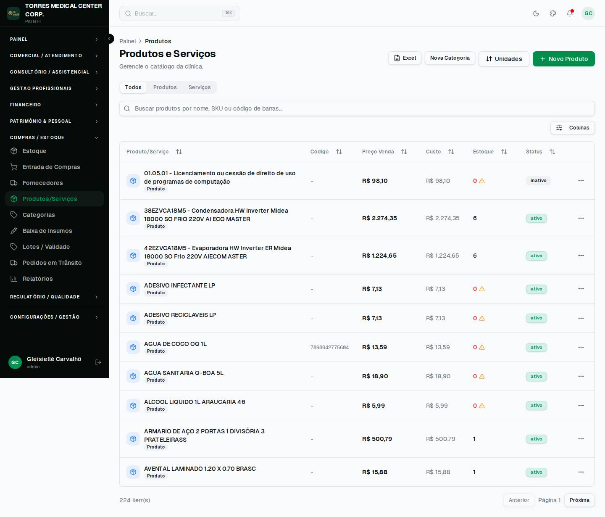
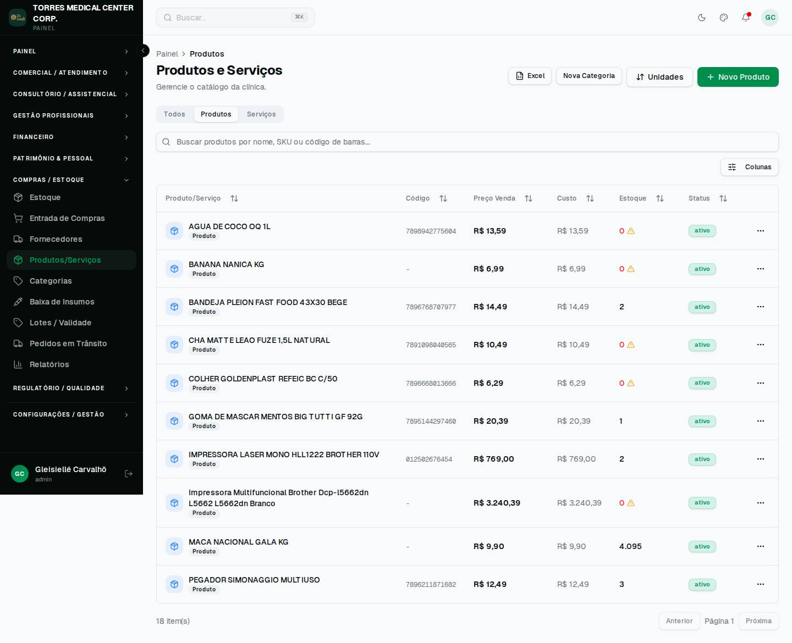
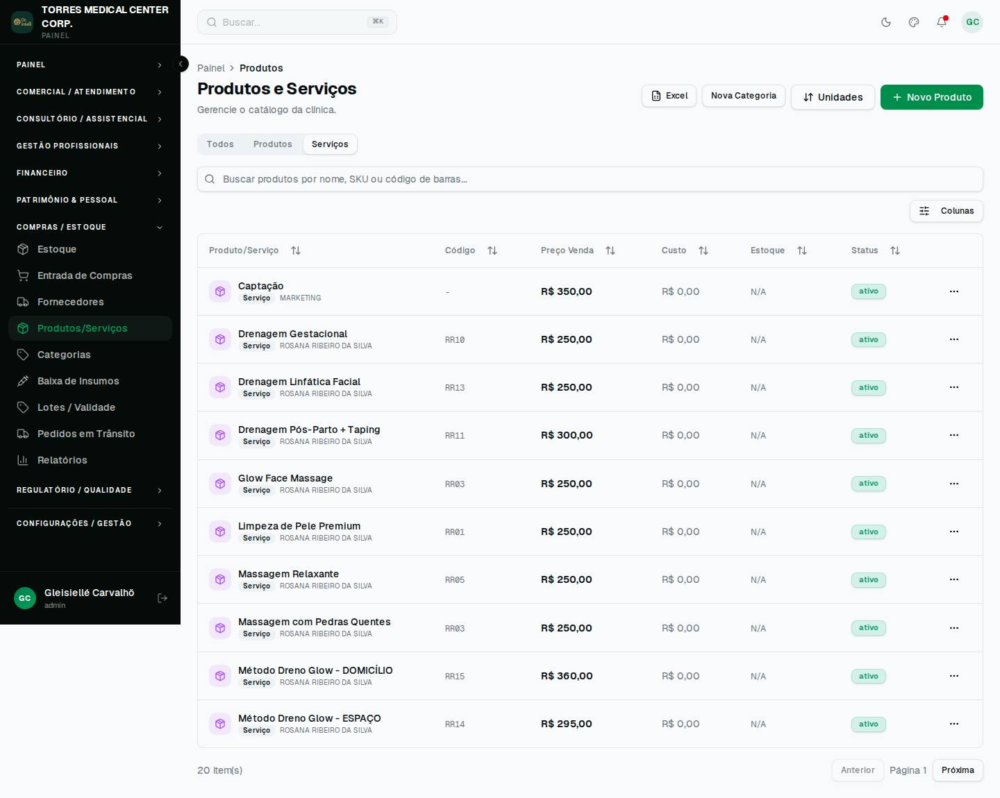
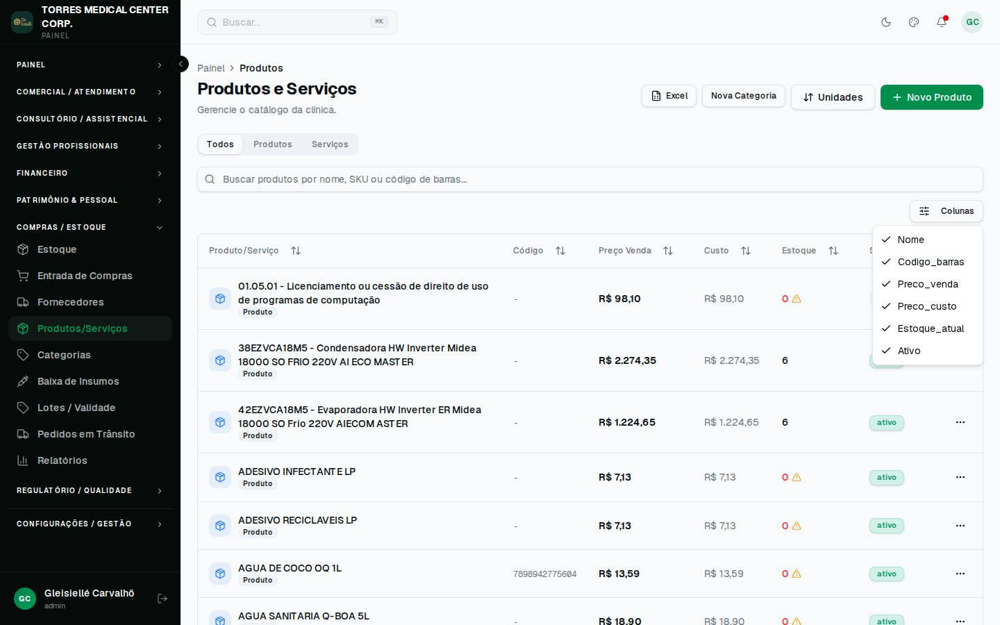
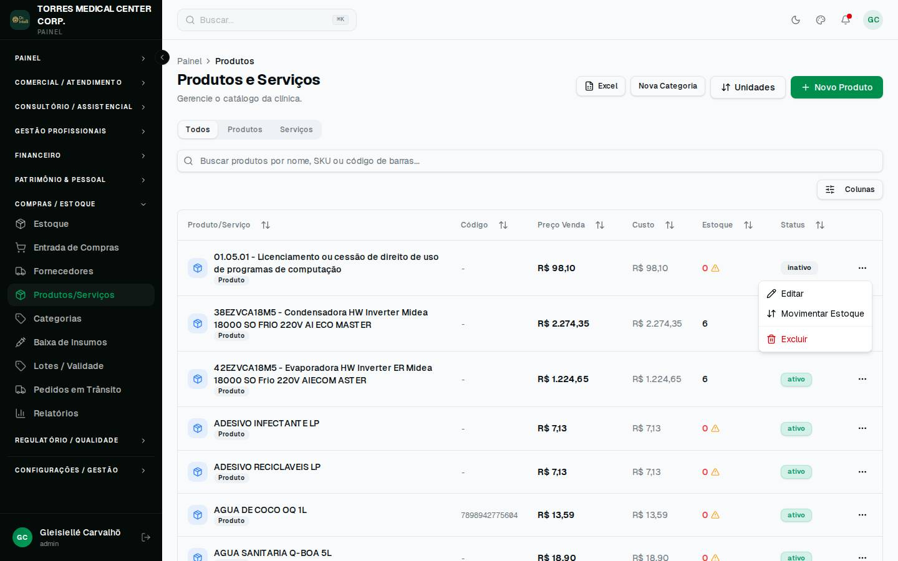
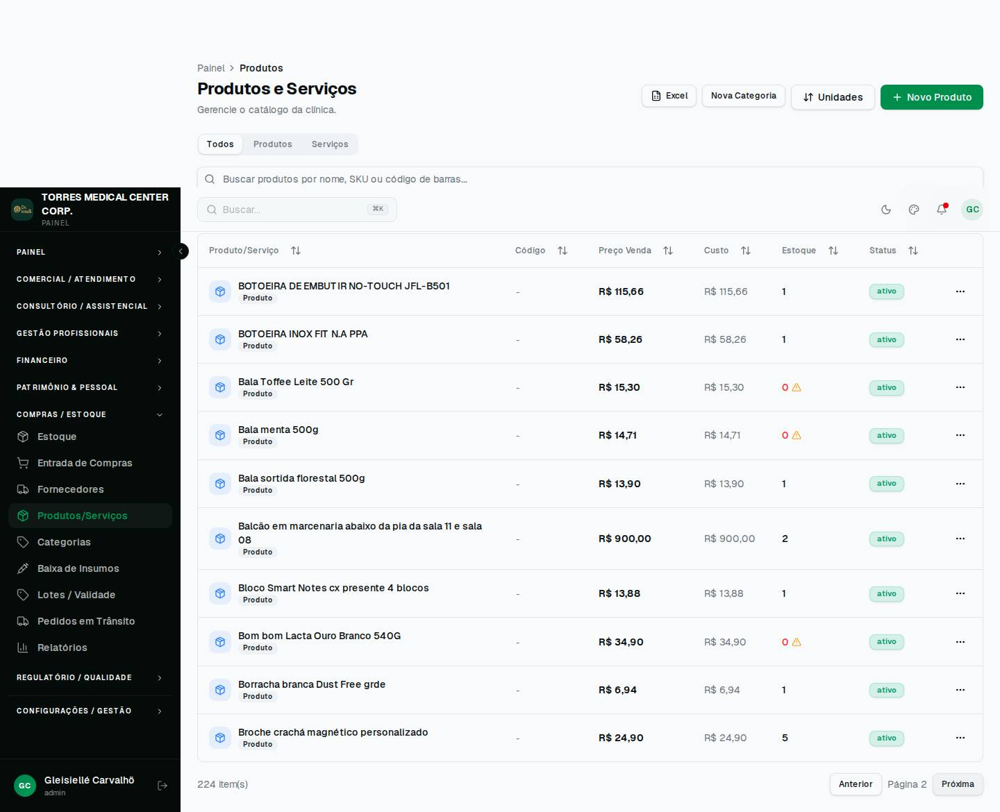

# Produtos/Serviços

- **Módulo:** COMPRAS / ESTOQUE
- **Tela:** Produtos/Serviços
- **URL:** `/produtos`
- **Título na página:** Produtos e Serviços

## Objetivo (inferido)

Tela "Produtos/Serviços" do módulo COMPRAS / ESTOQUE. Apresenta listagem em tabela com colunas Produto/Serviço, Código, Preço Venda, Custo, Estoque, Status. Possui 1 campo(s) de entrada/filtro. Texto de apoio: "Painel Produtos Produtos e Serviços Gerencie o catálogo da clínica. Excel Nova Categoria Unidades Novo Produto Todos Produtos Serviços Colunas Produto/Serviço Código Preço Venda Custo Estoque Status 0…"

## Screenshot

## Campos

| Nome | Rótulo | Tipo | Obrigatório | Valores/opções |
|---|---|---|---|---|
| — | Buscar produtos por nome, SKU ou código de barras... | text | não indicado | — |

## Botões e ações

- Buscar... ⌘K
- Toggle theme
- Customize theme
- Notifications
- GC
- Excel
- Nova Categoria
- Unidades
- Novo Produto
- Todos
- Produtos
- Serviços
- Colunas
- Produto/Serviço
- Código
- Preço Venda
- Custo
- Estoque
- Status
- (ícone sem rótulo)
- Anterior _(desabilitado)_
- Próxima

## Tabelas / grids

**Tabela 1** — 10 linha(s) visível(is)

- Colunas: Produto/Serviço · Código · Preço Venda · Custo · Estoque · Status
- Colunas possivelmente ordenáveis: Produto/Serviço, Código, Preço Venda, Custo, Estoque, Status

- Filtros/busca: Buscar produtos por nome, SKU ou código de barras...
- Paginação: não identificada

## Abas

_Nenhuma aba._

## Modais

_Nenhum modal aberto na carga da tela. Modais disparados por botões não foram abertos (regra somente-leitura)._

## Links para outras telas

- Painel → `/`

## Mensagens e validações visíveis

_Nenhuma mensagem visível._

<!-- estados -->
## Estados capturados (interações de visualização)

_Capturados em 15/10/2026 clicando só em itens de visualização do checklist da issue. Nenhum formulário foi preenchido e toda gravação foi bloqueada._

### Nova Categoria

- Abre modal **Nova Categoria**

| Campo | Tipo | Obrigatório | Opções |
|---|---|---|---|
| Nome | text | não indicado | — |
| Tipo | combobox | não indicado | — |

- Botões do modal: Produto · Cancelar · Criar · Close

### Ordenação por coluna — 1 print de exemplo (colunas: Unidades, Produto/Serviço, Código, Preço Venda, Custo, Estoque, Status)

- Abre modal **Unidades de Medida**

| Campo | Tipo | Obrigatório | Opções |
|---|---|---|---|
| Nome (ex: Mililitro) | text | não indicado | — |
| Sigla (ex: ML) | text | não indicado | — |

- Botões do modal: Incluir · Close

### Novo Produto

- Abre modal **Novo Produto/Serviço**

| Campo | Tipo | Obrigatório | Opções |
|---|---|---|---|
| Nome * | text | sim | — |
| Tipo | combobox | não indicado | — |
| Categoria | combobox | não indicado | — |
| Unidade de Medida | combobox | não indicado | — |
| Marca | text | não indicado | — |
| Código de barras | text | não indicado | — |
| SKU | text | não indicado | — |
| Preço de custo (R$) | number | não indicado | — |
| Preço de venda (R$) * | number | sim | — |
| Estoque mínimo | number | não indicado | — |
| Controla estoque | switch | não indicado | — |
| NCM (fiscal) | text | não indicado | — |
| Descrição | textarea | não indicado | — |

- Botões do modal: Produto · Selecione · Sem unidade · Cancelar · Cadastrar · Close

### Todos

### Produtos

### Serviços

### Colunas

- Itens do menu/lista: Nome · Codigo_barras · Preco_venda · Preco_custo · Estoque_atual · Ativo

### Menu de ações (⋯) (na linha da tabela)

- Itens do menu/lista: Editar · Movimentar Estoque · Excluir

### Paginação — 1 print da página 2

<!-- /estados -->
