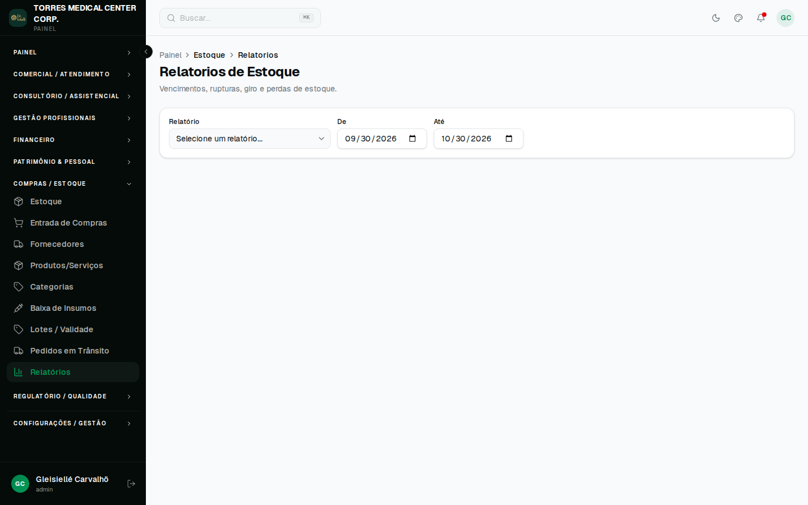

# Relatórios

- **Módulo:** COMPRAS / ESTOQUE
- **Tela:** Relatórios
- **URL:** `/estoque/relatorios`
- **Título na página:** Relatorios de Estoque

## Objetivo (inferido)

Tela "Relatórios" do módulo COMPRAS / ESTOQUE. Possui 3 campo(s) de entrada/filtro. Texto de apoio: "Painel Estoque Relatorios Relatorios de Estoque Vencimentos, rupturas, giro e perdas de estoque. Relatório Selecione um relatório... EST-01 — Vencimento proximo (60 dias) EST-02 — Ruptura vs Agenda ES…"

## Screenshot

## Campos

| Nome | Rótulo | Tipo | Obrigatório | Valores/opções |
|---|---|---|---|---|
| — | — | select | não indicado | Selecione um relatório..., EST-01 — Vencimento proximo (60 dias), EST-02 — Ruptura vs Agenda, EST-03 — Giro de Estoque por Protocolo, EST-04 — Perda por Validade, EST-05 — Posição de Estoque, EST-06 — Estoque Abaixo do Mínimo, EST-07 — Movimentação de Estoque, EST-08 — Compras por Fornecedor, EST-09 — Compras por Produto, EST-10 — Curva ABC de Produtos, EST-11 — Produtos sem Movimentação, EST-12 — Evolução de Compras |
| — | De | date | não indicado | — |
| — | Até | date | não indicado | — |

## Botões e ações

- Buscar... ⌘K
- Toggle theme
- Customize theme
- Notifications
- GC

## Tabelas / grids

_Nenhuma tabela encontrada._

- Filtros/busca: não identificado
- Paginação: não identificada

## Abas

_Nenhuma aba._

## Modais

_Nenhum modal aberto na carga da tela. Modais disparados por botões não foram abertos (regra somente-leitura)._

## Links para outras telas

- Painel → `/`

## Mensagens e validações visíveis

_Nenhuma mensagem visível._

<!-- estados -->
## Estados capturados (interações de visualização)

_Capturados em 15/10/2026 clicando só em itens de visualização do checklist da issue. Nenhum formulário foi preenchido e toda gravação foi bloqueada._

### Dropdown aberto: Selecione um relatório... EST-01 — Vencimento proximo (60 dias) EST-02 — Ruptura

- select nativo: opções listadas, sem print
- Opções: Selecione um relatório..., EST-01 — Vencimento proximo (60 dias), EST-02 — Ruptura vs Agenda, EST-03 — Giro de Estoque por Protocolo, EST-04 — Perda por Validade, EST-05 — Posição de Estoque, EST-06 — Estoque Abaixo do Mínimo, EST-07 — Movimentação de Estoque, EST-08 — Compras por Fornecedor, EST-09 — Compras por Produto, EST-10 — Curva ABC de Produtos, EST-11 — Produtos sem Movimentação, EST-12 — Evolução de Compras

<!-- /estados -->
