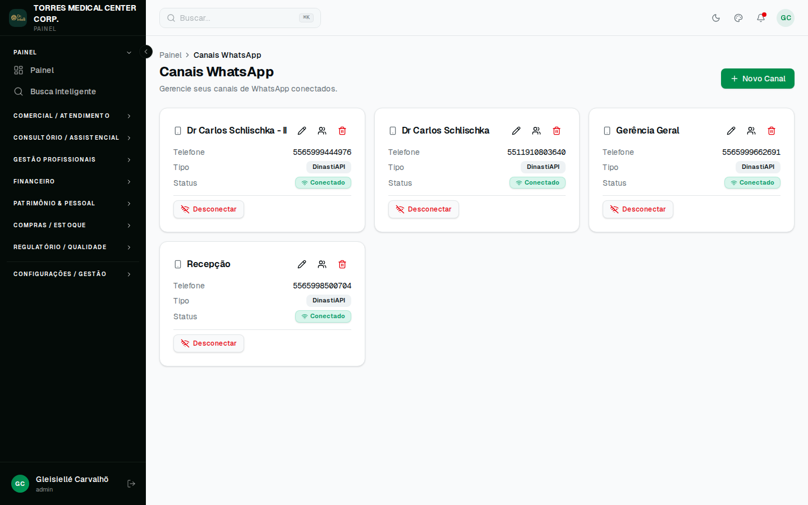
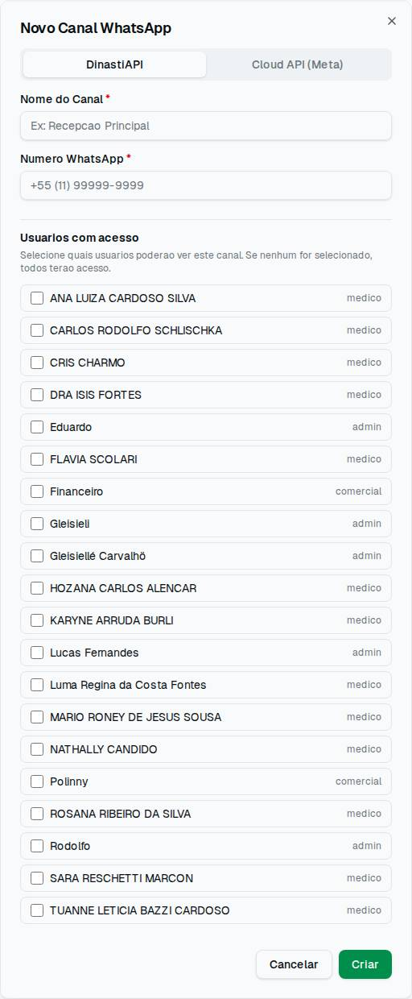
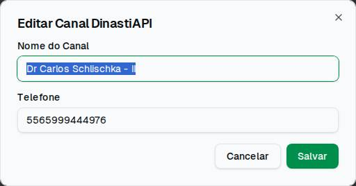
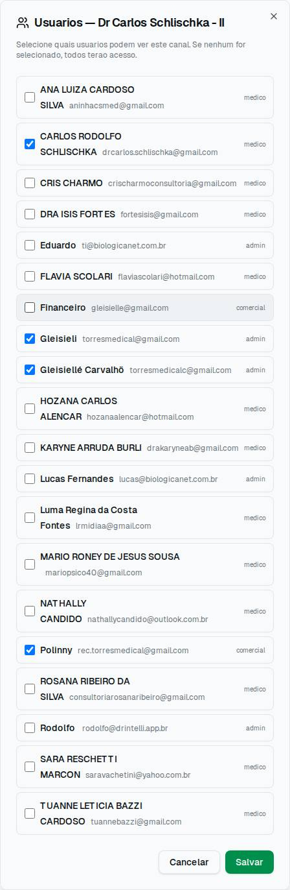

# Agentes IA

- **Módulo:** CONFIGURAÇÕES / GESTÃO
- **Tela:** Agentes IA
- **URL:** `/agentes-ia`
- **Título na página:** Canais WhatsApp

## Objetivo (inferido)

Tela "Agentes IA" do módulo CONFIGURAÇÕES / GESTÃO. Texto de apoio: "Painel Canais WhatsApp Canais WhatsApp Gerencie seus canais de WhatsApp conectados. Novo Canal Dr Carlos Schlischka - II Telefone 5565999444976 Tipo DinastiAPI Status Conectado Desconectar Dr Carlos S…"

## Screenshot

## Campos

_Nenhum campo de formulário/filtro visível._

## Botões e ações

- Buscar... ⌘K
- Toggle theme
- Customize theme
- Notifications
- GC
- Novo Canal
- Ver / Editar canal
- Gerenciar usuarios
- (ícone sem rótulo)
- Desconectar

## Tabelas / grids

_Nenhuma tabela encontrada._

- Filtros/busca: não identificado
- Paginação: não identificada

## Abas

_Nenhuma aba._

## Modais

_Nenhum modal aberto na carga da tela. Modais disparados por botões não foram abertos (regra somente-leitura)._

## Links para outras telas

- Painel → `/`

## Mensagens e validações visíveis

_Nenhuma mensagem visível._

<!-- estados -->
## Estados capturados (interações de visualização)

_Capturados em 15/10/2026 clicando só em itens de visualização do checklist da issue. Nenhum formulário foi preenchido e toda gravação foi bloqueada._

### Novo Canal

- Abre modal **Novo Canal WhatsApp**
- Abas do modal: DinastiAPI · Cloud API (Meta)

| Campo | Tipo | Obrigatório | Opções |
|---|---|---|---|
| Nome do Canal * | text | sim | — |
| Numero WhatsApp * | text | sim | — |
| ANA LUIZA CARDOSO SILVA medico | checkbox | não indicado | — |
| ANA LUIZA CARDOSO SILVA medico | checkbox | não indicado | — |
| ANA LUIZA CARDOSO SILVA medico | checkbox | não indicado | — |
| ANA LUIZA CARDOSO SILVA medico | checkbox | não indicado | — |
| ANA LUIZA CARDOSO SILVA medico | checkbox | não indicado | — |
| ANA LUIZA CARDOSO SILVA medico | checkbox | não indicado | — |
| ANA LUIZA CARDOSO SILVA medico | checkbox | não indicado | — |
| ANA LUIZA CARDOSO SILVA medico | checkbox | não indicado | — |
| ANA LUIZA CARDOSO SILVA medico | checkbox | não indicado | — |
| ANA LUIZA CARDOSO SILVA medico | checkbox | não indicado | — |
| ANA LUIZA CARDOSO SILVA medico | checkbox | não indicado | — |
| ANA LUIZA CARDOSO SILVA medico | checkbox | não indicado | — |
| ANA LUIZA CARDOSO SILVA medico | checkbox | não indicado | — |
| ANA LUIZA CARDOSO SILVA medico | checkbox | não indicado | — |
| ANA LUIZA CARDOSO SILVA medico | checkbox | não indicado | — |
| ANA LUIZA CARDOSO SILVA medico | checkbox | não indicado | — |
| ANA LUIZA CARDOSO SILVA medico | checkbox | não indicado | — |
| ANA LUIZA CARDOSO SILVA medico | checkbox | não indicado | — |
| ANA LUIZA CARDOSO SILVA medico | checkbox | não indicado | — |
| ANA LUIZA CARDOSO SILVA medico | checkbox | não indicado | — |

- Botões do modal: DinastiAPI · Cloud API (Meta) · Cancelar · Criar · Close

### Ver / Editar canal

- Abre modal **Editar Canal DinastiAPI**

| Campo | Tipo | Obrigatório | Opções |
|---|---|---|---|
| Nome do Canal | text | não indicado | — |
| Telefone | text | não indicado | — |

- Botões do modal: Cancelar · Salvar · Close

### Gerenciar usuarios

- Abre modal **Usuarios — Dr Carlos Schlischka - II**

| Campo | Tipo | Obrigatório | Opções |
|---|---|---|---|
| ANA LUIZA CARDOSO SILVAaninhacsmed@gmail.com medico | checkbox | não indicado | — |
| ANA LUIZA CARDOSO SILVAaninhacsmed@gmail.com medico | checkbox | não indicado | — |
| ANA LUIZA CARDOSO SILVAaninhacsmed@gmail.com medico | checkbox | não indicado | — |
| ANA LUIZA CARDOSO SILVAaninhacsmed@gmail.com medico | checkbox | não indicado | — |
| ANA LUIZA CARDOSO SILVAaninhacsmed@gmail.com medico | checkbox | não indicado | — |
| ANA LUIZA CARDOSO SILVAaninhacsmed@gmail.com medico | checkbox | não indicado | — |
| ANA LUIZA CARDOSO SILVAaninhacsmed@gmail.com medico | checkbox | não indicado | — |
| ANA LUIZA CARDOSO SILVAaninhacsmed@gmail.com medico | checkbox | não indicado | — |
| ANA LUIZA CARDOSO SILVAaninhacsmed@gmail.com medico | checkbox | não indicado | — |
| ANA LUIZA CARDOSO SILVAaninhacsmed@gmail.com medico | checkbox | não indicado | — |
| ANA LUIZA CARDOSO SILVAaninhacsmed@gmail.com medico | checkbox | não indicado | — |
| ANA LUIZA CARDOSO SILVAaninhacsmed@gmail.com medico | checkbox | não indicado | — |
| ANA LUIZA CARDOSO SILVAaninhacsmed@gmail.com medico | checkbox | não indicado | — |
| ANA LUIZA CARDOSO SILVAaninhacsmed@gmail.com medico | checkbox | não indicado | — |
| ANA LUIZA CARDOSO SILVAaninhacsmed@gmail.com medico | checkbox | não indicado | — |
| ANA LUIZA CARDOSO SILVAaninhacsmed@gmail.com medico | checkbox | não indicado | — |
| ANA LUIZA CARDOSO SILVAaninhacsmed@gmail.com medico | checkbox | não indicado | — |
| ANA LUIZA CARDOSO SILVAaninhacsmed@gmail.com medico | checkbox | não indicado | — |
| ANA LUIZA CARDOSO SILVAaninhacsmed@gmail.com medico | checkbox | não indicado | — |
| ANA LUIZA CARDOSO SILVAaninhacsmed@gmail.com medico | checkbox | não indicado | — |

- Botões do modal: Cancelar · Salvar · Close

<!-- /estados -->
