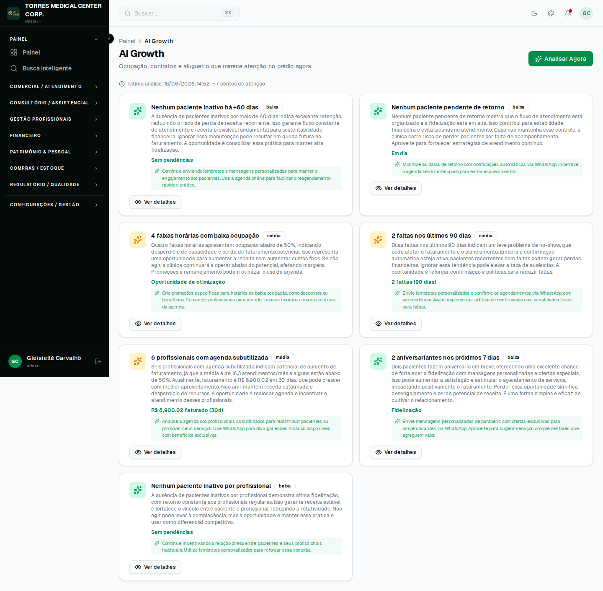

# AI Growth

- **Módulo:** CONFIGURAÇÕES / GESTÃO
- **Tela:** AI Growth
- **URL:** `/ai-growth`
- **Título na página:** AI Growth

## Objetivo (inferido)

Tela "AI Growth" do módulo CONFIGURAÇÕES / GESTÃO. Texto de apoio: "Painel AI Growth AI Growth Ocupação, contratos e aluguel: o que merece atenção no prédio agora. Analisar Agora Última análise: 18/06/2026, 14:52 • 7 pontos de atenção Nenhum paciente inativo há +60 di…"

## Screenshot

## Campos

_Nenhum campo de formulário/filtro visível._

## Botões e ações

- Buscar... ⌘K
- Toggle theme
- Customize theme
- Notifications
- GC
- Analisar Agora
- Ver detalhes

## Tabelas / grids

_Nenhuma tabela encontrada._

- Filtros/busca: não identificado
- Paginação: não identificada

## Abas

_Nenhuma aba._

## Modais

_Nenhum modal aberto na carga da tela. Modais disparados por botões não foram abertos (regra somente-leitura)._

## Links para outras telas

- Painel → `/`

## Mensagens e validações visíveis

_Nenhuma mensagem visível._
