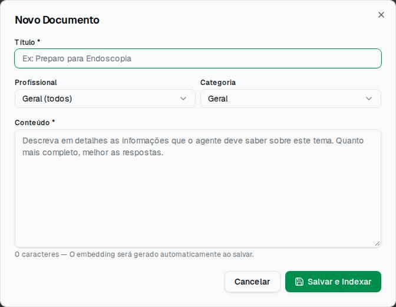
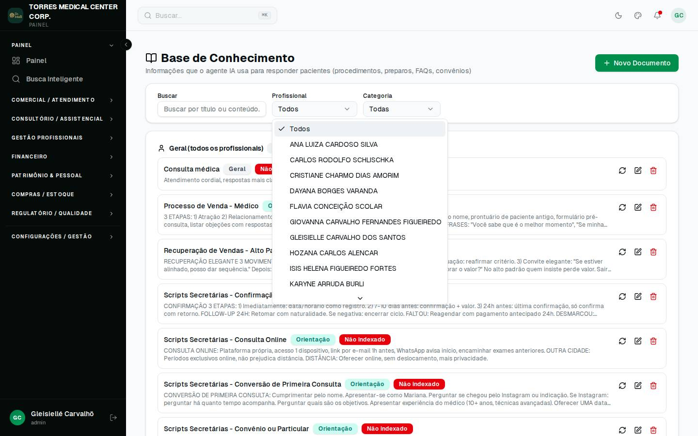
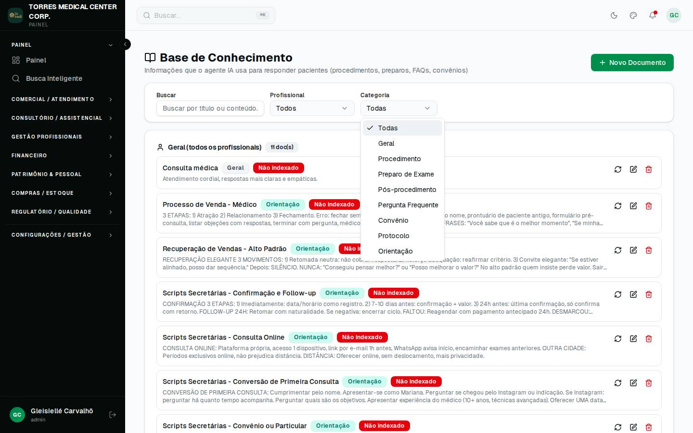
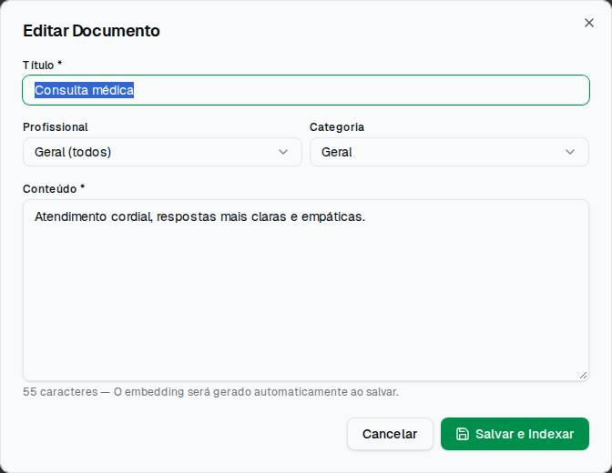

# Base de Conhecimento

- **Módulo:** CONFIGURAÇÕES / GESTÃO
- **Tela:** Base de Conhecimento
- **URL:** `/base-conhecimento`
- **Título na página:** Base de Conhecimento

## Objetivo (inferido)

Tela "Base de Conhecimento" do módulo CONFIGURAÇÕES / GESTÃO. Possui 3 campo(s) de entrada/filtro. Texto de apoio: "Base de Conhecimento Informações que o agente IA usa para responder pacientes (procedimentos, preparos, FAQs, convênios) Novo Documento Buscar Profissional Todos Categoria Todas Geral (todos os profis…"

## Screenshot

## Campos

| Nome | Rótulo | Tipo | Obrigatório | Valores/opções |
|---|---|---|---|---|
| — | Buscar | text | não indicado | — |
| — | Profissional | combobox | não indicado | — |
| — | Categoria | combobox | não indicado | — |

## Botões e ações

- Buscar... ⌘K
- Toggle theme
- Customize theme
- Notifications
- GC
- Novo Documento
- Todos
- Todas
- Indexar
- (ícone sem rótulo)

## Tabelas / grids

_Nenhuma tabela encontrada._

- Filtros/busca: não identificado
- Paginação: não identificada

## Abas

_Nenhuma aba._

## Modais

_Nenhum modal aberto na carga da tela. Modais disparados por botões não foram abertos (regra somente-leitura)._

## Links para outras telas

_Nenhum link na área principal._

## Mensagens e validações visíveis

_Nenhuma mensagem visível._

<!-- estados -->
## Estados capturados (interações de visualização)

_Capturados em 15/10/2026 clicando só em itens de visualização do checklist da issue. Nenhum formulário foi preenchido e toda gravação foi bloqueada._

### Novo Documento

- Abre modal **Novo Documento**

| Campo | Tipo | Obrigatório | Opções |
|---|---|---|---|
| Título * | text | sim | — |
| Profissional | combobox | não indicado | — |
| Categoria | combobox | não indicado | — |
| Conteúdo * | textarea | sim | — |

- Botões do modal: Geral (todos) · Geral · Cancelar · Salvar e Indexar · Close

### Dropdown aberto: Todos

- Itens do menu/lista: Todos · ANA LUIZA CARDOSO SILVA · CARLOS RODOLFO SCHLISCHKA · CRISTIANE CHARMO DIAS AMORIM · DAYANA BORGES VARANDA · FLAVIA CONCEIÇÃO SCOLAR · GIOVANNA CARVALHO FERNANDES FIGUEIREDO · GLEISIELLE CARVALHO DOS SANTOS · HOZANA CARLOS ALENCAR · ISIS HELENA FIGUEIREDO FORTES · KARYNE ARRUDA BURLI · LUMA REGINA DA COSTA FONTES · MARCOS VINICIUS VILELA MANCILHA · MARIO RONEY DE JESUS SOUSA · NATHALLY CANDIDO · PABLO GONÇALVES DA SILVA · ROSANA RIBEIRO DA SILVA · SARA RESCHETTI MARCON · SILVIA CRISTINA DE ALMEIDA · TUANNE LETICIA BAZZI CARDOSO · VITA GESTÃO DE SERVIÇOS DE SAÚDE LTDA

### Dropdown aberto: Todas

- Itens do menu/lista: Todas · Geral · Procedimento · Preparo de Exame · Pós-procedimento · Pergunta Frequente · Convênio · Protocolo · Orientação

### Editar (ícone lápis)

- Abre modal **Editar Documento**

| Campo | Tipo | Obrigatório | Opções |
|---|---|---|---|
| Título * | text | sim | — |
| Profissional | combobox | não indicado | — |
| Categoria | combobox | não indicado | — |
| Conteúdo * | textarea | sim | — |

- Botões do modal: Geral (todos) · Geral · Cancelar · Salvar e Indexar · Close

<!-- /estados -->
