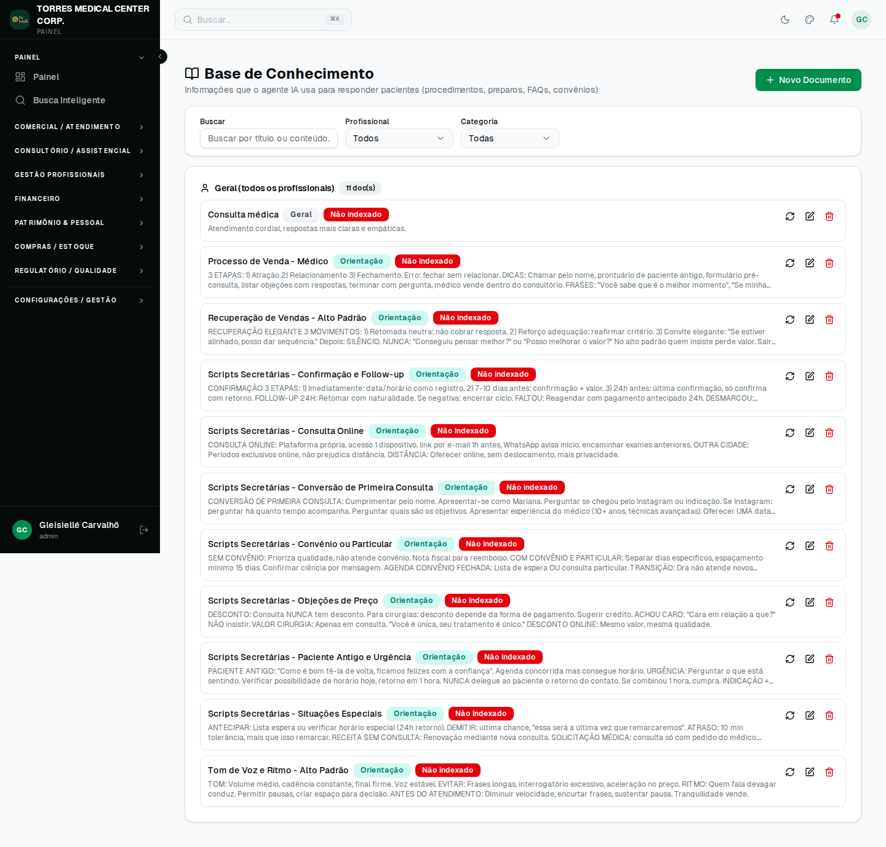

# Base de Conhecimento

- **Módulo:** CONFIGURAÇÕES / GESTÃO
- **Tela:** Base de Conhecimento
- **URL:** `/base-conhecimento`
- **Título na página:** Base de Conhecimento

## Objetivo (inferido)

Tela "Base de Conhecimento" do módulo CONFIGURAÇÕES / GESTÃO. Possui 3 campo(s) de entrada/filtro. Texto de apoio: "Base de Conhecimento Informações que o agente IA usa para responder pacientes (procedimentos, preparos, FAQs, convênios) Novo Documento Buscar Profissional Todos Categoria Todas Geral (todos os profis…"

## Screenshot

## Campos

| Nome | Rótulo | Tipo | Obrigatório | Valores/opções |
|---|---|---|---|---|
| — | Buscar | text | não indicado | — |
| — | Profissional | combobox | não indicado | — |
| — | Categoria | combobox | não indicado | — |

## Botões e ações

- Buscar... ⌘K
- Toggle theme
- Customize theme
- Notifications
- GC
- Novo Documento
- Todos
- Todas
- Indexar
- (ícone sem rótulo)

## Tabelas / grids

_Nenhuma tabela encontrada._

- Filtros/busca: não identificado
- Paginação: não identificada

## Abas

_Nenhuma aba._

## Modais

_Nenhum modal aberto na carga da tela. Modais disparados por botões não foram abertos (regra somente-leitura)._

## Links para outras telas

_Nenhum link na área principal._

## Mensagens e validações visíveis

_Nenhuma mensagem visível._
