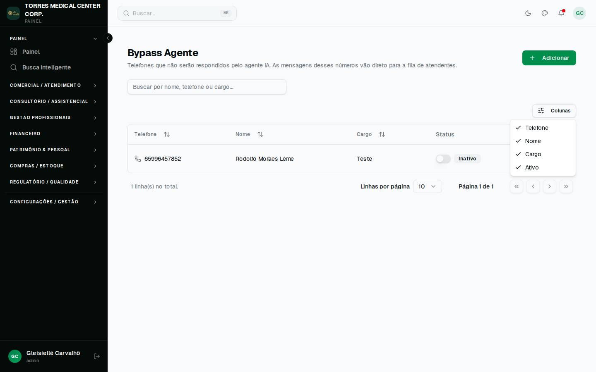
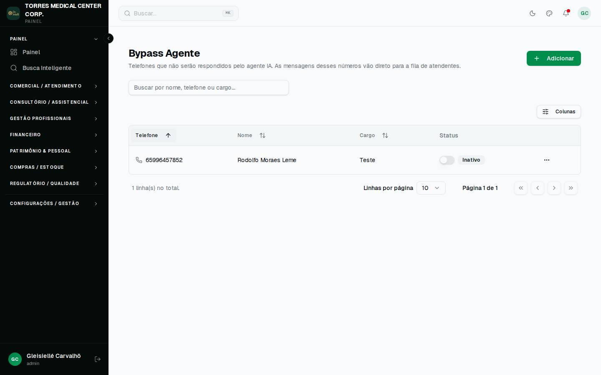

# Bypass Agente

- **Módulo:** CONFIGURAÇÕES / GESTÃO
- **Tela:** Bypass Agente
- **URL:** `/bypass-agente`
- **Título na página:** Bypass Agente

## Objetivo (inferido)

Tela "Bypass Agente" do módulo CONFIGURAÇÕES / GESTÃO. Apresenta listagem em tabela com colunas Telefone, Nome, Cargo, Status. Possui 3 campo(s) de entrada/filtro. Texto de apoio: "Bypass Agente Telefones que não serão respondidos pelo agente IA. As mensagens desses números vão direto para a fila de atendentes. Adicionar Colunas Telefone Nome Cargo Status 65996457852 Rodolfo Mor…"

## Screenshot

## Campos

| Nome | Rótulo | Tipo | Obrigatório | Valores/opções |
|---|---|---|---|---|
| — | Buscar por nome, telefone ou cargo... | text | não indicado | — |
| — | — | switch | não indicado | — |
| — | — | combobox | não indicado | — |

## Botões e ações

- Buscar... ⌘K
- Toggle theme
- Customize theme
- Notifications
- GC
- Adicionar
- Colunas
- Telefone
- Nome
- Cargo
- on
- (ícone sem rótulo)
- 10
- Ir para primeira página _(desabilitado)_
- Ir para página anterior _(desabilitado)_
- Ir para próxima página _(desabilitado)_
- Ir para última página _(desabilitado)_

## Tabelas / grids

**Tabela 1** — 1 linha(s) visível(is)

- Colunas: Telefone · Nome · Cargo · Status
- Colunas possivelmente ordenáveis: Telefone, Nome, Cargo

- Filtros/busca: Buscar por nome, telefone ou cargo...
- Paginação: Página 1 de 1

## Abas

_Nenhuma aba._

## Modais

_Nenhum modal aberto na carga da tela. Modais disparados por botões não foram abertos (regra somente-leitura)._

## Links para outras telas

_Nenhum link na área principal._

## Mensagens e validações visíveis

_Nenhuma mensagem visível._

<!-- estados -->
## Estados capturados (interações de visualização)

_Capturados em 15/10/2026 clicando só em itens de visualização do checklist da issue. Nenhum formulário foi preenchido e toda gravação foi bloqueada._

### Adicionar

- Abre modal **Adicionar Telefone ao Bypass**

| Campo | Tipo | Obrigatório | Opções |
|---|---|---|---|
| Telefone * | text | sim | — |
| Nome | text | não indicado | — |
| Cargo | text | não indicado | — |

- Botões do modal: Cancelar · Adicionar · Close

### Colunas

- Itens do menu/lista: Telefone · Nome · Cargo · Ativo

### Ordenação por coluna — 1 print de exemplo (colunas: Telefone, Nome, Cargo)

### Paginação — 1 print da página 2

- lista com uma página só (botão de próxima página desabilitado), sem print

<!-- /estados -->
