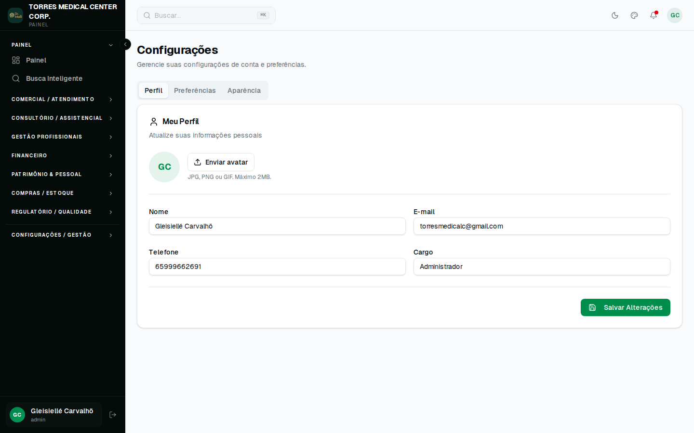

# Configurações

- **Módulo:** CONFIGURAÇÕES / GESTÃO
- **Tela:** Configurações
- **URL:** `/settings`
- **Título na página:** Configurações

## Objetivo (inferido)

Tela "Configurações" do módulo CONFIGURAÇÕES / GESTÃO. Possui 5 campo(s) de entrada/filtro. Organizada em abas (Perfil, Preferências, Aparência). Texto de apoio: "Configurações Gerencie suas configurações de conta e preferências. Perfil Preferências Aparência Meu Perfil Atualize suas informações pessoais GC Enviar avatar JPG, PNG ou GIF. Máximo 2MB. Nome E-mail…"

## Screenshot

## Campos

| Nome | Rótulo | Tipo | Obrigatório | Valores/opções |
|---|---|---|---|---|
| avatar_upload | Enviar avatar | file | não indicado | — |
| nome | Nome | text | não indicado | — |
| email | E-mail | email | não indicado | — |
| telefone | Telefone | text | não indicado | — |
| cargo | Cargo | text | não indicado | — |

## Botões e ações

- Buscar... ⌘K
- Toggle theme
- Customize theme
- Notifications
- GC
- Perfil
- Preferências
- Aparência
- Salvar Alterações

## Tabelas / grids

_Nenhuma tabela encontrada._

- Filtros/busca: não identificado
- Paginação: não identificada

## Abas

- Perfil _(ativa)_
- Preferências
- Aparência

## Modais

_Nenhum modal aberto na carga da tela. Modais disparados por botões não foram abertos (regra somente-leitura)._

## Links para outras telas

_Nenhum link na área principal._

## Mensagens e validações visíveis

_Nenhuma mensagem visível._
