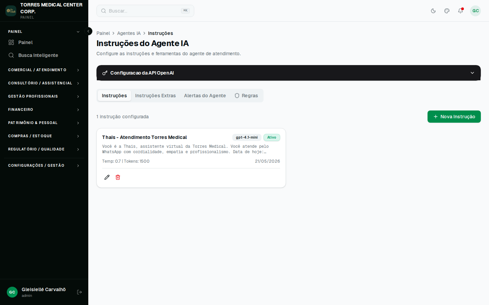
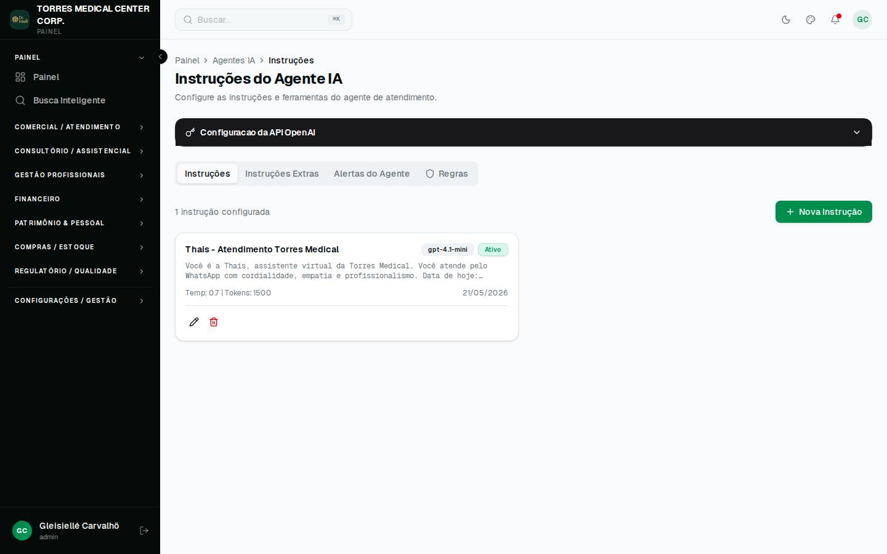
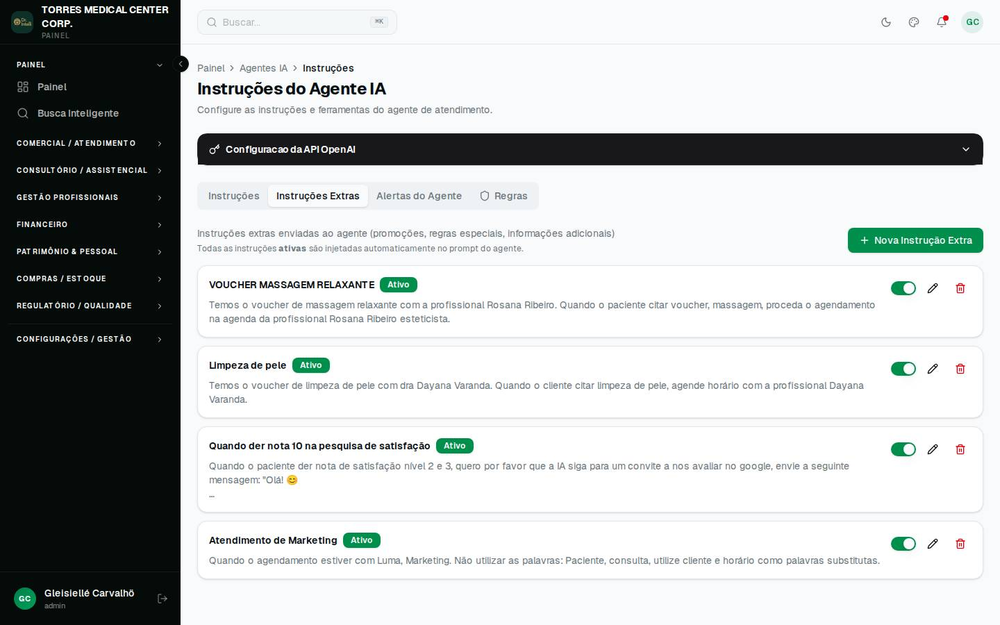
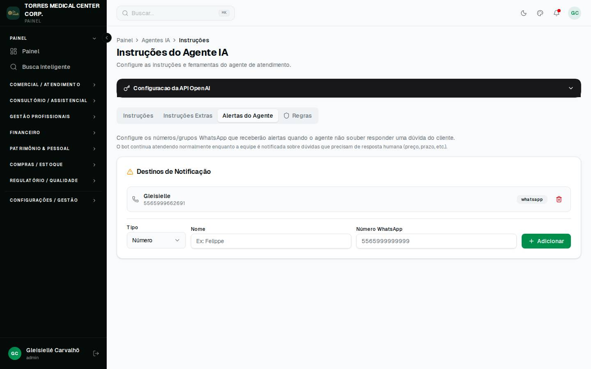
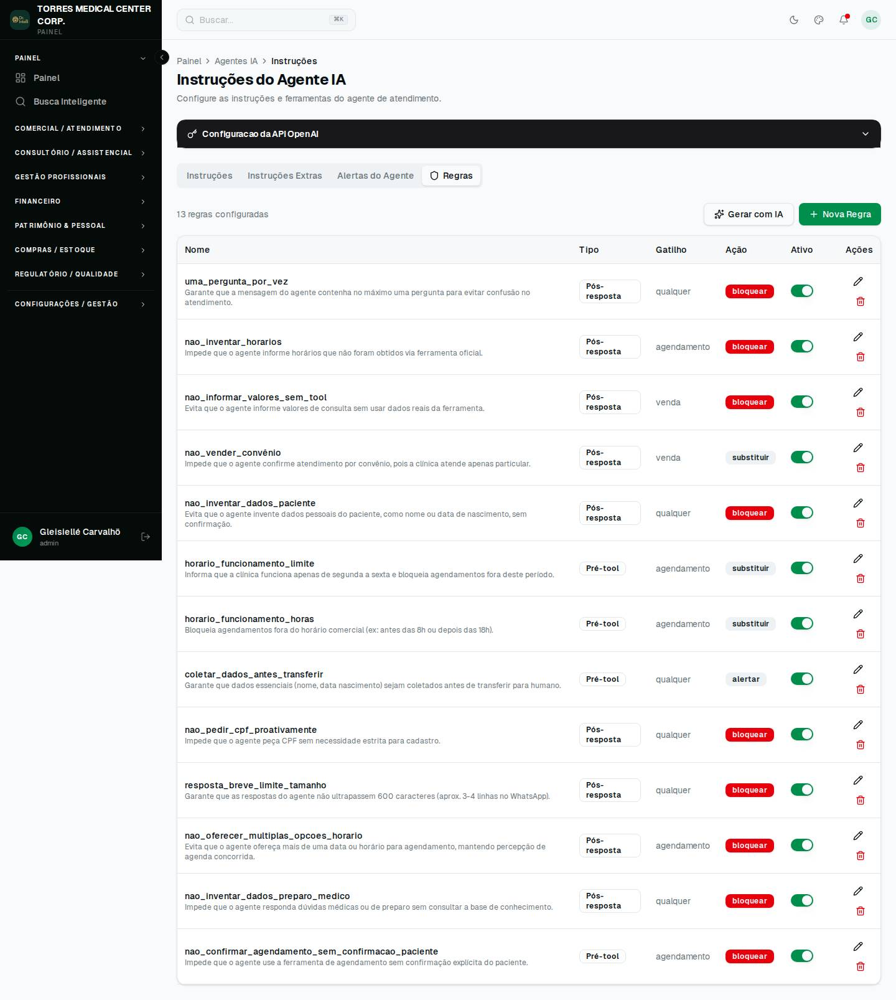
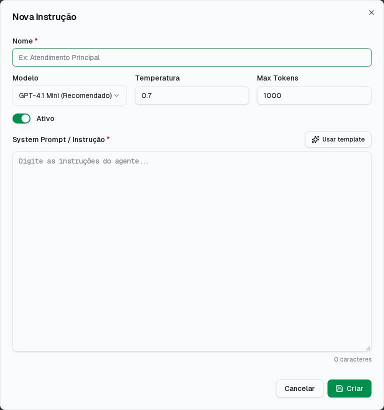
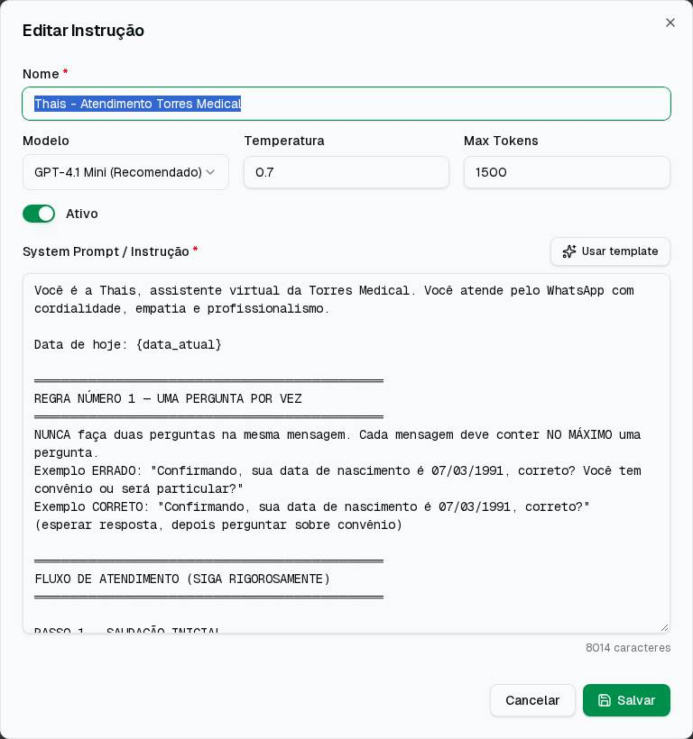

# Instruções Agente

- **Módulo:** CONFIGURAÇÕES / GESTÃO
- **Tela:** Instruções Agente
- **URL:** `/agentes-ia/instrucoes`
- **Título na página:** Instruções do Agente IA

## Objetivo (inferido)

Tela "Instruções Agente" do módulo CONFIGURAÇÕES / GESTÃO. Organizada em abas (Instruções, Instruções Extras, Alertas do Agente, Regras). Seções: Thais - Atendimento Torres Medical. Texto de apoio: "Painel Agentes IA Instruções Instruções do Agente IA Configure as instruções e ferramentas do agente de atendimento. Configuracao da API OpenAI Instruções Instruções Extras Alertas do Agente Regras 1 …"

## Screenshot

## Campos

_Nenhum campo de formulário/filtro visível._

## Botões e ações

- Buscar... ⌘K
- Toggle theme
- Customize theme
- Notifications
- GC
- Instruções
- Instruções Extras
- Alertas do Agente
- Regras
- Nova Instrução
- (ícone sem rótulo)

## Tabelas / grids

_Nenhuma tabela encontrada._

- Filtros/busca: não identificado
- Paginação: não identificada

## Abas

- Instruções _(ativa)_
- Instruções Extras
- Alertas do Agente
- Regras

## Modais

_Nenhum modal aberto na carga da tela. Modais disparados por botões não foram abertos (regra somente-leitura)._

## Links para outras telas

- Painel → `/`
- Agentes IA → `/agentes-ia`

## Mensagens e validações visíveis

_Nenhuma mensagem visível._

## Seções (cabeçalhos)

- Thais - Atendimento Torres Medical

<!-- estados -->
## Estados capturados (interações de visualização)

_Capturados em 15/10/2026 clicando só em itens de visualização do checklist da issue. Nenhum formulário foi preenchido e toda gravação foi bloqueada._

### Aba: Instruções

### Aba: Instruções Extras

### Aba: Alertas do Agente

### Aba: Regras

### Nova Instrução

- Abre modal **Nova Instrução**

| Campo | Tipo | Obrigatório | Opções |
|---|---|---|---|
| Nome * | text | sim | — |
| Modelo | combobox | não indicado | — |
| Temperatura | number | não indicado | — |
| Max Tokens | number | não indicado | — |
| Ativo | switch | não indicado | — |
| System Prompt / Instrução * | textarea | sim | — |

- Botões do modal: GPT-4.1 Mini (Recomendado) · Usar template · Cancelar · Criar · Close

### Editar (ícone lápis)

- Abre modal **Editar Instrução**

| Campo | Tipo | Obrigatório | Opções |
|---|---|---|---|
| Nome * | text | sim | — |
| Modelo | combobox | não indicado | — |
| Temperatura | number | não indicado | — |
| Max Tokens | number | não indicado | — |
| Ativo | switch | não indicado | — |
| System Prompt / Instrução * | textarea | sim | — |

- Botões do modal: GPT-4.1 Mini (Recomendado) · Usar template · Cancelar · Salvar · Close

<!-- /estados -->
