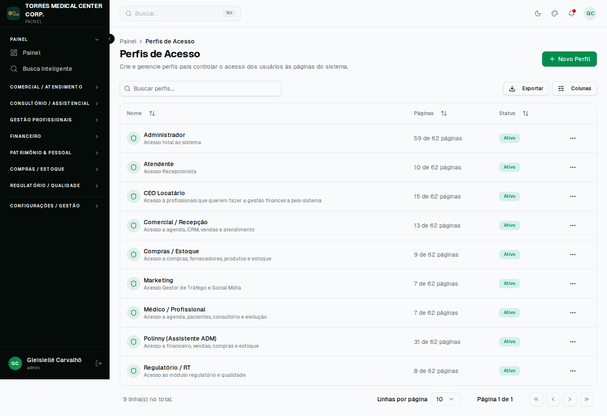
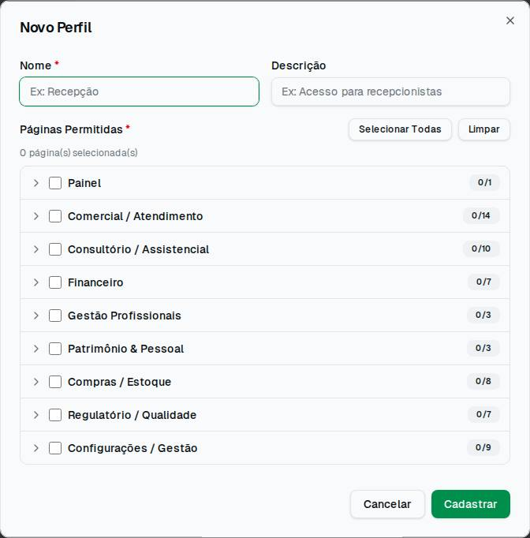
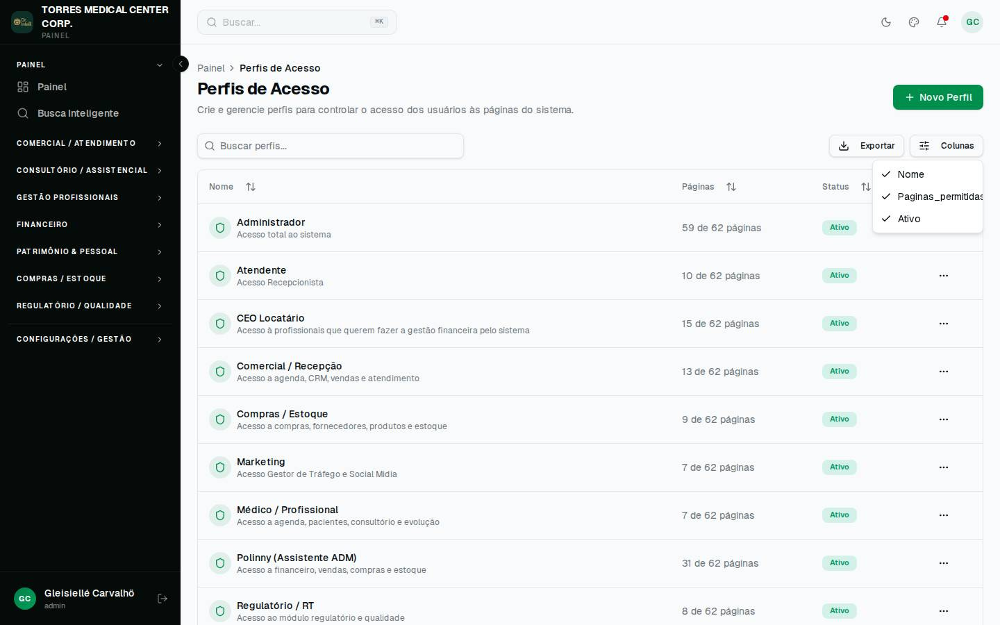
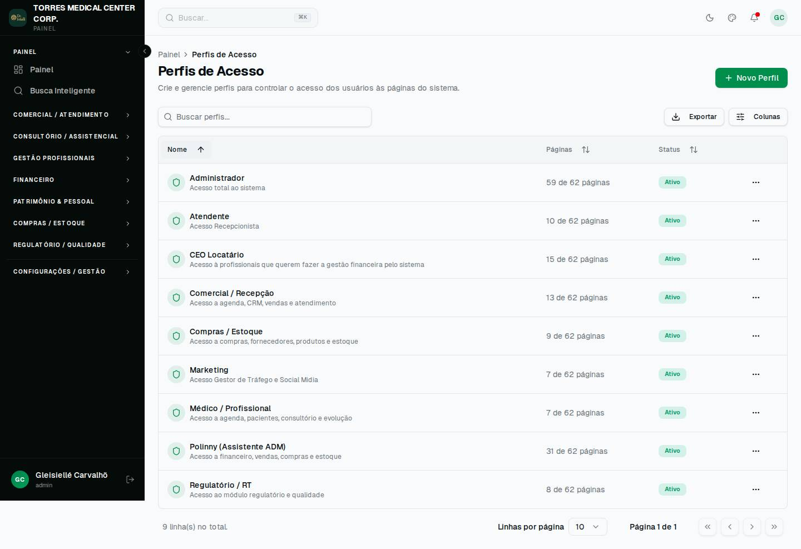
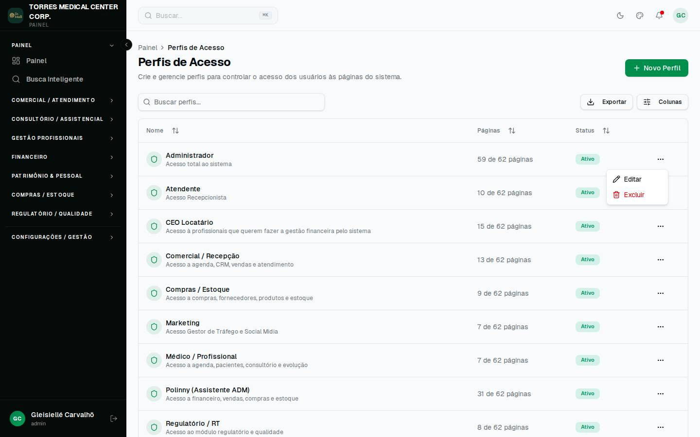

# Perfis de Acesso

- **Módulo:** CONFIGURAÇÕES / GESTÃO
- **Tela:** Perfis de Acesso
- **URL:** `/perfis`
- **Título na página:** Perfis de Acesso

## Objetivo (inferido)

Tela "Perfis de Acesso" do módulo CONFIGURAÇÕES / GESTÃO. Apresenta listagem em tabela com colunas Nome, Páginas, Status. Possui 2 campo(s) de entrada/filtro. Texto de apoio: "Painel Perfis de Acesso Perfis de Acesso Crie e gerencie perfis para controlar o acesso dos usuários às páginas do sistema. Novo Perfil Exportar Colunas Nome Páginas Status Administrador Acesso total …"

## Screenshot

## Campos

| Nome | Rótulo | Tipo | Obrigatório | Valores/opções |
|---|---|---|---|---|
| — | Buscar perfis... | text | não indicado | — |
| — | — | combobox | não indicado | — |

## Botões e ações

- Buscar... ⌘K
- Toggle theme
- Customize theme
- Notifications
- GC
- Novo Perfil
- Exportar
- Colunas
- Nome
- Páginas
- Status
- (ícone sem rótulo)
- 10
- Ir para primeira página _(desabilitado)_
- Ir para página anterior _(desabilitado)_
- Ir para próxima página _(desabilitado)_
- Ir para última página _(desabilitado)_

## Tabelas / grids

**Tabela 1** — 9 linha(s) visível(is)

- Colunas: Nome · Páginas · Status
- Colunas possivelmente ordenáveis: Nome, Páginas, Status

- Filtros/busca: Buscar perfis...
- Paginação: Página 1 de 1

## Abas

_Nenhuma aba._

## Modais

_Nenhum modal aberto na carga da tela. Modais disparados por botões não foram abertos (regra somente-leitura)._

## Links para outras telas

- Painel → `/`

## Mensagens e validações visíveis

_Nenhuma mensagem visível._

<!-- estados -->
## Estados capturados (interações de visualização)

_Capturados em 15/10/2026 clicando só em itens de visualização do checklist da issue. Nenhum formulário foi preenchido e toda gravação foi bloqueada._

### Novo Perfil

- Abre modal **Novo Perfil**

| Campo | Tipo | Obrigatório | Opções |
|---|---|---|---|
| Nome * | text | sim | — |
| Descrição | text | não indicado | — |
| — | checkbox | não indicado | — |
| — | checkbox | não indicado | — |
| — | checkbox | não indicado | — |
| — | checkbox | não indicado | — |
| — | checkbox | não indicado | — |
| — | checkbox | não indicado | — |
| — | checkbox | não indicado | — |
| — | checkbox | não indicado | — |
| — | checkbox | não indicado | — |

- Botões do modal: Selecionar Todas · Limpar · Cancelar · Cadastrar · Close

### Colunas

- Itens do menu/lista: Nome · Paginas_permitidas · Ativo

### Ordenação por coluna — 1 print de exemplo (colunas: Nome, Páginas, Status)

### Menu de ações (⋯) (na linha da tabela)

- Itens do menu/lista: Editar · Excluir

### Paginação — 1 print da página 2

- lista com uma página só (botão de próxima página desabilitado), sem print

<!-- /estados -->
