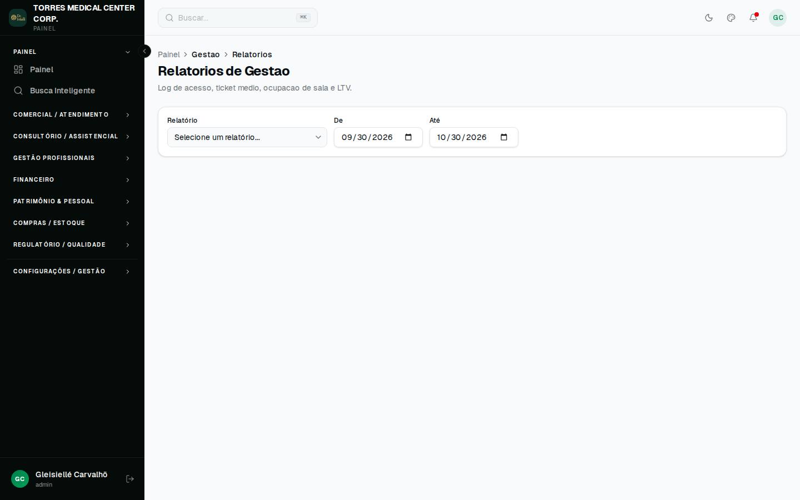

# Relatórios

- **Módulo:** CONFIGURAÇÕES / GESTÃO
- **Tela:** Relatórios
- **URL:** `/gestao/relatorios`
- **Título na página:** Relatorios de Gestao

## Objetivo (inferido)

Tela "Relatórios" do módulo CONFIGURAÇÕES / GESTÃO. Possui 3 campo(s) de entrada/filtro. Texto de apoio: "Painel Gestao Relatorios Relatorios de Gestao Log de acesso, ticket medio, ocupacao de sala e LTV. Relatório Selecione um relatório... GES-01 — Log de Acesso GES-02 — Ticket Medio por Canal GES-03 — O…"

## Screenshot

## Campos

| Nome | Rótulo | Tipo | Obrigatório | Valores/opções |
|---|---|---|---|---|
| — | — | select | não indicado | Selecione um relatório..., GES-01 — Log de Acesso, GES-02 — Ticket Medio por Canal, GES-03 — Ocupacao por Sala, GES-04 — LTV Paciente |
| — | De | date | não indicado | — |
| — | Até | date | não indicado | — |

## Botões e ações

- Buscar... ⌘K
- Toggle theme
- Customize theme
- Notifications
- GC

## Tabelas / grids

_Nenhuma tabela encontrada._

- Filtros/busca: não identificado
- Paginação: não identificada

## Abas

_Nenhuma aba._

## Modais

_Nenhum modal aberto na carga da tela. Modais disparados por botões não foram abertos (regra somente-leitura)._

## Links para outras telas

- Painel → `/`

## Mensagens e validações visíveis

_Nenhuma mensagem visível._

<!-- estados -->
## Estados capturados (interações de visualização)

_Capturados em 15/10/2026 clicando só em itens de visualização do checklist da issue. Nenhum formulário foi preenchido e toda gravação foi bloqueada._

### Dropdown aberto: Selecione um relatório... GES-01 — Log de Acesso GES-02 — Ticket Medio por Canal

- select nativo: opções listadas, sem print
- Opções: Selecione um relatório..., GES-01 — Log de Acesso, GES-02 — Ticket Medio por Canal, GES-03 — Ocupacao por Sala, GES-04 — LTV Paciente

<!-- /estados -->
