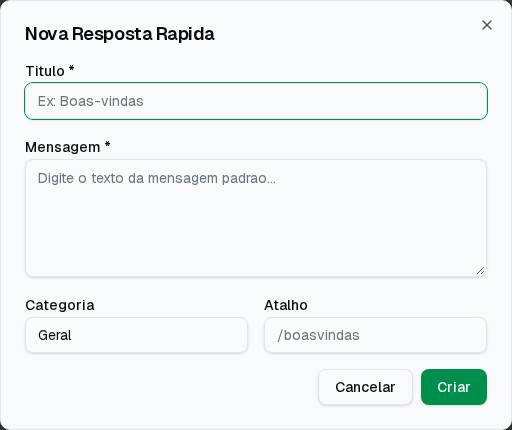

# Respostas Rápidas

- **Módulo:** CONFIGURAÇÕES / GESTÃO
- **Tela:** Respostas Rápidas
- **URL:** `/respostas-rapidas`
- **Título na página:** Respostas Rapidas

## Objetivo (inferido)

Tela "Respostas Rápidas" do módulo CONFIGURAÇÕES / GESTÃO. Possui 1 campo(s) de entrada/filtro. Texto de apoio: "Respostas Rapidas Mensagens padrao para uso no atendimento WhatsApp Nova Resposta Nenhuma resposta rapida cadastrada Criar primeira resposta…"

## Screenshot

## Campos

| Nome | Rótulo | Tipo | Obrigatório | Valores/opções |
|---|---|---|---|---|
| — | Buscar... | text | não indicado | — |

## Botões e ações

- Buscar... ⌘K
- Toggle theme
- Customize theme
- Notifications
- GC
- Nova Resposta
- Criar primeira resposta

## Tabelas / grids

_Nenhuma tabela encontrada._

- Filtros/busca: não identificado
- Paginação: não identificada

## Abas

_Nenhuma aba._

## Modais

_Nenhum modal aberto na carga da tela. Modais disparados por botões não foram abertos (regra somente-leitura)._

## Links para outras telas

_Nenhum link na área principal._

## Mensagens e validações visíveis

_Nenhuma mensagem visível._

<!-- estados -->
## Estados capturados (interações de visualização)

_Capturados em 15/10/2026 clicando só em itens de visualização do checklist da issue. Nenhum formulário foi preenchido e toda gravação foi bloqueada._

### Nova Resposta

- Abre modal **Nova Resposta Rapida**

| Campo | Tipo | Obrigatório | Opções |
|---|---|---|---|
| Titulo * | text | sim | — |
| Mensagem * | textarea | sim | — |
| Categoria | text | não indicado | — |
| Atalho | text | não indicado | — |

- Botões do modal: Cancelar · Criar · Close

### Criar primeira resposta

- Abre modal **Nova Resposta Rapida**

| Campo | Tipo | Obrigatório | Opções |
|---|---|---|---|
| Titulo * | text | sim | — |
| Mensagem * | textarea | sim | — |
| Categoria | text | não indicado | — |
| Atalho | text | não indicado | — |

- Botões do modal: Cancelar · Criar · Close

<!-- /estados -->
