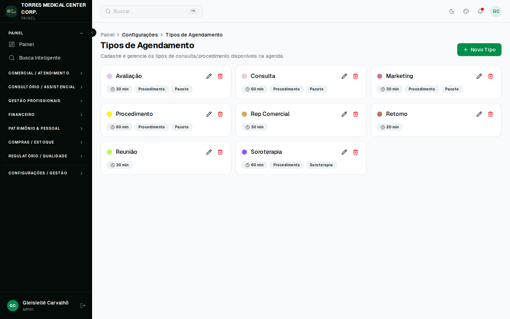
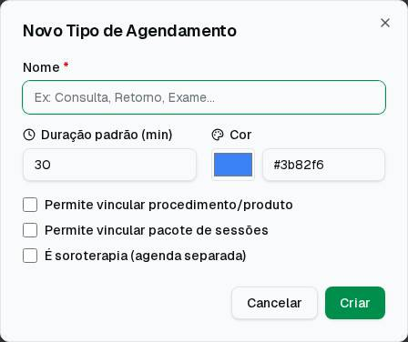
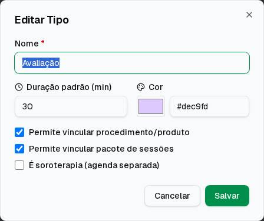

# Tipos de Agendamento

- **Módulo:** CONFIGURAÇÕES / GESTÃO
- **Tela:** Tipos de Agendamento
- **URL:** `/config/tipos-agendamento`
- **Título na página:** Tipos de Agendamento

## Objetivo (inferido)

Tela "Tipos de Agendamento" do módulo CONFIGURAÇÕES / GESTÃO. Texto de apoio: "Painel Configurações Tipos de Agendamento Tipos de Agendamento Cadastre e gerencie os tipos de consulta/procedimento disponíveis na agenda. Novo Tipo Avaliação 30 min Procedimento Pacote Consulta 60 m…"

## Screenshot

## Campos

_Nenhum campo de formulário/filtro visível._

## Botões e ações

- Buscar... ⌘K
- Toggle theme
- Customize theme
- Notifications
- GC
- Novo Tipo
- (ícone sem rótulo)

## Tabelas / grids

_Nenhuma tabela encontrada._

- Filtros/busca: não identificado
- Paginação: não identificada

## Abas

_Nenhuma aba._

## Modais

_Nenhum modal aberto na carga da tela. Modais disparados por botões não foram abertos (regra somente-leitura)._

## Links para outras telas

- Painel → `/`

## Mensagens e validações visíveis

_Nenhuma mensagem visível._

<!-- estados -->
## Estados capturados (interações de visualização)

_Capturados em 15/10/2026 clicando só em itens de visualização do checklist da issue. Nenhum formulário foi preenchido e toda gravação foi bloqueada._

### Novo Tipo

- Abre modal **Novo Tipo de Agendamento**

| Campo | Tipo | Obrigatório | Opções |
|---|---|---|---|
| Nome * | text | sim | — |
| Duração padrão (min) | number | não indicado | — |
| — | color | não indicado | — |
| — | text | não indicado | — |
| Permite vincular procedimento/produto | checkbox | não indicado | — |
| Permite vincular pacote de sessões | checkbox | não indicado | — |
| É soroterapia (agenda separada) | checkbox | não indicado | — |

- Botões do modal: Cancelar · Criar · Close

### Editar (ícone lápis)

- Abre modal **Editar Tipo**

| Campo | Tipo | Obrigatório | Opções |
|---|---|---|---|
| Nome * | text | sim | — |
| Duração padrão (min) | number | não indicado | — |
| — | color | não indicado | — |
| — | text | não indicado | — |
| Permite vincular procedimento/produto | checkbox | não indicado | — |
| Permite vincular pacote de sessões | checkbox | não indicado | — |
| É soroterapia (agenda separada) | checkbox | não indicado | — |

- Botões do modal: Cancelar · Salvar · Close

<!-- /estados -->
