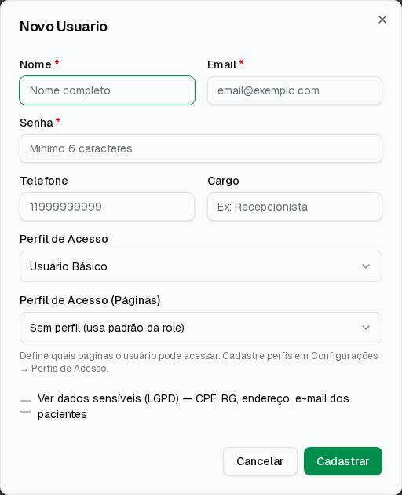
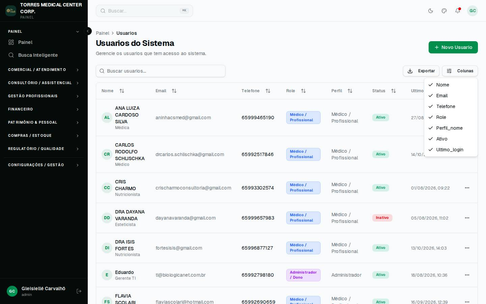
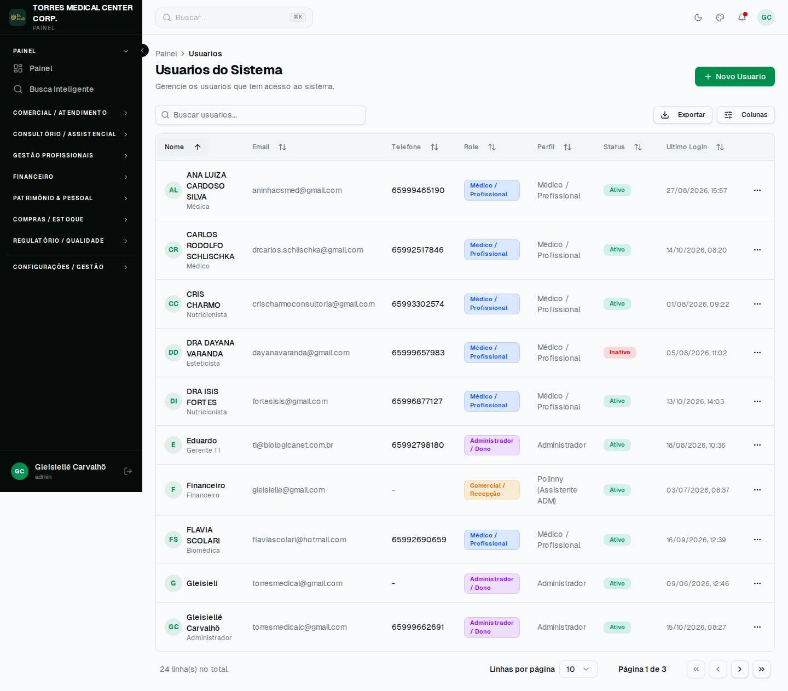
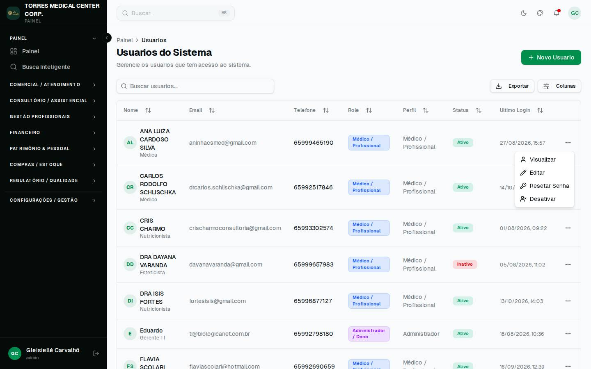
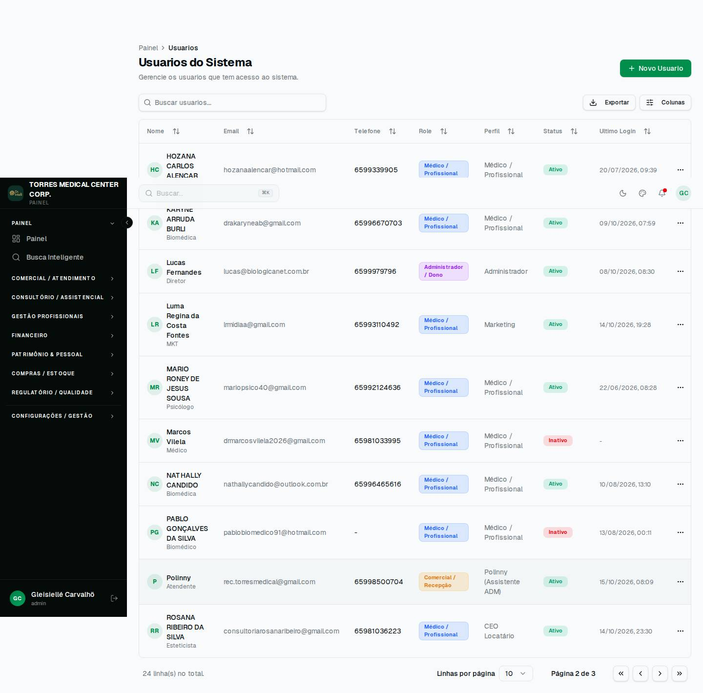

# Usuários

- **Módulo:** CONFIGURAÇÕES / GESTÃO
- **Tela:** Usuários
- **URL:** `/usuarios`
- **Título na página:** Usuarios do Sistema

## Objetivo (inferido)

Tela "Usuários" do módulo CONFIGURAÇÕES / GESTÃO. Apresenta listagem em tabela com colunas Nome, Email, Telefone, Role, Perfil, Status. Possui 2 campo(s) de entrada/filtro. Texto de apoio: "Painel Usuarios Usuarios do Sistema Gerencie os usuarios que tem acesso ao sistema. Novo Usuario Exportar Colunas Nome Email Telefone Role Perfil Status Ultimo Login AL ANA LUIZA CARDOSO SILVA Médica …"

## Screenshot

## Campos

| Nome | Rótulo | Tipo | Obrigatório | Valores/opções |
|---|---|---|---|---|
| — | Buscar usuarios... | text | não indicado | — |
| — | — | combobox | não indicado | — |

## Botões e ações

- Buscar... ⌘K
- Toggle theme
- Customize theme
- Notifications
- GC
- Novo Usuario
- Exportar
- Colunas
- Nome
- Email
- Telefone
- Role
- Perfil
- Status
- Ultimo Login
- (ícone sem rótulo)
- 10
- Ir para primeira página _(desabilitado)_
- Ir para página anterior _(desabilitado)_
- Ir para próxima página
- Ir para última página

## Tabelas / grids

**Tabela 1** — 10 linha(s) visível(is)

- Colunas: Nome · Email · Telefone · Role · Perfil · Status · Ultimo Login
- Colunas possivelmente ordenáveis: Nome, Email, Telefone, Role, Perfil, Status, Ultimo Login

- Filtros/busca: Buscar usuarios...
- Paginação: Página 1 de 3

## Abas

_Nenhuma aba._

## Modais

_Nenhum modal aberto na carga da tela. Modais disparados por botões não foram abertos (regra somente-leitura)._

## Links para outras telas

- Painel → `/`

## Mensagens e validações visíveis

_Nenhuma mensagem visível._

<!-- estados -->
## Estados capturados (interações de visualização)

_Capturados em 15/10/2026 clicando só em itens de visualização do checklist da issue. Nenhum formulário foi preenchido e toda gravação foi bloqueada._

### Novo Usuario

- Abre modal **Novo Usuario**

| Campo | Tipo | Obrigatório | Opções |
|---|---|---|---|
| Nome * | text | sim | — |
| Email * | email | sim | — |
| Senha * | password | sim | — |
| Telefone | text | não indicado | — |
| Cargo | text | não indicado | — |
| Perfil de Acesso | combobox | não indicado | — |
| Perfil de Acesso (Páginas) | combobox | não indicado | — |
| Ver dados sensíveis (LGPD) — CPF, RG, endereço, e-mail dos pacientes | checkbox | não indicado | — |

- Botões do modal: Usuário Básico · Sem perfil (usa padrão da role) · Cancelar · Cadastrar · Close

### Colunas

- Itens do menu/lista: Nome · Email · Telefone · Role · Perfil_nome · Ativo · Ultimo_login

### Ordenação por coluna — 1 print de exemplo (colunas: Nome, Email, Telefone, Role, Perfil, Status, Ultimo Login)

### Menu de ações (⋯) (na linha da tabela)

- Itens do menu/lista: Visualizar · Editar · Resetar Senha · Desativar

### Paginação — 1 print da página 2

<!-- /estados -->
