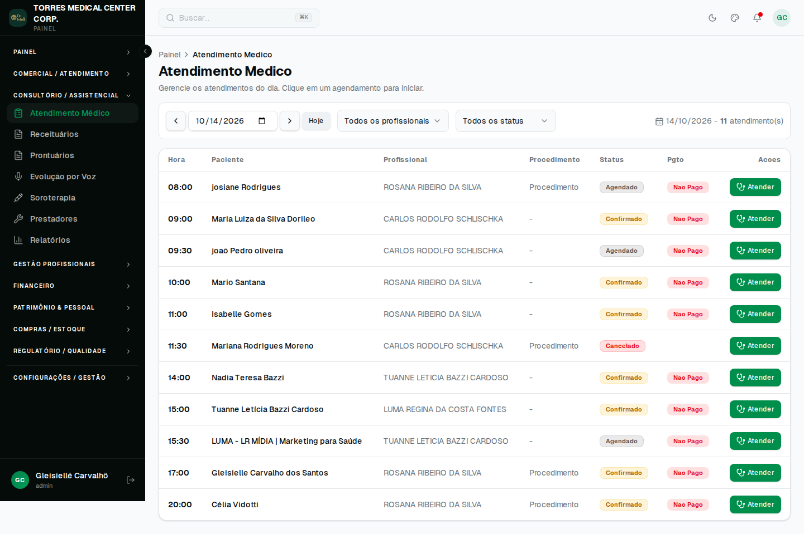

# Atendimento Médico

- **Módulo:** CONSULTÓRIO / ASSISTENCIAL
- **Tela:** Atendimento Médico
- **URL:** `/atendimento-medico`
- **Título na página:** Atendimento Medico

## Objetivo (inferido)

Tela "Atendimento Médico" do módulo CONSULTÓRIO / ASSISTENCIAL. Apresenta listagem em tabela com colunas Hora, Paciente, Profissional, Procedimento, Status, Pgto. Possui 3 campo(s) de entrada/filtro. Texto de apoio: "Painel Atendimento Medico Atendimento Medico Gerencie os atendimentos do dia. Clique em um agendamento para iniciar. Hoje Todos os profissionais Todos os status 14/10/2026 - 11 atendimento(s) Hora Pac…"

## Screenshot

## Campos

| Nome | Rótulo | Tipo | Obrigatório | Valores/opções |
|---|---|---|---|---|
| — | — | date | não indicado | — |
| — | — | combobox | não indicado | — |
| — | — | combobox | não indicado | — |

## Botões e ações

- Buscar... ⌘K
- Toggle theme
- Customize theme
- Notifications
- GC
- (ícone sem rótulo)
- Hoje
- Todos os profissionais
- Todos os status
- Atender

## Tabelas / grids

**Tabela 1** — 11 linha(s) visível(is)

- Colunas: Hora · Paciente · Profissional · Procedimento · Status · Pgto · Acoes
- Colunas possivelmente ordenáveis: não identificado

- Filtros/busca: não identificado
- Paginação: não identificada

## Abas

_Nenhuma aba._

## Modais

_Nenhum modal aberto na carga da tela. Modais disparados por botões não foram abertos (regra somente-leitura)._

## Links para outras telas

- Painel → `/`

## Mensagens e validações visíveis

_Nenhuma mensagem visível._
