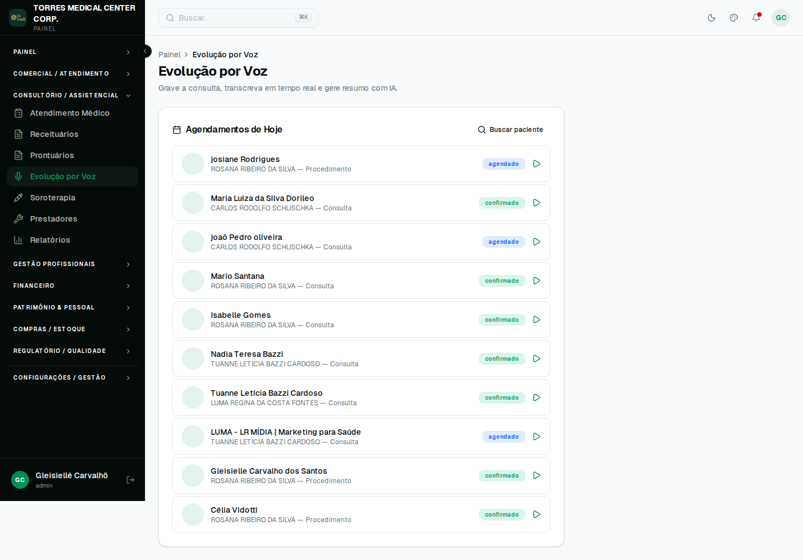
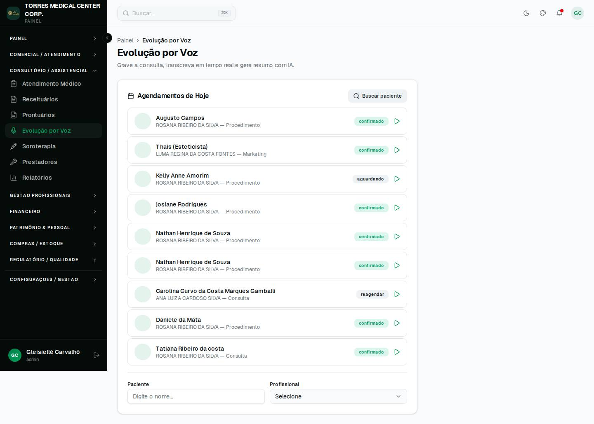

# Evolução por Voz

- **Módulo:** CONSULTÓRIO / ASSISTENCIAL
- **Tela:** Evolução por Voz
- **URL:** `/evolucoes`
- **Título na página:** Evolução por Voz

## Objetivo (inferido)

Tela "Evolução por Voz" do módulo CONSULTÓRIO / ASSISTENCIAL. Texto de apoio: "Painel Evolução por Voz Evolução por Voz Grave a consulta, transcreva em tempo real e gere resumo com IA. Agendamentos de Hoje Buscar paciente josiane Rodrigues ROSANA RIBEIRO DA SILVA — Procedimento …"

## Screenshot

## Campos

_Nenhum campo de formulário/filtro visível._

## Botões e ações

- Buscar... ⌘K
- Toggle theme
- Customize theme
- Notifications
- GC
- Buscar paciente
- josiane Rodrigues ROSANA RIBEIRO DA SILVA — Procedimento agendado
- Maria Luiza da Silva Dorileo CARLOS RODOLFO SCHLISCHKA — Consulta confirmado
- joaõ Pedro oliveira CARLOS RODOLFO SCHLISCHKA — Consulta agendado
- Mario Santana ROSANA RIBEIRO DA SILVA — Consulta confirmado
- Isabelle Gomes ROSANA RIBEIRO DA SILVA — Consulta confirmado
- Nadia Teresa Bazzi TUANNE LETICIA BAZZI CARDOSO — Consulta confirmado
- Tuanne Letícia Bazzi Cardoso LUMA REGINA DA COSTA FONTES — Consulta confirmado
- LUMA - LR MÍDIA | Marketing para Saúde TUANNE LETICIA BAZZI CARDOSO — Consulta agendado
- Gleisielle Carvalho dos Santos ROSANA RIBEIRO DA SILVA — Procedimento confirmado
- Célia Vidotti ROSANA RIBEIRO DA SILVA — Procedimento confirmado

## Tabelas / grids

_Nenhuma tabela encontrada._

- Filtros/busca: não identificado
- Paginação: não identificada

## Abas

_Nenhuma aba._

## Modais

_Nenhum modal aberto na carga da tela. Modais disparados por botões não foram abertos (regra somente-leitura)._

## Links para outras telas

- Painel → `/`

## Mensagens e validações visíveis

_Nenhuma mensagem visível._

<!-- estados -->
## Estados capturados (interações de visualização)

_Capturados em 15/10/2026 clicando só em itens de visualização do checklist da issue. Nenhum formulário foi preenchido e toda gravação foi bloqueada._

### Buscar paciente

<!-- /estados -->
