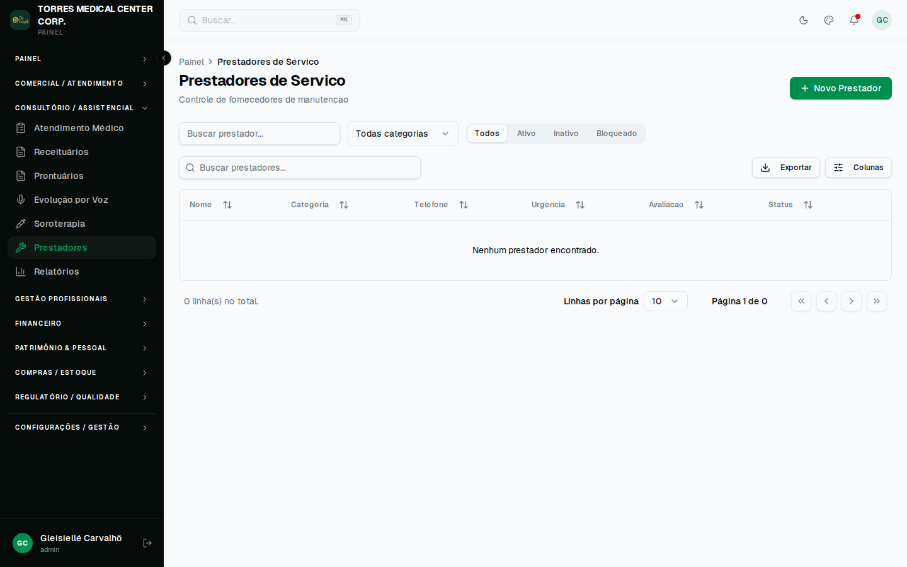
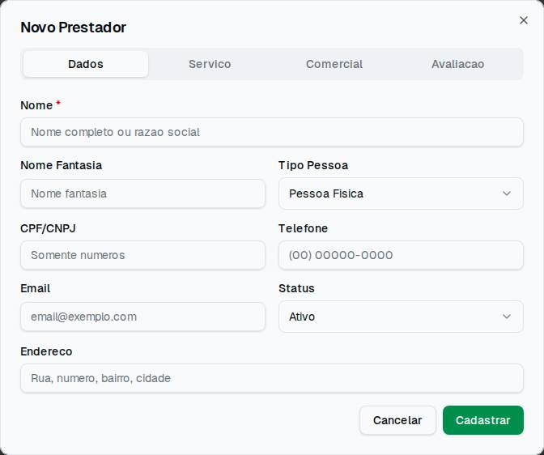
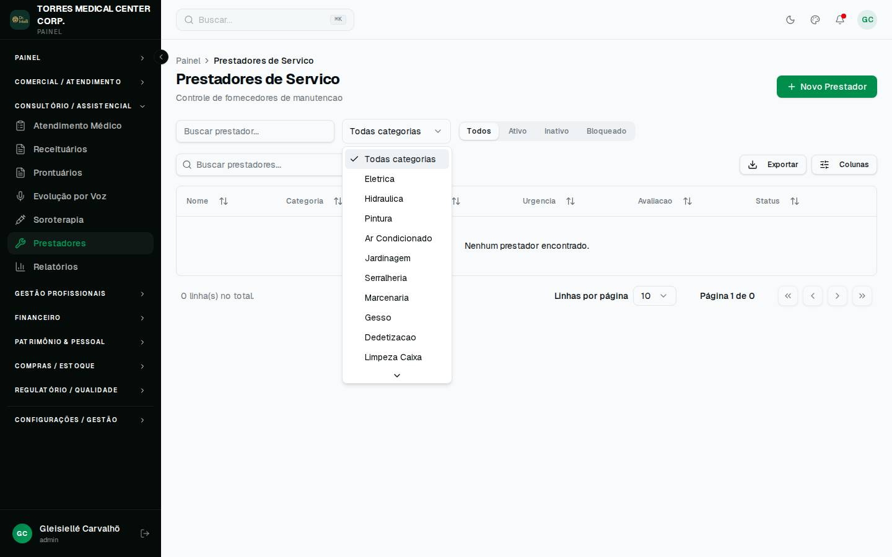
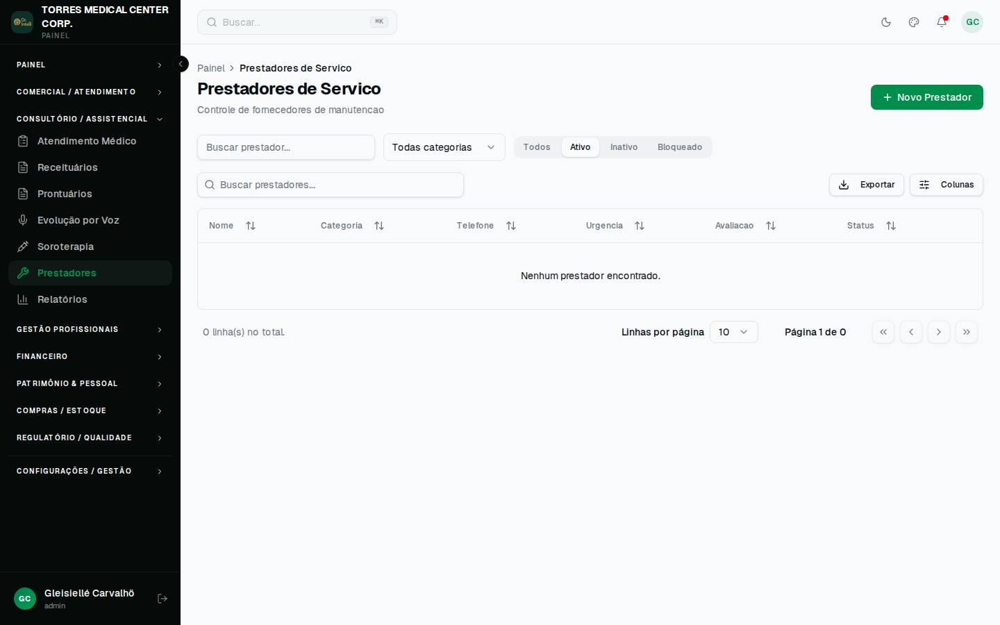
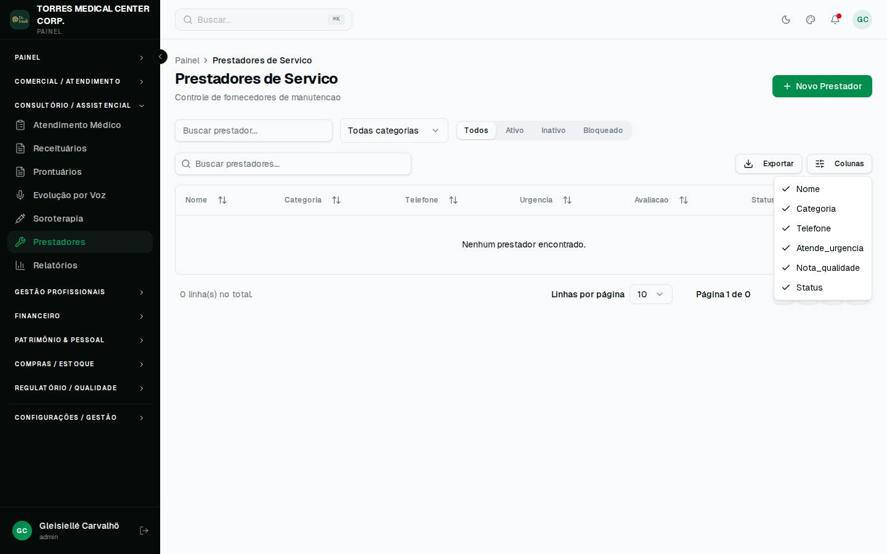
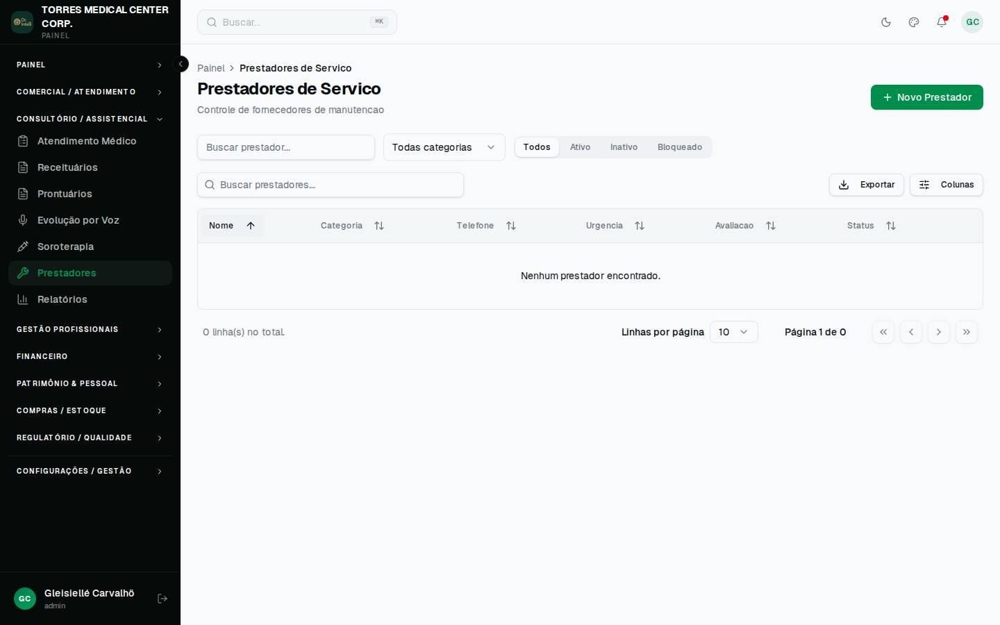

# Prestadores

- **Módulo:** CONSULTÓRIO / ASSISTENCIAL
- **Tela:** Prestadores
- **URL:** `/prestadores`
- **Título na página:** Prestadores de Servico

## Objetivo (inferido)

Tela "Prestadores" do módulo CONSULTÓRIO / ASSISTENCIAL. Apresenta listagem em tabela com colunas Nome, Categoria, Telefone, Urgencia, Avaliacao, Status. Possui 4 campo(s) de entrada/filtro. Texto de apoio: "Painel Prestadores de Servico Prestadores de Servico Controle de fornecedores de manutencao Novo Prestador Todas categorias Todos Ativo Inativo Bloqueado Exportar Colunas Nome Categoria Telefone Urgen…"

## Screenshot

## Campos

| Nome | Rótulo | Tipo | Obrigatório | Valores/opções |
|---|---|---|---|---|
| — | Buscar prestador... | text | não indicado | — |
| — | — | combobox | não indicado | — |
| — | Buscar prestadores... | text | não indicado | — |
| — | — | combobox | não indicado | — |

## Botões e ações

- Buscar... ⌘K
- Toggle theme
- Customize theme
- Notifications
- GC
- Novo Prestador
- Todas categorias
- Todos
- Ativo
- Inativo
- Bloqueado
- Exportar
- Colunas
- Nome
- Categoria
- Telefone
- Urgencia
- Avaliacao
- Status
- 10
- Ir para primeira página _(desabilitado)_
- Ir para página anterior _(desabilitado)_
- Ir para próxima página _(desabilitado)_
- Ir para última página _(desabilitado)_

## Tabelas / grids

**Tabela 1** — 1 linha(s) visível(is)

- Colunas: Nome · Categoria · Telefone · Urgencia · Avaliacao · Status
- Colunas possivelmente ordenáveis: Nome, Categoria, Telefone, Urgencia, Avaliacao, Status

- Filtros/busca: Buscar prestador..., Buscar prestadores...
- Paginação: Página 1 de 0

## Abas

_Nenhuma aba._

## Modais

_Nenhum modal aberto na carga da tela. Modais disparados por botões não foram abertos (regra somente-leitura)._

## Links para outras telas

- Painel → `/`

## Mensagens e validações visíveis

_Nenhuma mensagem visível._

<!-- estados -->
## Estados capturados (interações de visualização)

_Capturados em 15/10/2026 clicando só em itens de visualização do checklist da issue. Nenhum formulário foi preenchido e toda gravação foi bloqueada._

### Novo Prestador

- Abre modal **Novo Prestador**
- Abas do modal: Dados · Servico · Comercial · Avaliacao

| Campo | Tipo | Obrigatório | Opções |
|---|---|---|---|
| Nome * | text | sim | — |
| Nome Fantasia | text | não indicado | — |
| Tipo Pessoa | combobox | não indicado | — |
| CPF/CNPJ | text | não indicado | — |
| Telefone | text | não indicado | — |
| Email | email | não indicado | — |
| Status | combobox | não indicado | — |
| Endereco | text | não indicado | — |

- Botões do modal: Dados · Servico · Comercial · Avaliacao · Pessoa Fisica · Ativo · Cancelar · Cadastrar · Close

### Dropdown aberto: Todas categorias

- Itens do menu/lista: Todas categorias · Eletrica · Hidraulica · Pintura · Ar Condicionado · Jardinagem · Serralheria · Marcenaria · Gesso · Dedetizacao · Limpeza Caixa · TI · Refrigeracao · Outros

### Todos

### Ativo

### Inativo

### Bloqueado

### Colunas

- Itens do menu/lista: Nome · Categoria · Telefone · Atende_urgencia · Nota_qualidade · Status

### Ordenação por coluna — 1 print de exemplo (colunas: Nome, Categoria, Telefone, Urgencia, Avaliacao, Status)

### Paginação — 1 print da página 2

- lista com uma página só (botão de próxima página desabilitado), sem print

<!-- /estados -->
