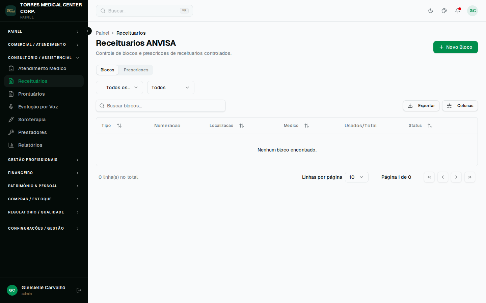

# Receituários

- **Módulo:** CONSULTÓRIO / ASSISTENCIAL
- **Tela:** Receituários
- **URL:** `/receituarios`
- **Título na página:** Receituarios ANVISA

## Objetivo (inferido)

Tela "Receituários" do módulo CONSULTÓRIO / ASSISTENCIAL. Apresenta listagem em tabela com colunas Tipo, Numeracao, Localizacao, Medico, Usados/Total, Status. Possui 4 campo(s) de entrada/filtro. Texto de apoio: "Painel Receituarios Receituarios ANVISA Controle de blocos e prescricoes de receituarios controlados. Novo Bloco Blocos Prescricoes Todos os tipos Todos Exportar Colunas Tipo Numeracao Localizacao Med…"

## Screenshot

## Campos

| Nome | Rótulo | Tipo | Obrigatório | Valores/opções |
|---|---|---|---|---|
| — | — | combobox | não indicado | — |
| — | — | combobox | não indicado | — |
| — | Buscar blocos... | text | não indicado | — |
| — | — | combobox | não indicado | — |

## Botões e ações

- Buscar... ⌘K
- Toggle theme
- Customize theme
- Notifications
- GC
- Novo Bloco
- Blocos
- Prescricoes
- Todos os tipos
- Todos
- Exportar
- Colunas
- Tipo
- Localizacao
- Medico
- Status
- 10
- Ir para primeira página _(desabilitado)_
- Ir para página anterior _(desabilitado)_
- Ir para próxima página _(desabilitado)_
- Ir para última página _(desabilitado)_

## Tabelas / grids

**Tabela 1** — 1 linha(s) visível(is)

- Colunas: Tipo · Numeracao · Localizacao · Medico · Usados/Total · Status
- Colunas possivelmente ordenáveis: Tipo, Localizacao, Medico, Status

- Filtros/busca: Buscar blocos...
- Paginação: Página 1 de 0

## Abas

_Nenhuma aba._

## Modais

_Nenhum modal aberto na carga da tela. Modais disparados por botões não foram abertos (regra somente-leitura)._

## Links para outras telas

- Painel → `/`

## Mensagens e validações visíveis

_Nenhuma mensagem visível._
