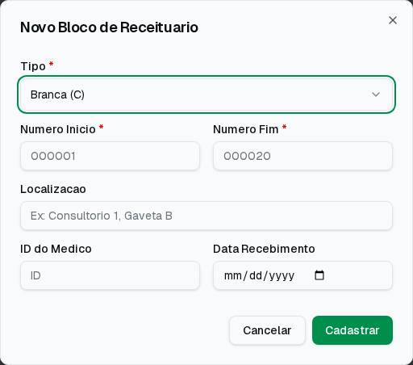
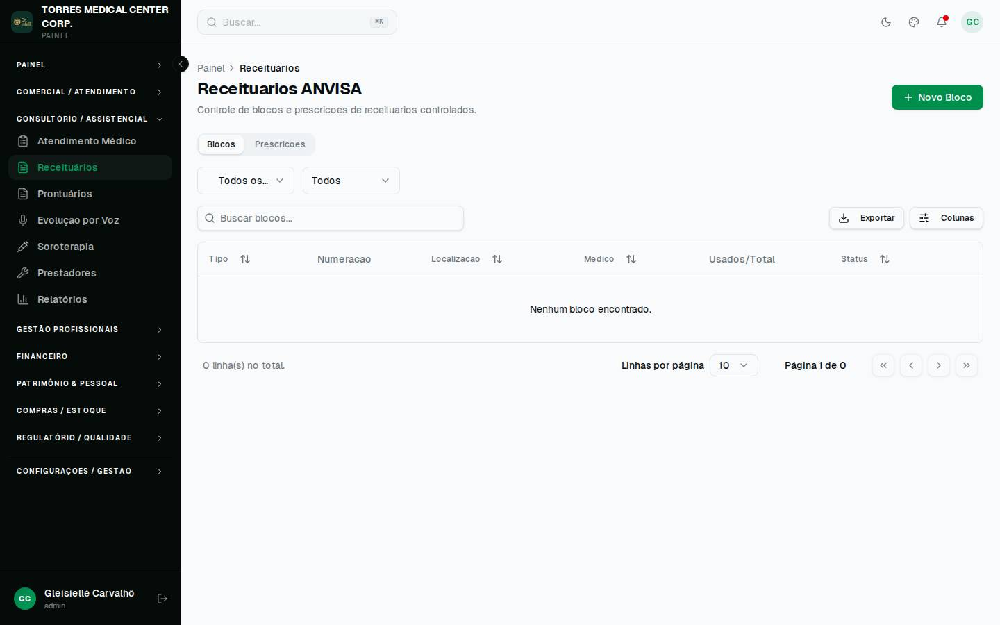
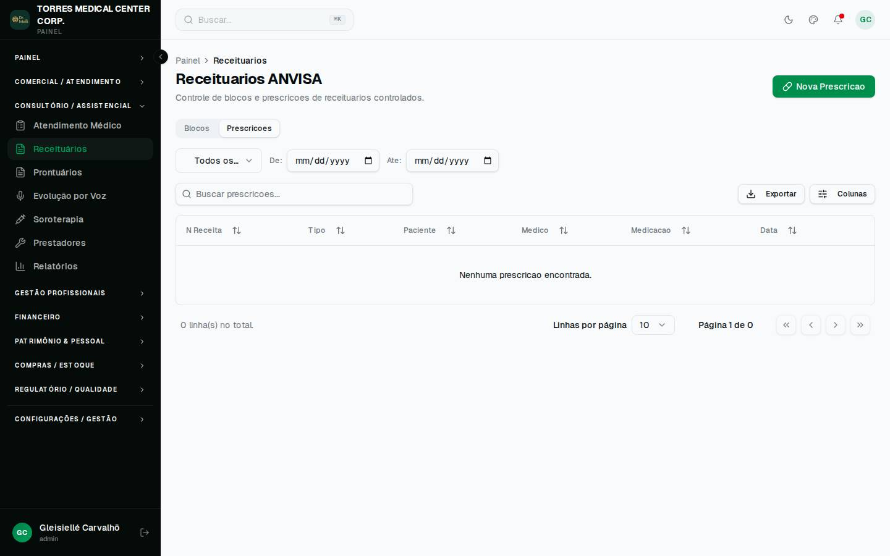
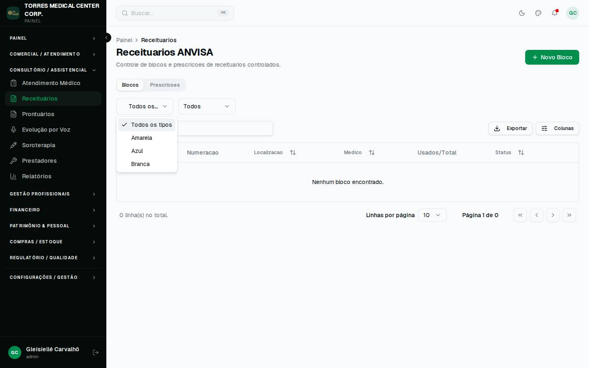
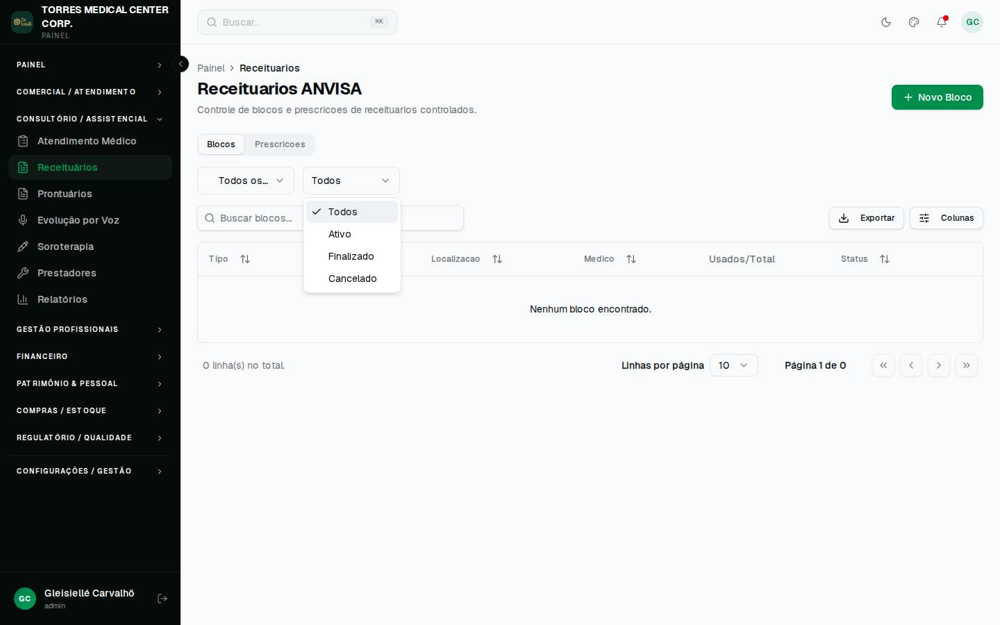
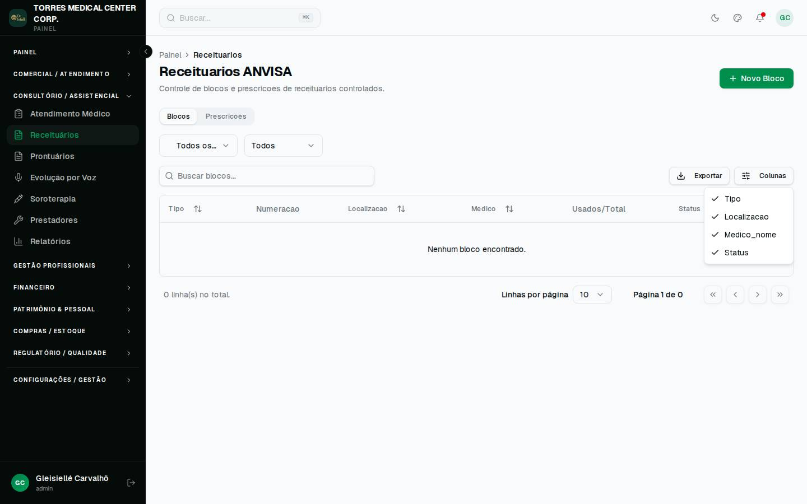
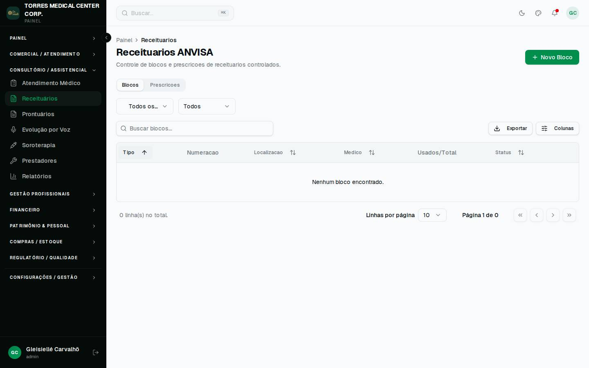

# Receituários

- **Módulo:** CONSULTÓRIO / ASSISTENCIAL
- **Tela:** Receituários
- **URL:** `/receituarios`
- **Título na página:** Receituarios ANVISA

## Objetivo (inferido)

Tela "Receituários" do módulo CONSULTÓRIO / ASSISTENCIAL. Apresenta listagem em tabela com colunas Tipo, Numeracao, Localizacao, Medico, Usados/Total, Status. Possui 4 campo(s) de entrada/filtro. Texto de apoio: "Painel Receituarios Receituarios ANVISA Controle de blocos e prescricoes de receituarios controlados. Novo Bloco Blocos Prescricoes Todos os tipos Todos Exportar Colunas Tipo Numeracao Localizacao Med…"

## Screenshot

## Campos

| Nome | Rótulo | Tipo | Obrigatório | Valores/opções |
|---|---|---|---|---|
| — | — | combobox | não indicado | — |
| — | — | combobox | não indicado | — |
| — | Buscar blocos... | text | não indicado | — |
| — | — | combobox | não indicado | — |

## Botões e ações

- Buscar... ⌘K
- Toggle theme
- Customize theme
- Notifications
- GC
- Novo Bloco
- Blocos
- Prescricoes
- Todos os tipos
- Todos
- Exportar
- Colunas
- Tipo
- Localizacao
- Medico
- Status
- 10
- Ir para primeira página _(desabilitado)_
- Ir para página anterior _(desabilitado)_
- Ir para próxima página _(desabilitado)_
- Ir para última página _(desabilitado)_

## Tabelas / grids

**Tabela 1** — 1 linha(s) visível(is)

- Colunas: Tipo · Numeracao · Localizacao · Medico · Usados/Total · Status
- Colunas possivelmente ordenáveis: Tipo, Localizacao, Medico, Status

- Filtros/busca: Buscar blocos...
- Paginação: Página 1 de 0

## Abas

_Nenhuma aba._

## Modais

_Nenhum modal aberto na carga da tela. Modais disparados por botões não foram abertos (regra somente-leitura)._

## Links para outras telas

- Painel → `/`

## Mensagens e validações visíveis

_Nenhuma mensagem visível._

<!-- estados -->
## Estados capturados (interações de visualização)

_Capturados em 15/10/2026 clicando só em itens de visualização do checklist da issue. Nenhum formulário foi preenchido e toda gravação foi bloqueada._

### Novo Bloco

- Abre modal **Novo Bloco de Receituario**

| Campo | Tipo | Obrigatório | Opções |
|---|---|---|---|
| Tipo * | combobox | sim | — |
| Numero Inicio * | number | sim | — |
| Numero Fim * | number | sim | — |
| Localizacao | text | não indicado | — |
| ID do Medico | number | não indicado | — |
| Data Recebimento | date | não indicado | — |

- Botões do modal: Branca (C) · Cancelar · Cadastrar · Close

### Blocos

### Prescricoes

### Dropdown aberto: Todos os tipos

- Itens do menu/lista: Todos os tipos · Amarela · Azul · Branca

### Dropdown aberto: Todos

- Itens do menu/lista: Todos · Ativo · Finalizado · Cancelado

### Colunas

- Itens do menu/lista: Tipo · Localizacao · Medico_nome · Status

### Ordenação por coluna — 1 print de exemplo (colunas: Tipo, Localizacao, Medico, Status)

### Paginação — 1 print da página 2

- lista com uma página só (botão de próxima página desabilitado), sem print

<!-- /estados -->
