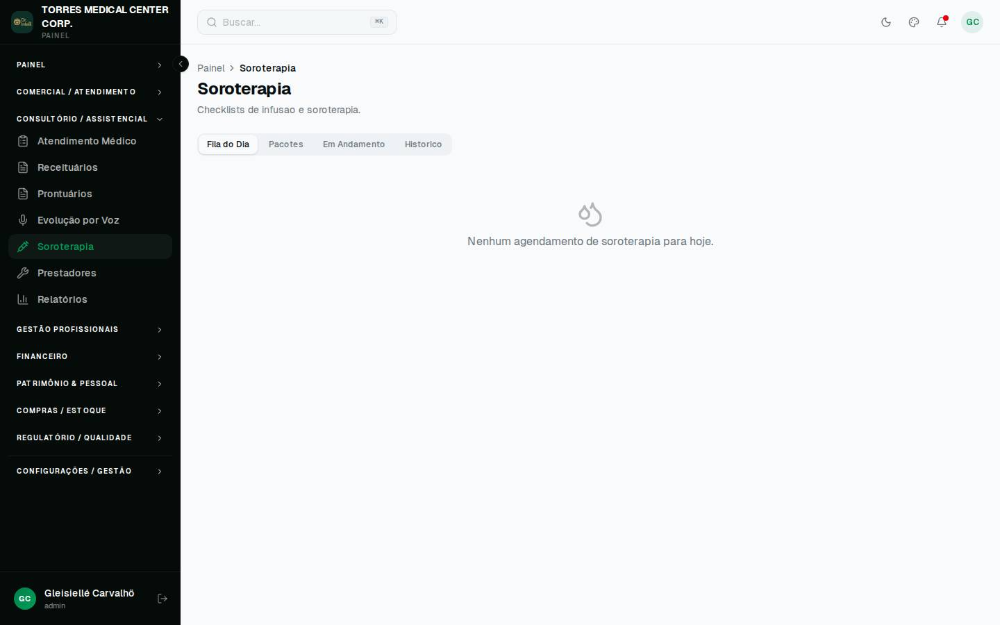
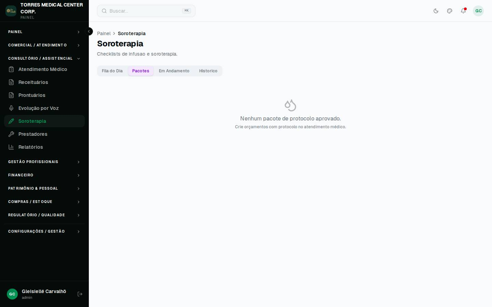
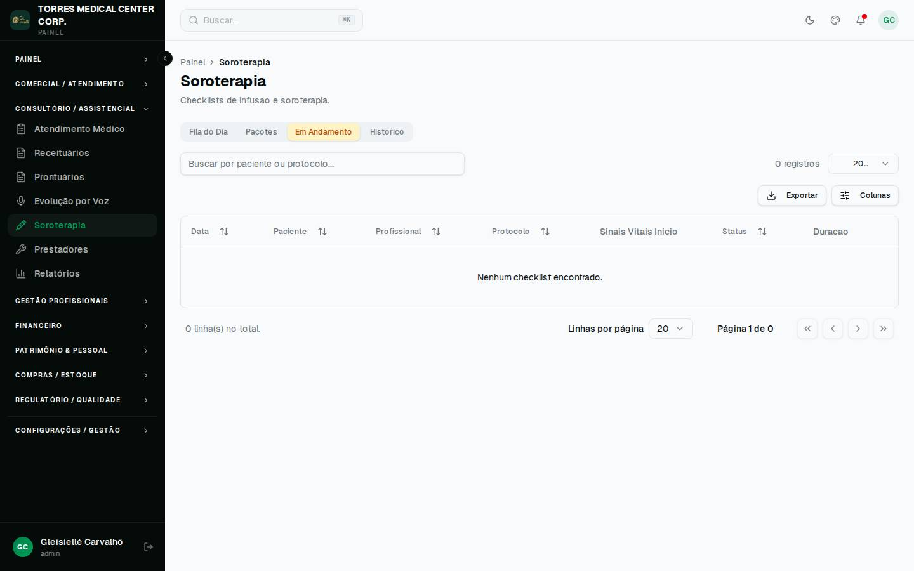
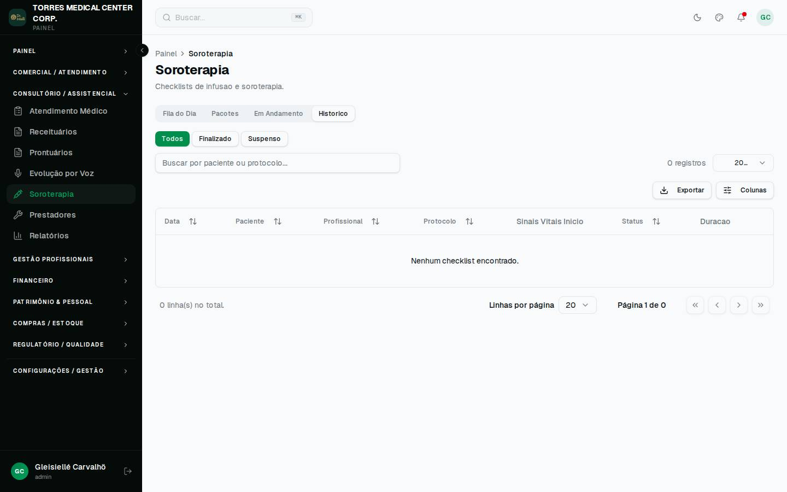

# Soroterapia

- **Módulo:** CONSULTÓRIO / ASSISTENCIAL
- **Tela:** Soroterapia
- **URL:** `/soroterapia`
- **Título na página:** Soroterapia

## Objetivo (inferido)

Tela "Soroterapia" do módulo CONSULTÓRIO / ASSISTENCIAL. Texto de apoio: "Painel Soroterapia Soroterapia Checklists de infusao e soroterapia. Fila do Dia Pacotes Em Andamento Historico Nenhum agendamento de soroterapia para hoje.…"

## Screenshot

## Campos

_Nenhum campo de formulário/filtro visível._

## Botões e ações

- Buscar... ⌘K
- Toggle theme
- Customize theme
- Notifications
- GC
- Fila do Dia
- Pacotes
- Em Andamento
- Historico

## Tabelas / grids

_Nenhuma tabela encontrada._

- Filtros/busca: não identificado
- Paginação: não identificada

## Abas

_Nenhuma aba._

## Modais

_Nenhum modal aberto na carga da tela. Modais disparados por botões não foram abertos (regra somente-leitura)._

## Links para outras telas

- Painel → `/`

## Mensagens e validações visíveis

_Nenhuma mensagem visível._

<!-- estados -->
## Estados capturados (interações de visualização)

_Capturados em 15/10/2026 clicando só em itens de visualização do checklist da issue. Nenhum formulário foi preenchido e toda gravação foi bloqueada._

### Fila do Dia

### Pacotes

### Em Andamento

### Historico

<!-- /estados -->
