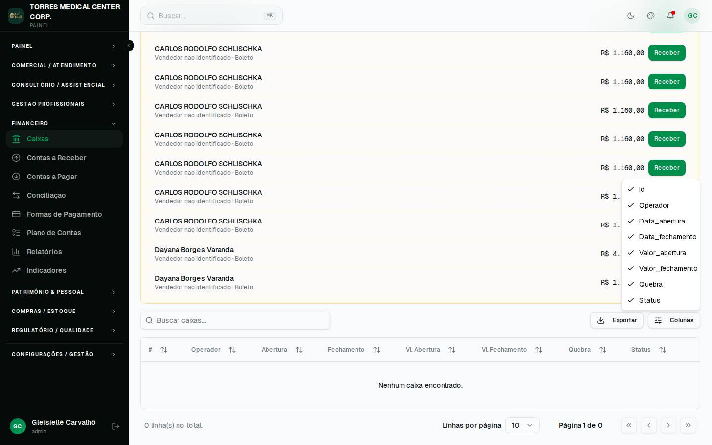

# Caixas

- **Módulo:** FINANCEIRO
- **Tela:** Caixas
- **URL:** `/caixas`
- **Título na página:** Caixas

## Objetivo (inferido)

Tela "Caixas" do módulo FINANCEIRO. Apresenta listagem em tabela com colunas #, Operador, Abertura, Fechamento, Vl. Abertura, Vl. Fechamento. Possui 2 campo(s) de entrada/filtro. Seções: Aguardando pagamento. Texto de apoio: "Painel Caixas Caixas Gerencie a abertura, fechamento e sangrias de caixa. Abrir Caixa Todos Aberto Fechado Aguardando pagamento Vendas e consultas ja fechadas que ainda nao foram recebidas em nenhum c…"

## Screenshot

## Campos

| Nome | Rótulo | Tipo | Obrigatório | Valores/opções |
|---|---|---|---|---|
| — | Buscar caixas... | text | não indicado | — |
| — | — | combobox | não indicado | — |

## Botões e ações

- Buscar... ⌘K
- Toggle theme
- Customize theme
- Notifications
- GC
- Abrir Caixa
- Todos
- Aberto
- Fechado
- Receber
- Exportar
- Colunas
- #
- Operador
- Abertura
- Fechamento
- Vl. Abertura
- Vl. Fechamento
- Quebra
- Status
- 10
- Ir para primeira página _(desabilitado)_
- Ir para página anterior _(desabilitado)_
- Ir para próxima página _(desabilitado)_
- Ir para última página _(desabilitado)_

## Tabelas / grids

**Tabela 1** — 1 linha(s) visível(is)

- Colunas: # · Operador · Abertura · Fechamento · Vl. Abertura · Vl. Fechamento · Quebra · Status
- Colunas possivelmente ordenáveis: #, Operador, Abertura, Fechamento, Vl. Abertura, Vl. Fechamento, Quebra, Status

- Filtros/busca: Buscar caixas...
- Paginação: Página 1 de 0

## Abas

_Nenhuma aba._

## Modais

_Nenhum modal aberto na carga da tela. Modais disparados por botões não foram abertos (regra somente-leitura)._

## Links para outras telas

- Painel → `/`

## Mensagens e validações visíveis

_Nenhuma mensagem visível._

## Seções (cabeçalhos)

- Aguardando pagamento

<!-- estados -->
## Estados capturados (interações de visualização)

_Capturados em 15/10/2026 clicando só em itens de visualização do checklist da issue. Nenhum formulário foi preenchido e toda gravação foi bloqueada._

### Todos

### Aberto

### Fechado

### Colunas

- Itens do menu/lista: Id · Operador · Data_abertura · Data_fechamento · Valor_abertura · Valor_fechamento · Quebra · Status

### Ordenação por coluna — 1 print de exemplo (colunas: #, Operador, Abertura, Fechamento, Vl. Abertura, Vl. Fechamento, Quebra, Status)

### Paginação — 1 print da página 2

- lista com uma página só (botão de próxima página desabilitado), sem print

<!-- /estados -->
