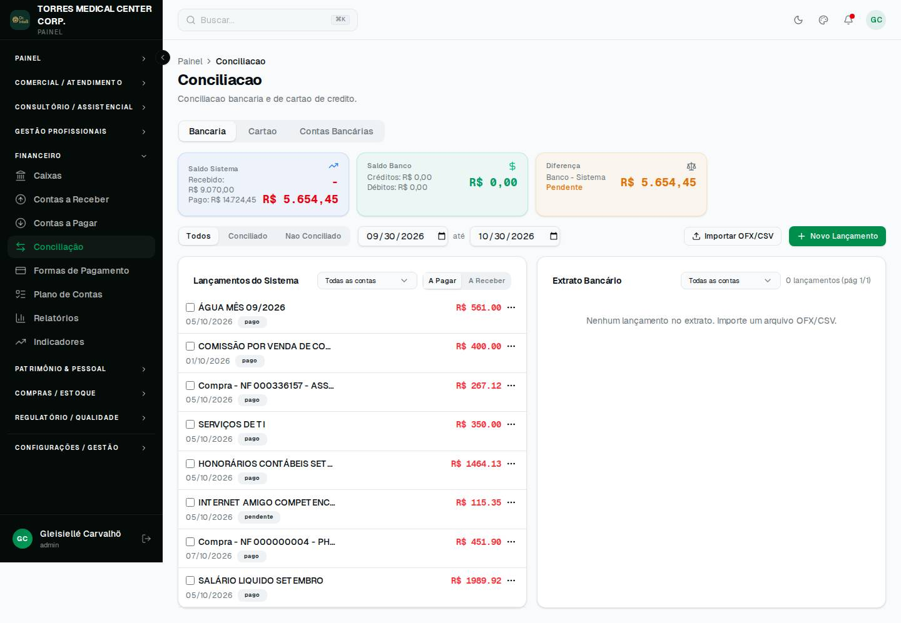
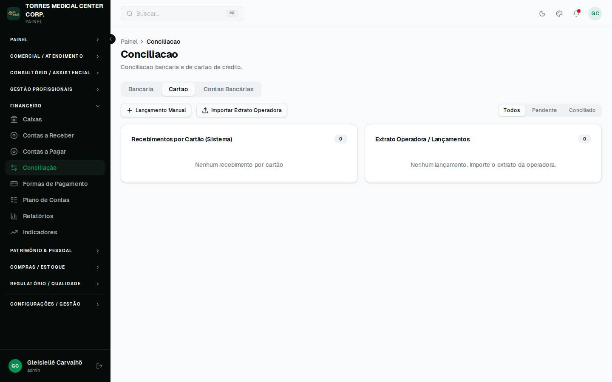
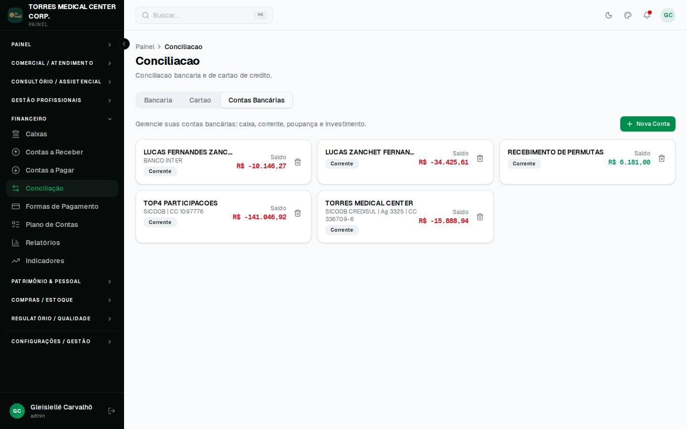
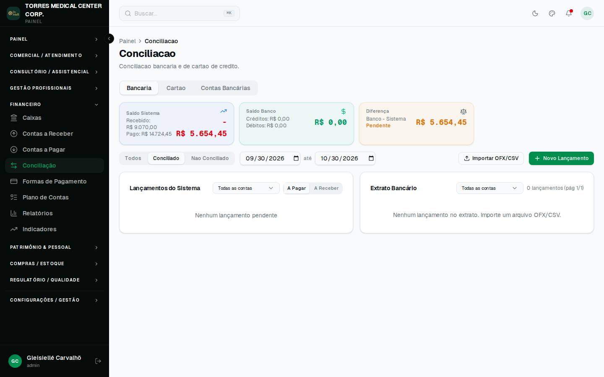
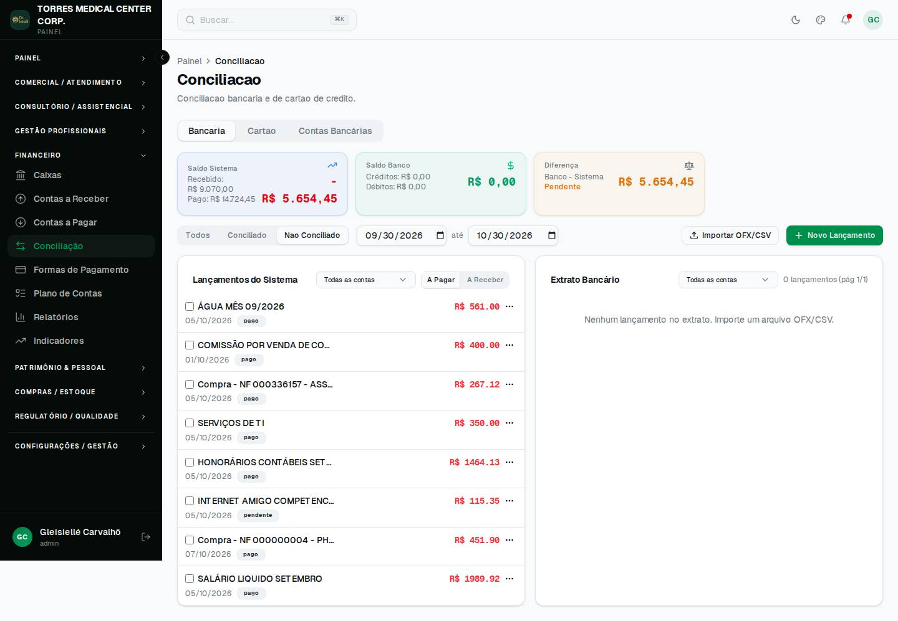
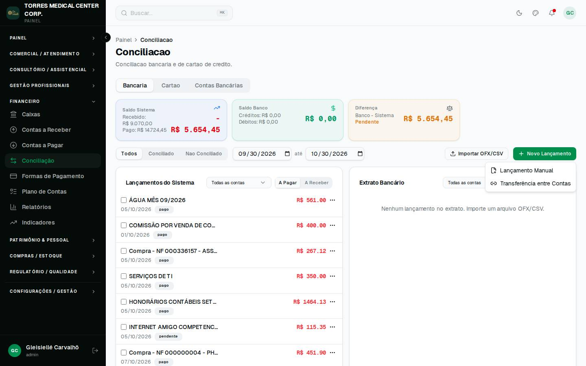
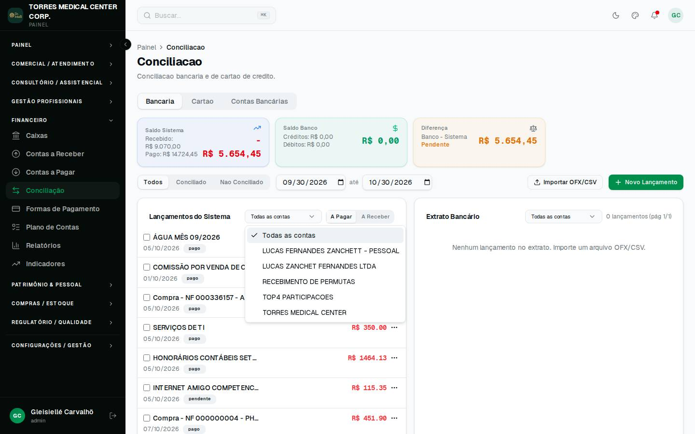
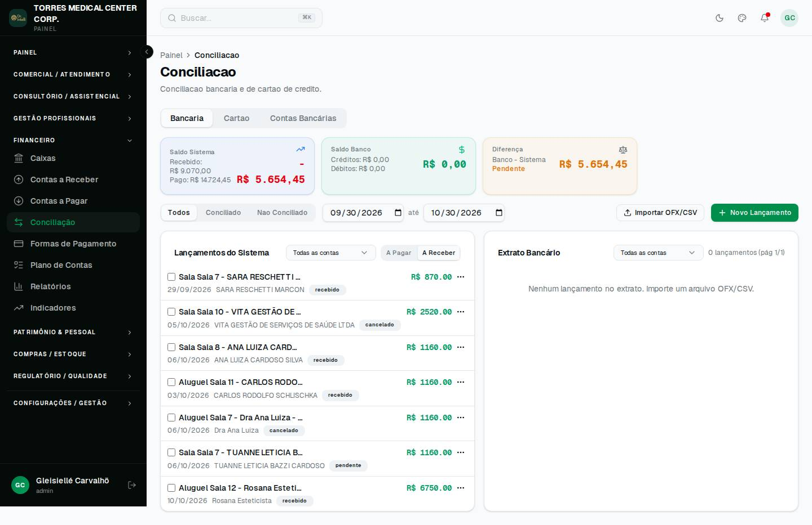
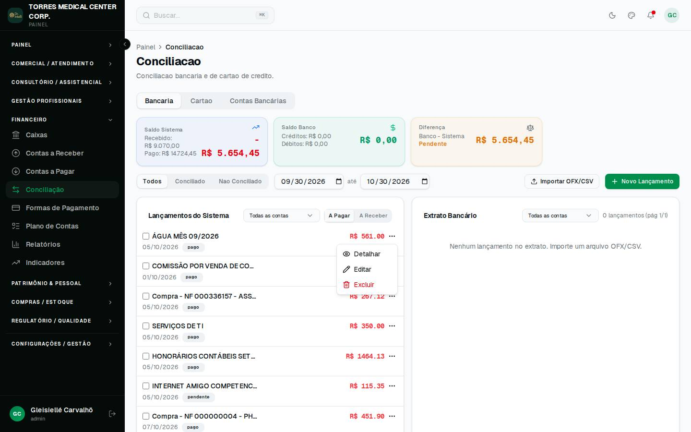

# Conciliação

- **Módulo:** FINANCEIRO
- **Tela:** Conciliação
- **URL:** `/conciliacao`
- **Título na página:** Conciliacao

## Objetivo (inferido)

Tela "Conciliação" do módulo FINANCEIRO. Possui 24 campo(s) de entrada/filtro. Texto de apoio: "Painel Conciliacao Conciliacao Conciliacao bancaria e de cartao de credito. Bancaria Cartao Contas Bancárias Saldo Sistema Recebido: R$ 9.070,00 Pago: R$ 14.679,45 -R$ 5.609,45 Saldo Banco Créditos: R…"

## Screenshot

## Campos

| Nome | Rótulo | Tipo | Obrigatório | Valores/opções |
|---|---|---|---|---|
| — | — | date | não indicado | — |
| — | — | date | não indicado | — |
| — | Importar OFX/CSV | file | não indicado | — |
| — | — | combobox | não indicado | — |
| — | — | checkbox | não indicado | — |
| — | — | checkbox | não indicado | — |
| — | — | checkbox | não indicado | — |
| — | — | checkbox | não indicado | — |
| — | — | checkbox | não indicado | — |
| — | — | checkbox | não indicado | — |
| — | — | checkbox | não indicado | — |
| — | — | checkbox | não indicado | — |
| — | — | checkbox | não indicado | — |
| — | — | checkbox | não indicado | — |
| — | — | checkbox | não indicado | — |
| — | — | checkbox | não indicado | — |
| — | — | checkbox | não indicado | — |
| — | — | checkbox | não indicado | — |
| — | — | checkbox | não indicado | — |
| — | — | checkbox | não indicado | — |
| — | — | checkbox | não indicado | — |
| — | — | checkbox | não indicado | — |
| — | — | checkbox | não indicado | — |
| — | — | combobox | não indicado | — |

## Botões e ações

- Buscar... ⌘K
- Toggle theme
- Customize theme
- Notifications
- GC
- Bancaria
- Cartao
- Contas Bancárias
- Todos
- Conciliado
- Nao Conciliado
- Novo Lançamento
- Todas as contas
- A Pagar
- A Receber
- (ícone sem rótulo)

## Tabelas / grids

_Nenhuma tabela encontrada._

- Filtros/busca: não identificado
- Paginação: não identificada

## Abas

_Nenhuma aba._

## Modais

_Nenhum modal aberto na carga da tela. Modais disparados por botões não foram abertos (regra somente-leitura)._

## Links para outras telas

- Painel → `/`

## Mensagens e validações visíveis

_Nenhuma mensagem visível._

<!-- estados -->
## Estados capturados (interações de visualização)

_Capturados em 15/10/2026 clicando só em itens de visualização do checklist da issue. Nenhum formulário foi preenchido e toda gravação foi bloqueada._

### Bancaria

### Cartao

### Contas Bancárias

### Todos

### Conciliado

### Nao Conciliado

### Novo Lançamento

- Itens do menu/lista: Lançamento Manual · Transferência entre Contas

### Dropdown aberto: Todas as contas

- Itens do menu/lista: Todas as contas · LUCAS FERNANDES ZANCHETT - PESSOAL · LUCAS ZANCHET FERNANDES LTDA · RECEBIMENTO DE PERMUTAS · TOP4 PARTICIPACOES · TORRES MEDICAL CENTER

### A Pagar

### A Receber

### Menu de ações (⋯)

- Itens do menu/lista: Detalhar · Editar · Excluir

<!-- /estados -->
