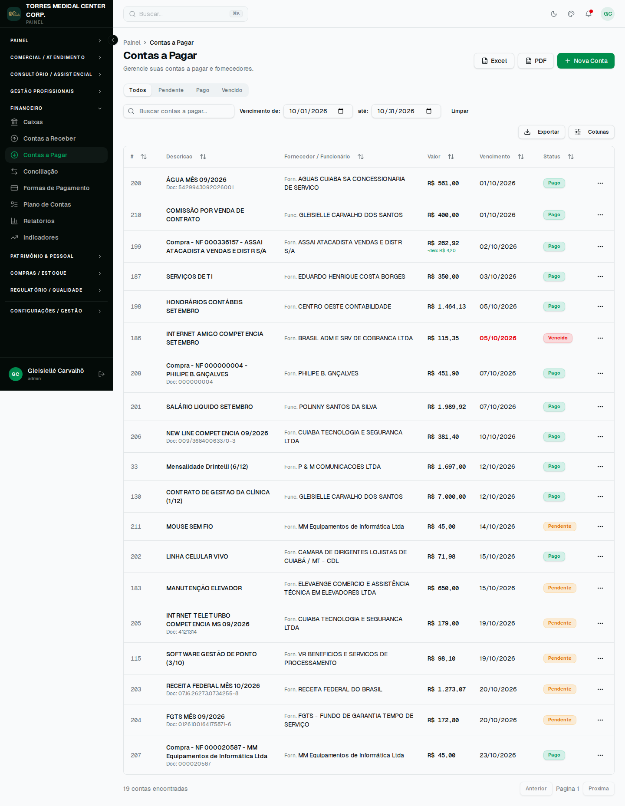
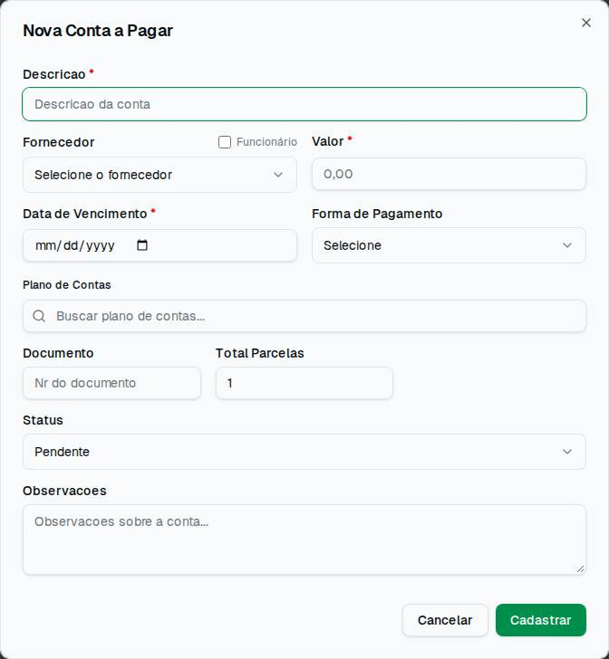
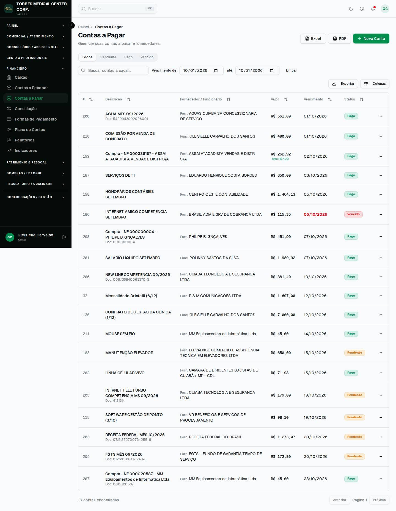
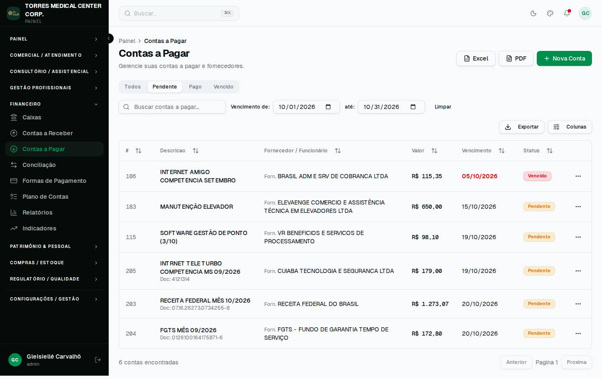
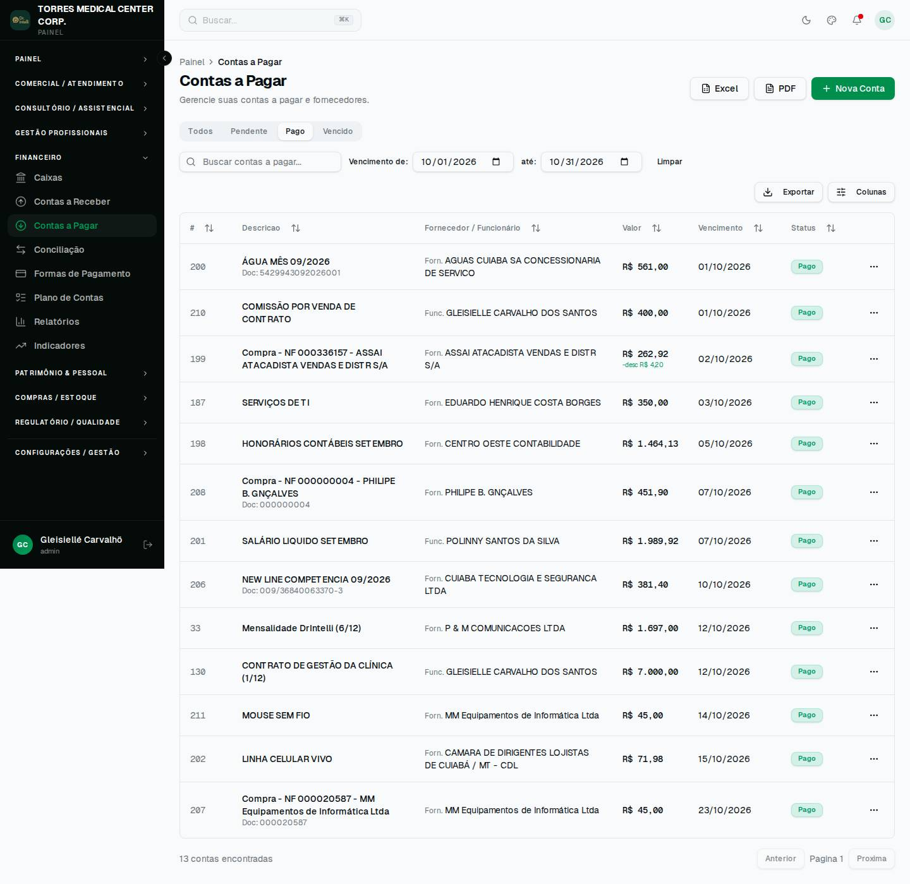
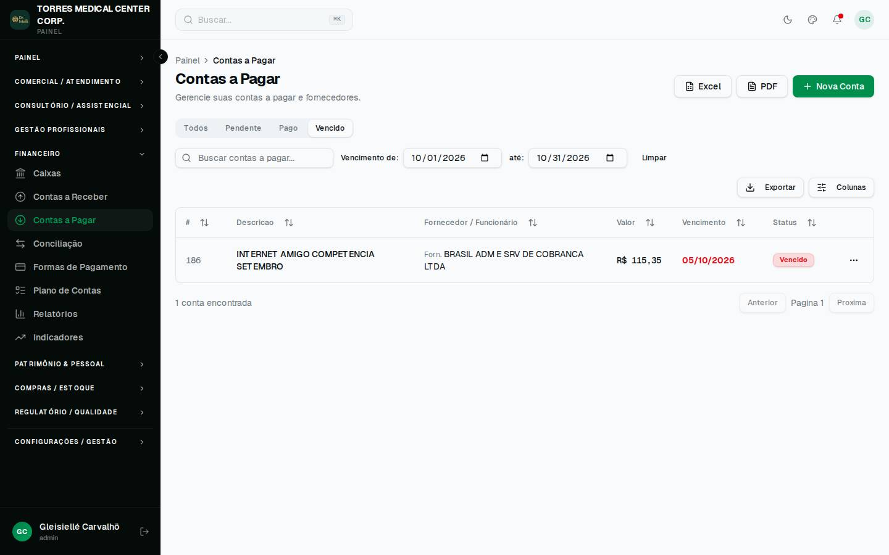
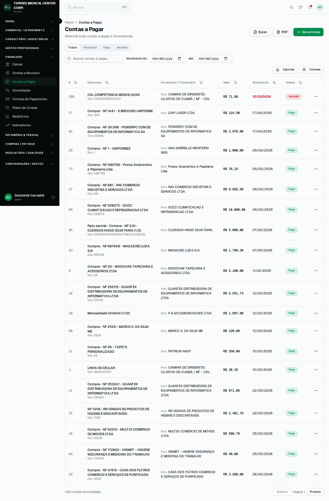
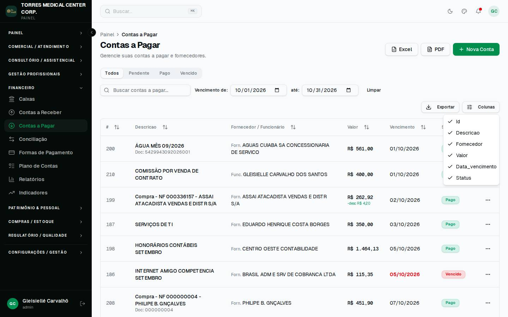
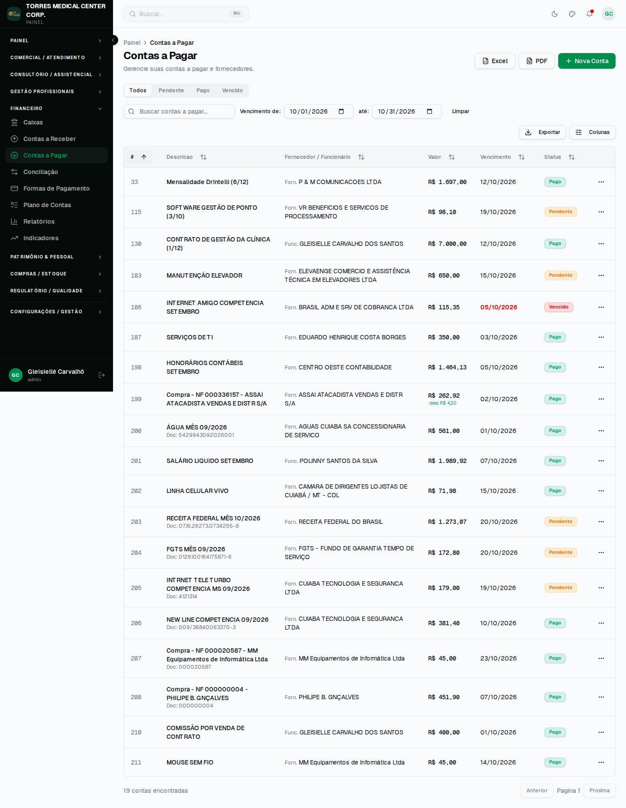
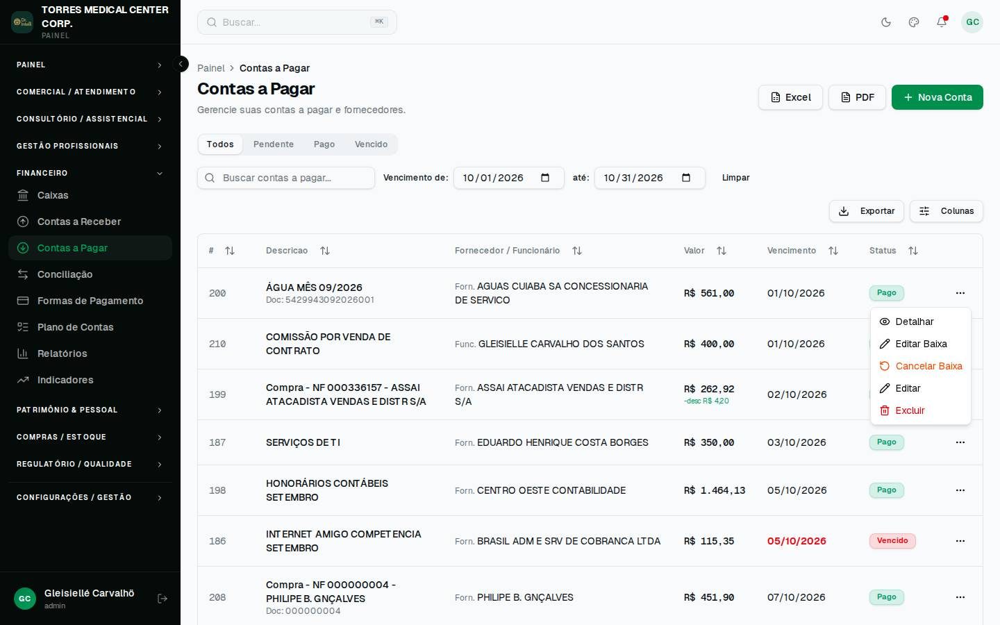

# Contas a Pagar

- **Módulo:** FINANCEIRO
- **Tela:** Contas a Pagar
- **URL:** `/pagar`
- **Título na página:** Contas a Pagar

## Objetivo (inferido)

Tela "Contas a Pagar" do módulo FINANCEIRO. Apresenta listagem em tabela com colunas #, Descricao, Fornecedor / Funcionário, Valor, Vencimento, Status. Possui 3 campo(s) de entrada/filtro. Texto de apoio: "Painel Contas a Pagar Contas a Pagar Gerencie suas contas a pagar e fornecedores. Excel PDF Nova Conta Todos Pendente Pago Vencido Vencimento de: até: Limpar Exportar Colunas # Descricao Fornecedor / …"

## Screenshot

## Campos

| Nome | Rótulo | Tipo | Obrigatório | Valores/opções |
|---|---|---|---|---|
| — | Buscar contas a pagar... | text | não indicado | — |
| — | Vencimento de: | date | não indicado | — |
| — | até: | date | não indicado | — |

## Botões e ações

- Buscar... ⌘K
- Toggle theme
- Customize theme
- Notifications
- GC
- Excel
- PDF
- Nova Conta
- Todos
- Pendente
- Pago
- Vencido
- Limpar
- Exportar
- Colunas
- #
- Descricao
- Fornecedor / Funcionário
- Valor
- Vencimento
- Status
- Acoes
- Anterior _(desabilitado)_
- Proxima _(desabilitado)_

## Tabelas / grids

**Tabela 1** — 19 linha(s) visível(is)

- Colunas: # · Descricao · Fornecedor / Funcionário · Valor · Vencimento · Status
- Colunas possivelmente ordenáveis: #, Descricao, Fornecedor / Funcionário, Valor, Vencimento, Status

- Filtros/busca: Buscar contas a pagar..., Vencimento de:, até:
- Paginação: não identificada

## Abas

_Nenhuma aba._

## Modais

_Nenhum modal aberto na carga da tela. Modais disparados por botões não foram abertos (regra somente-leitura)._

## Links para outras telas

- Painel → `/`

## Mensagens e validações visíveis

_Nenhuma mensagem visível._

<!-- estados -->
## Estados capturados (interações de visualização)

_Capturados em 15/10/2026 clicando só em itens de visualização do checklist da issue. Nenhum formulário foi preenchido e toda gravação foi bloqueada._

### Nova Conta

- Abre modal **Nova Conta a Pagar**

| Campo | Tipo | Obrigatório | Opções |
|---|---|---|---|
| Descricao * | text | sim | — |
| Fornecedor | checkbox | não indicado | — |
| Fornecedor | combobox | não indicado | — |
| Valor * | number | sim | — |
| Data de Vencimento * | date | sim | — |
| Forma de Pagamento | combobox | não indicado | — |
| Buscar plano de contas... | text | não indicado | — |
| Documento | text | não indicado | — |
| Total Parcelas | number | não indicado | — |
| Status | combobox | não indicado | — |
| Observacoes | textarea | não indicado | — |

- Botões do modal: Selecione o fornecedor · Selecione · Pendente · Cancelar · Cadastrar · Close

### Todos

### Pendente

### Pago

### Vencido

### Limpar

### Colunas

- Itens do menu/lista: Id · Descricao · Fornecedor · Valor · Data_vencimento · Status

### Ordenação por coluna — 1 print de exemplo (colunas: #, Descricao, Fornecedor / Funcionário, Valor, Vencimento, Status)

### Menu de ações (⋯) (na linha da tabela)

- Itens do menu/lista: Detalhar · Editar Baixa · Cancelar Baixa · Editar · Excluir

### Paginação — 1 print da página 2

- lista com uma página só (botão de próxima página desabilitado), sem print

<!-- /estados -->
