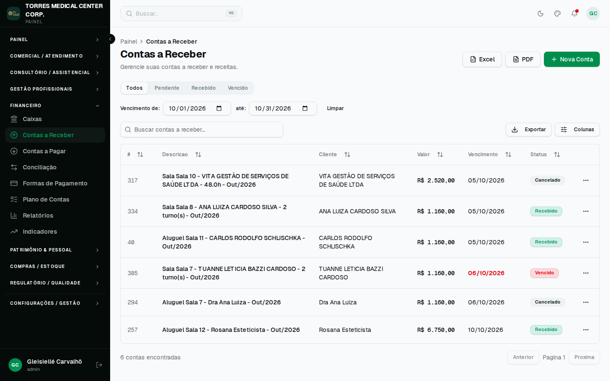

# Contas a Receber

- **Módulo:** FINANCEIRO
- **Tela:** Contas a Receber
- **URL:** `/receber`
- **Título na página:** Contas a Receber

## Objetivo (inferido)

Tela "Contas a Receber" do módulo FINANCEIRO. Apresenta listagem em tabela com colunas #, Descricao, Cliente, Valor, Vencimento, Status. Possui 3 campo(s) de entrada/filtro. Texto de apoio: "Painel Contas a Receber Contas a Receber Gerencie suas contas a receber e receitas. Excel PDF Nova Conta Todos Pendente Recebido Vencido Vencimento de: até: Limpar Exportar Colunas # Descricao Cliente…"

## Screenshot

## Campos

| Nome | Rótulo | Tipo | Obrigatório | Valores/opções |
|---|---|---|---|---|
| — | Vencimento de: | date | não indicado | — |
| — | até: | date | não indicado | — |
| — | Buscar contas a receber... | text | não indicado | — |

## Botões e ações

- Buscar... ⌘K
- Toggle theme
- Customize theme
- Notifications
- GC
- Excel
- PDF
- Nova Conta
- Todos
- Pendente
- Recebido
- Vencido
- Limpar
- Exportar
- Colunas
- #
- Descricao
- Cliente
- Valor
- Vencimento
- Status
- Acoes
- Anterior _(desabilitado)_
- Proxima _(desabilitado)_

## Tabelas / grids

**Tabela 1** — 6 linha(s) visível(is)

- Colunas: # · Descricao · Cliente · Valor · Vencimento · Status
- Colunas possivelmente ordenáveis: #, Descricao, Cliente, Valor, Vencimento, Status

- Filtros/busca: Vencimento de:, até:, Buscar contas a receber...
- Paginação: não identificada

## Abas

_Nenhuma aba._

## Modais

_Nenhum modal aberto na carga da tela. Modais disparados por botões não foram abertos (regra somente-leitura)._

## Links para outras telas

- Painel → `/`

## Mensagens e validações visíveis

_Nenhuma mensagem visível._
