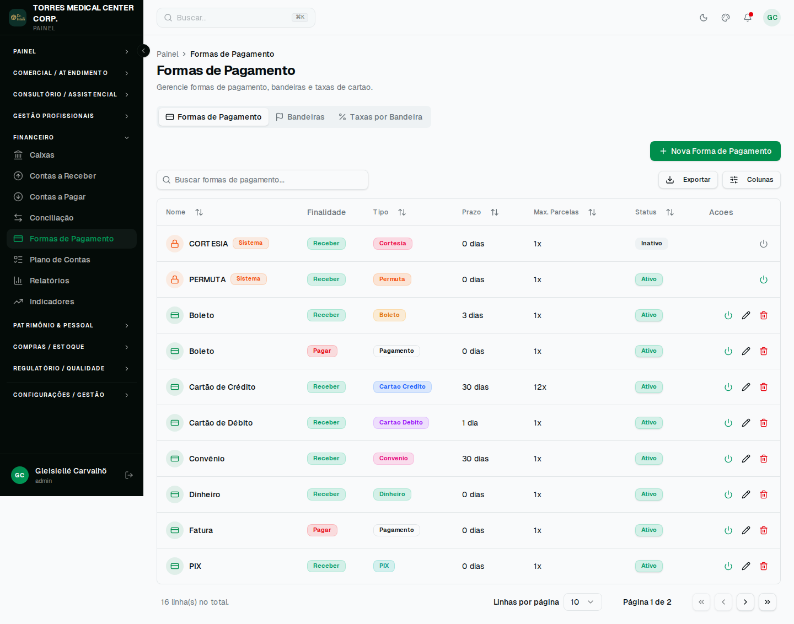
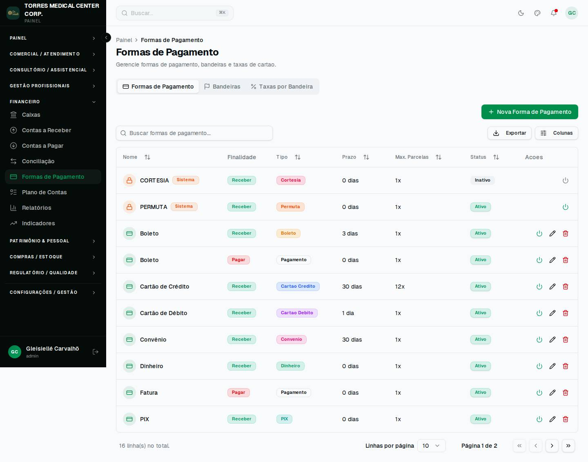
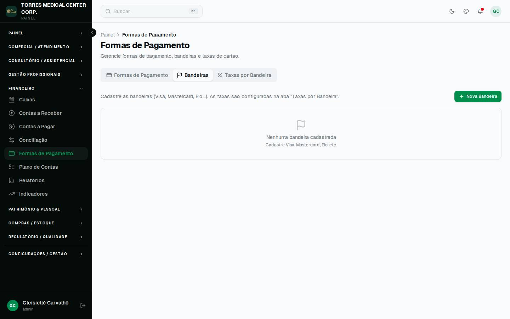
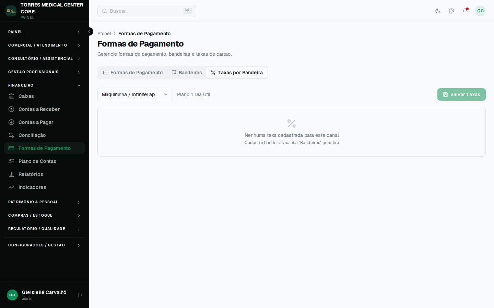
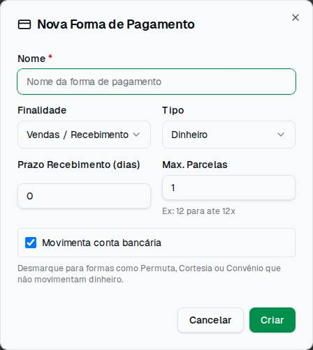
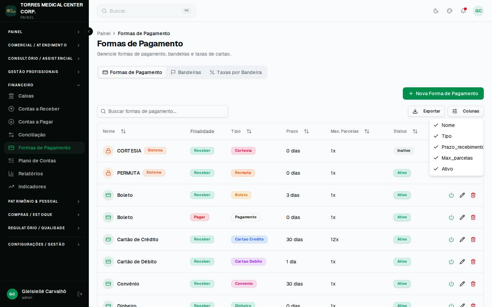
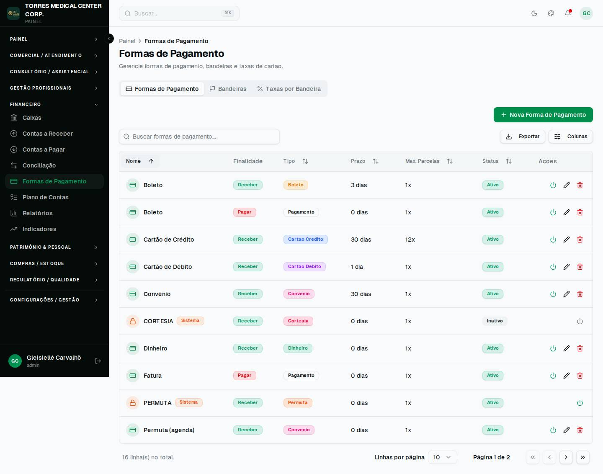
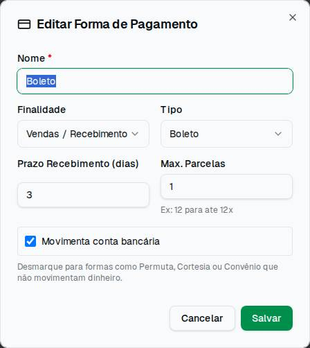
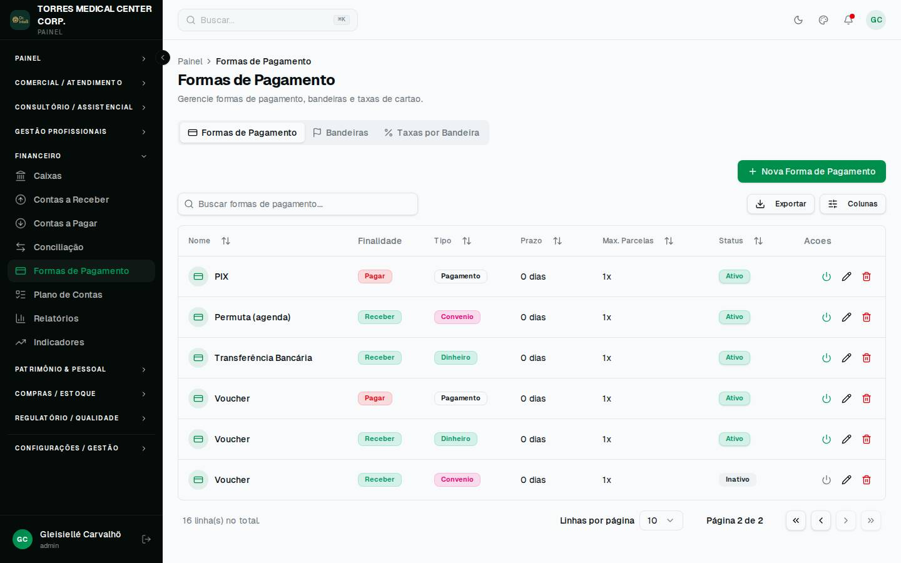

# Formas de Pagamento

- **Módulo:** FINANCEIRO
- **Tela:** Formas de Pagamento
- **URL:** `/formas-pgto`
- **Título na página:** Formas de Pagamento

## Objetivo (inferido)

Tela "Formas de Pagamento" do módulo FINANCEIRO. Apresenta listagem em tabela com colunas Nome, Finalidade, Tipo, Prazo, Max. Parcelas, Status. Possui 2 campo(s) de entrada/filtro. Organizada em abas (Formas de Pagamento, Bandeiras, Taxas por Bandeira). Texto de apoio: "Painel Formas de Pagamento Formas de Pagamento Gerencie formas de pagamento, bandeiras e taxas de cartao. Formas de Pagamento Bandeiras Taxas por Bandeira Nova Forma de Pagamento Exportar Colunas Nome…"

## Screenshot

## Campos

| Nome | Rótulo | Tipo | Obrigatório | Valores/opções |
|---|---|---|---|---|
| — | Buscar formas de pagamento... | text | não indicado | — |
| — | — | combobox | não indicado | — |

## Botões e ações

- Buscar... ⌘K
- Toggle theme
- Customize theme
- Notifications
- GC
- Formas de Pagamento
- Bandeiras
- Taxas por Bandeira
- Nova Forma de Pagamento
- Exportar
- Colunas
- Nome
- Tipo
- Prazo
- Max. Parcelas
- Status
- Ativar
- Desativar
- Editar
- Excluir
- 10
- Ir para primeira página _(desabilitado)_
- Ir para página anterior _(desabilitado)_
- Ir para próxima página
- Ir para última página

## Tabelas / grids

**Tabela 1** — 10 linha(s) visível(is)

- Colunas: Nome · Finalidade · Tipo · Prazo · Max. Parcelas · Status · Acoes
- Colunas possivelmente ordenáveis: Nome, Tipo, Prazo, Max. Parcelas, Status

- Filtros/busca: Buscar formas de pagamento...
- Paginação: Página 1 de 2

## Abas

- Formas de Pagamento _(ativa)_
- Bandeiras
- Taxas por Bandeira

## Modais

_Nenhum modal aberto na carga da tela. Modais disparados por botões não foram abertos (regra somente-leitura)._

## Links para outras telas

- Painel → `/`

## Mensagens e validações visíveis

_Nenhuma mensagem visível._

<!-- estados -->
## Estados capturados (interações de visualização)

_Capturados em 15/10/2026 clicando só em itens de visualização do checklist da issue. Nenhum formulário foi preenchido e toda gravação foi bloqueada._

### Aba: Formas de Pagamento

### Aba: Bandeiras

### Aba: Taxas por Bandeira

### Nova Forma de Pagamento

- Abre modal **Nova Forma de Pagamento**

| Campo | Tipo | Obrigatório | Opções |
|---|---|---|---|
| Nome * | text | sim | — |
| Finalidade | combobox | não indicado | — |
| Tipo | combobox | não indicado | — |
| Prazo Recebimento (dias) | number | não indicado | — |
| Max. Parcelas | number | não indicado | — |
| Movimenta conta bancária | checkbox | não indicado | — |

- Botões do modal: Vendas / Recebimento · Dinheiro · Cancelar · Criar · Close

### Colunas

- Itens do menu/lista: Nome · Tipo · Prazo_recebimento · Max_parcelas · Ativo

### Ordenação por coluna — 1 print de exemplo (colunas: Nome, Tipo, Prazo, Max. Parcelas, Status)

### Editar (na linha da tabela)

- Abre modal **Editar Forma de Pagamento**

| Campo | Tipo | Obrigatório | Opções |
|---|---|---|---|
| Nome * | text | sim | — |
| Finalidade | combobox | não indicado | — |
| Tipo | combobox | não indicado | — |
| Prazo Recebimento (dias) | number | não indicado | — |
| Max. Parcelas | number | não indicado | — |
| Movimenta conta bancária | checkbox | não indicado | — |

- Botões do modal: Vendas / Recebimento · Boleto · Cancelar · Salvar · Close

### Paginação — 1 print da página 2

<!-- /estados -->
