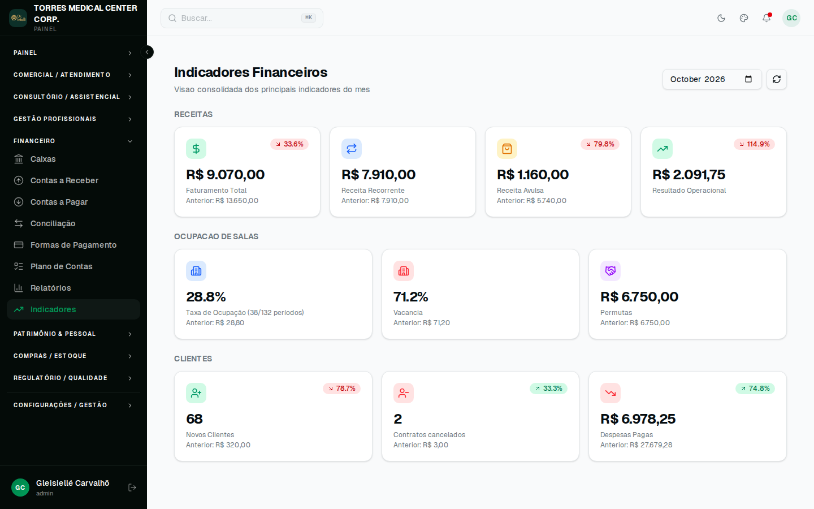

# Indicadores

- **Módulo:** FINANCEIRO
- **Tela:** Indicadores
- **URL:** `/financeiro/indicadores`
- **Título na página:** Indicadores Financeiros

## Objetivo (inferido)

Tela "Indicadores" do módulo FINANCEIRO. Possui 1 campo(s) de entrada/filtro. Seções: RECEITAS; OCUPACAO DE SALAS; CLIENTES. Texto de apoio: "Indicadores Financeiros Visao consolidada dos principais indicadores do mes RECEITAS 33.6% R$ 9.070,00 Faturamento Total Anterior: R$ 13.650,00 R$ 7.910,00 Receita Recorrente Anterior: R$ 7.910,00 79.…"

## Screenshot

## Campos

| Nome | Rótulo | Tipo | Obrigatório | Valores/opções |
|---|---|---|---|---|
| — | — | month | não indicado | — |

## Botões e ações

- Buscar... ⌘K
- Toggle theme
- Customize theme
- Notifications
- GC
- (ícone sem rótulo)

## Tabelas / grids

_Nenhuma tabela encontrada._

- Filtros/busca: não identificado
- Paginação: não identificada

## Abas

_Nenhuma aba._

## Modais

_Nenhum modal aberto na carga da tela. Modais disparados por botões não foram abertos (regra somente-leitura)._

## Links para outras telas

_Nenhum link na área principal._

## Mensagens e validações visíveis

_Nenhuma mensagem visível._

## Seções (cabeçalhos)

- RECEITAS
- OCUPACAO DE SALAS
- CLIENTES
